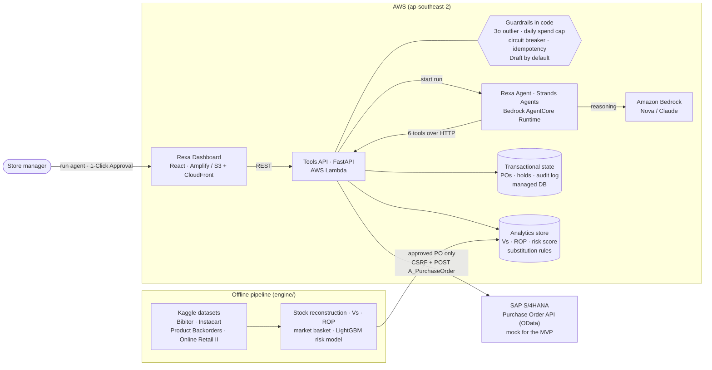
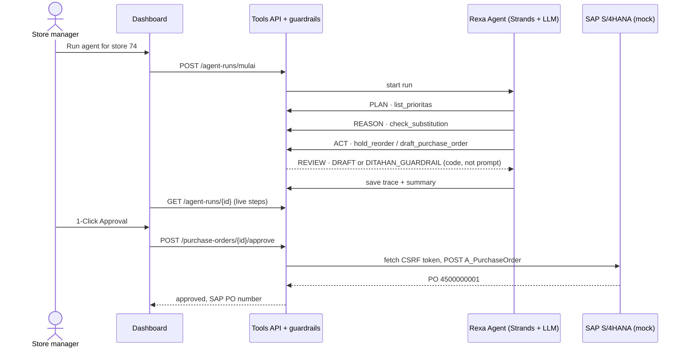

# Arsitektur Rexa

Diagram untuk Zoom mentoring dan slide final. Label memakai bahasa Inggris karena presentasi final berbahasa Inggris. Diagram ini tampil langsung di GitHub (Mermaid).

## Target final di AWS

## Loop agentic: plan → reason → act → review, dengan manusia di akhir

## Posisi sekarang vs target final

| Komponen | Sekarang (25 Okt 2026) | Target final |
|---|---|---|
| Dashboard | **AWS Amplify** (`main.d30b19xkk8lknt.amplifyapp.com`); Vercel dan lokal tetap ada | AWS Amplify |
| Tools API | AWS Lambda (container image, Function URL, Sydney) di VPC; deploy dari repo (`deploy\deploy_lambda.ps1`) | Lambda (+ API Gateway bila perlu) |
| Agent | Strands di laptop lewat worker yang mengambil tugas dari antrian API; LLM **Claude Sonnet 4.6 di Amazon Bedrock** (Ollama `qwen3:14b` sebagai cadangan lokal) | Bedrock AgentCore Runtime + Amazon Bedrock |
| State transaksi | SQLite di **Amazon EFS** (dipakai bersama semua instance, tidak hilang saat cold start) | Database terkelola (RDS/DynamoDB) |
| Data analitik | DuckDB ikut di-deploy bersama API | Tetap DuckDB (hanya dibaca), disimpan di S3 |
| SAP | Tiruan OData V2 `API_PURCHASEORDER_PROCESS_SRV` di dalam API | Tetap tiruan; opsional SAP riil (OData V4 `CE_PURCHASEORDER_0001`) |

## Prinsip desain yang ditekankan ke juri

- **Guardrail di kode, bukan di prompt.** Agent hanya bisa bertindak lewat 6 tools di API. Batas 3σ, batas nominal harian, circuit breaker, idempotency key, dan status Draft dicek di server, jadi prompt injection atau model yang keliru tidak bisa melewatinya.
- **Manusia tetap memutuskan.** Agent hanya menyusun draf (Level 2). PO baru masuk SAP setelah manajer menekan 1-Click Approval, dan kalau SAP gagal, PO tetap draf.
- **Tidak terikat satu penyedia model.** Ollama (lokal) dan Amazon Bedrock dipilih lewat satu variabel lingkungan; kode agent sama.
- **Angka dari data, bukan dari LLM.** Vs, reorder point, skor risiko, dan substitusi dihitung oleh pipeline; LLM hanya memilih tindakan dan menjelaskannya.
