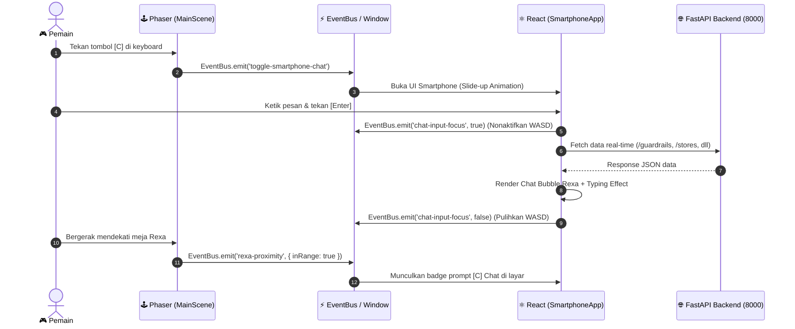

# 📱 Virtual HQ — Proposal Arsitektur & UI/UX Chatbot Smartphone ("Rexa Intercom")

**Dokumen Perencanaan Arsitektur & Antarmuka Interaktif**  
**Versi Dokumen:** 1.0 (Draft Proposal)  
**Target Lokasi:** `virtual_hq/`  
**Konteks Proyek:** ChibiRex Virtual HQ (Phaser 3 + React + FastAPI REST Backend)  
**Konsep Utama:** *Company Smartphone / Interkom Korporat* — Saluran komunikasi langsung (Direct Message) antara Player (Store Manager) dan **Rexa** (Autonomous AI Copilot).

---

## 1. Pemetaan Fitur & Kapabilitas Chatbot (What It Can Do)

Chatbot Smartphone bukan sekadar LLM teks biasa, melainkan **Antarmuka Operasional Berbasis Data (Actionable RAG & Function Calling)** yang terhubung langsung ke basis data toko dan REST API backend ChibiRex.

```
┌────────────────────────────────────────────────────────────────────────┐
│                        SMARTPHONE INTERCOM (REXAPEDIA)                 │
└───────────────────────────────────┬────────────────────────────────────┘
                                    │
           ┌────────────────────────┴────────────────────────┐
           ▼                                                 ▼
   [MODE 1: FAST ASSISTANT]                         [MODE 2: AUTONOMOUS AGENT]
   • Direct REST API Queries                        • Multi-Step Reasoning
   • Instant Retrieval (<500ms)                     • Bedrock / Ollama Cycle
   • Financial & Inventory Status                   • Tool-Calling & PO Drafts
   • Read-Only Secure Assistant                     • Thought Stream Polling
```

### A. Matriks Endpoint API & Kemampuan Chatbot

| Domain Informasi | Target REST API | Parameter Utama | Pertanyaan User (Contoh Prompt) | Kemampuan & Respons Cerdas Rexa |
| :--- | :--- | :--- | :--- | :--- |
| **Keamanan & Guardrail** | `GET /guardrails/status` | `store: 74` | *"Berapa sisa anggaran belanja kita hari ini?"* atau *"Apakah sistem aman?"* | Membaca limit PO harian (Rp 50 Juta), total PO yang sudah diterbitkan hari ini, dan status Circuit Breaker (Normal / Tripped). |
| **Kesehatan Toko (KPI)** | `GET /stores/{store}/ringkasan` | `store: 74` | *"Bagaimana kondisi kesehatan toko saat ini?"* | Mengutip 3 pilar *Inventory Health Score*: Ketersediaan (%), Perputaran (%), dan Stabilitas Kas (%), serta total valuasi aset stok. |
| **Audit Deadstock & Hold** | `GET /holds`<br>`GET /stores/{store}/reallocation` | `store: 74` | *"Berapa modal yang berhasil kita selamatkan dari deadstock?"* | Menghitung akumulasi modal yang dihemat dari SKU slow-moving (seperti Sirup Hazelnut) dan menjelaskan alokasi dana ke produk laris. |
| **Cek Spesifik SKU** | `GET /sku/{inventory_id}` | `inventory_id` | *"Cek stok Kopi Arabika Specialty"* | Memberikan rincian stok fisik, laju konsumsi harian, sisa hari pakai (*days of supply*), dan Data Confidence Score. |
| **Draf PO SAP S/4HANA** | `GET /purchase-orders` | `status: DRAFT` | *"Apakah ada PO yang menunggu persetujuan saya?"* | Mendaftar draf PO yang menunggu 1-Click Approval di Meja Manajer lengkap dengan estimasi nilai pengadaan. |
| **Pemicu Siklus AI Mandiri** | `POST /agent-runs/mulai` | `store: 74` | *"Tolong jalankan patroli audit toko sekarang"* | Menginisiasi autonomous loop di background, lalu memberikan tautan / update live status di chat. |

---

### B. Contoh Skenario Interaksi Percakapan Nyata

#### Skenario 1: Tanya Sisa Anggaran (Guardrail Integrasi)
> **Player:** *"Rexa, berapa sisa anggaran pengadaan yang aman hari ini?"*  
> **Rexa (AI Copilot):**  
> *"Berdasarkan monitor Guardrail Rian, batas pengadaan harian Toko 74 adalah **Rp 50.000.000**.  
> Hari ini telah diterbitkan PO senilai **Rp 13.678.880**, sehingga **sisa kuota belanja aman adalah Rp 36.321.120**.  
> Status Circuit Breaker: 🟢 **NORMAL** (Tidak ada anomali lonjakan transaksi)."*  
> `Tag: Guardrail Verified | Confidence: 99.4%`

#### Skenario 2: Analisis Alasan Hold Reorder
> **Player:** *"Kenapa Sirup Hazelnut tidak di-reorder padahal stok menipis?"*  
> **Rexa (AI Copilot):**  
> *"Reorder SKU-002 (Sirup Hazelnut) **ditahan oleh Suppression Engine** karena 3 pertimbangan:  
> 1. **Tren Penjualan Turun**: Permintaan anjlok menjadi 0.28x dari normal.  
> 2. **Substitusi Aman**: 84% pelanggan beralih ke Sirup Karamel Monin tanpa membatalkan transaksi.  
> 3. **Penyelamatan Modal**: Menahan pesanan ini menyelamatkan kas sebesar **Rp 5.500.000** untuk dialihkan ke Kopi Arabika Specialty."*  
> `Tag: Suppression Engine | Confidence: 97.8%`

#### Skenario 3: Health Score Toko
> **Player:** *"Bagaimana performa toko kita minggu ini?"*  
> **Rexa (AI Copilot):**  
> *"Ringkasan Kesehatan Inventaris Toko 74:  
> • **Ketersediaan**: 94% (Hanya 2 SKU mendekati safety stock)  
> • **Perputaran**: 88% (Arus keluar-masuk barang stabil)  
> • **Stabilitas Kas**: 91% (Kas terhindar dari deadstock)  
> **Overall Store Health**: 🟢 **91.0 / 100** (Kategori Prima)."*  
> `Tag: Executive KPI | Confidence: 98.2%`

---

## 2. Alur Interaksi & Trigger (How to Open & Close)

Untuk menjaga fleksibilitas dan kenyamanan pengguna saat menjelajahi kantor virtual, antarmuka Smartphone dapat dibuka melalui 3 jalur pemicu (*multi-entry trigger*):

```
                       ┌────────────────────────┐
                       │ METODE AKSES SMARTPHONE│
                       └───────────┬────────────┘
         ┌─────────────────────────┼─────────────────────────┐
         ▼                         ▼                         ▼
   [KEYBOARD SHORTCUT]      [HUD DOCK BUTTON]       [PROXIMITY NPC REXA]
     Tekan Tombol [C]        Klik Ikon Ponsel        Tekan [E] Dekat Rexa
    (Communicator Mode)      di Pojok Kanan Atas       Pilih "Chat Copilot"
```

### A. Skema Pemicu (Opening Triggers)
1. **Global Keyboard Hotkey `[C]` (Communicator):**
   - Menekan tombol `[C]` kapan saja di dalam scene game akan men-toggle (buka/tutup) smartphone.
   - Paling natural dan cepat bagi pemain game desktop ala RPG/Cyberpunk.
2. **Interactive HUD Phone Icon (Pojok Kanan Layar):**
   - Tombol floating mungil berikon Smartphone / Interkom di sisi kanan atas kanvas game.
   - Memiliki **LED Ping Animation** (lingkaran hijau berkedip) yang menandakan Rexa dalam status *Online & Siaga*.
3. **NPC Proximity Rexa (`[E]` Trigger):**
   - Saat mendekati meja Rexa di Ruang AI Copilot (< 50px), floating action pill menampilkan:
     `⚡ [Tekan E untuk Analisis Toko] | 💬 [Tekan C untuk Chat Langsung]`.

### B. Logika Penutupan (Closing Triggers)
- Menekan tombol `[C]` kembali saat smartphone aktif.
- Menekan tombol `[ESC]` pada keyboard.
- Mengklik tombol silang `[✕]` atau tombol *Minimize* di header smartphone.
- Mengklik area luar smartphone (jika dalam mode dismissible backdrop).

---

## 3. Spesifikasi UI/UX & Desain Visual Smartphone

Konsep visual mengusung gaya **Modern Titanium Cyber-Device** (perpaduan smartphone flagship elegan dengan nuansa terminal korporat).

```
 ┌─────────────────────────────────────────────────────────┐
 │  📱 REXA COMMUNICATOR (340px × 560px)                   │
 ├─────────────────────────────────────────────────────────┤
 │  [●] 09:41                RexaOS 2.0         📶 🔋 98% │  <-- Dynamic Island / Status Bar
 ├─────────────────────────────────────────────────────────┤
 │  [🦖] Rexa Copilot               🟢 ONLINE  [−] [✕]    │  <-- Header App & Actions
 │       Connected to Store 74                             │
 ├─────────────────────────────────────────────────────────┤
 │  💡 Quick Chips:                                        │
 │  [Sisa Kas Hari Ini] [Status Guardrail] [Audit Deadstock]│  <-- Horizontal Chip Carousel
 ├─────────────────────────────────────────────────────────┤
 │                                                         │
 │  ┌──────────────────────────────────────────────────┐  │
 │  │ 🦖 Rexa: Halo Manager! Ada kondisi inventaris    │  │  <-- Assistant Chat Bubble
 │  │ yang ingin Anda analisis hari ini?               │  │
 │  │ [Tag: Ready | 09:40]                             │  │
 │  └──────────────────────────────────────────────────┘  │
 │                                                         │
 │                    ┌────────────────────────────────┐  │
 │                    │ 👤 Cek sisa anggaran belanja   │  │  <-- User Chat Bubble
 │                    │ [09:41]                        │  │
 │                    └────────────────────────────────┘  │
 │                                                         │
 │  ┌──────────────────────────────────────────────────┐  │
 │  │ 🦖 Rexa: Sisa kuota belanja hari ini aman di     │  │
 │  │ angka Rp 36.321.120 dari pagu Rp 50.000.000.    │  │
 │  │ [Tag: Guardrail Verified | 09:41]                │  │
 │  └──────────────────────────────────────────────────┘  │
 │                                                         │
 │  🦖 Rexa sedang mengetik data real-time... ● ● ●       │  <-- Typing Indicator
 ├─────────────────────────────────────────────────────────┤
 │  [ Tanyakan sesuatu ke Rexa...           ] [ ➤ Kirim ]  │  <-- Input Field & Send Action
 └─────────────────────────────────────────────────────────┘
```

### A. Dimensi, Penempatan, & Responsivitas
- **Penempatan:** Sudut **Kanan Bawah** di dalam viewport game aktif (`#game-container`).
- **Dimensi:**
  - Lebar: `340px`
  - Tinggi: `540px` (atau `min(540px, 85vh)`)
  - Margin: `20px` dari batas kanan dan bawah kanvas game.
  - Border Radius: `24px` menyerupai lekukan bodi smartphone modern.
- **Batasan Mutlak Kanvas:** Smartphone ditempatkan dengan `position: absolute` di dalam pembungkus kanvas, **tidak boleh meluber keluar** ke area letterbox hitam browser.

### B. Animasi Transisi (Smooth Motion)
- **Animasi Buka (Slide-Up):**
  - Menggunakan transisi CSS hardware-accelerated:
    `transform: translateY(100%) scale(0.92)` $\rightarrow$ `transform: translateY(0) scale(1)`.
  - Durasi: `280ms`, Easing: `cubic-bezier(0.16, 1, 0.3, 1)` (efek spring halus premium).
- **Animasi Tutup (Slide-Down):**
  - `transform: translateY(0) scale(1)` $\rightarrow$ `transform: translateY(110%) scale(0.9)`.
  - Durasi: `200ms`, Easing: `cubic-bezier(0.4, 0, 1, 1)`.

### C. Komponen Visual Utama
1. **Status Bar / Dynamic Island Atas:**
   - Jam digital real-time, logo sinyal interkom satelit, dan indikator baterai 98%.
2. **App Header:**
   - Avatar pixel art Rexa berbingkai lingkaran emas amber.
   - Status badge: Titik hijau neon berdenyut (`animate-ping`) bertuliskan *"AI Online — Toko 74"*.
   - Tombol Clear History `[↺]` dan Tutup `[✕]`.
3. **Quick Action Chips (Pill Pintas):**
   - Kumpulan tombol pertanyaan siap klik untuk mempermudah demo tanpa harus mengetik manual:
     - 💰 *"Sisa Anggaran"*
     - 🛡️ *"Status Guardrail"*
     - 📦 *"Deadstock Sirup"*
     - 📊 *"Health Score"*
4. **Area Bubble Percakapan:**
   - **Bubble User:** Latar biru gradien (`#0284c7` $\rightarrow$ `#0369a1`), teks putih, rounded border dengan ekor di kanan.
   - **Bubble Rexa:** Latar dark slate (`#1e293b`), border tipis cyan (`0x38bdf8`), teks perak terang, mendukung format tebal (*bold*), bullet point, dan badge verifikasi guardrail.
5. **Typing Indicator (Animasi Mengetik):**
   - Muncul selama 400–700ms saat sistem memproses jawaban:
     Tiga titik cyan bergelombang (*wave pulse*) dengan label teks lembut: *"Rexa sedang memverifikasi data..."*.
6. **Input Box & Action Bar:**
   - Text input elegan dengan background transparan gelap (`#0f172a`), border focus neon biru.
   - Tombol Kirim berikon panah pesawat (`➤`) yang aktif saat ada input teks.

### D. Game State: Overlay Non-Blocking vs Keyboard Focus Handling
* **Prinsip Utama: NON-BLOCKING OVERLAY (Imersif)**
  - Saat smartphone terbuka, Player **TIDAK DIBEKUKAN** (`isPlayerFrozen = false`).
  - Pemain dapat tetap berjalan mengelilingi kantor sambil membaca instruksi atau saran dari Rexa di smartphone.
* **Smart Input Focus Trapping:**
  - Saat kolom input teks sedang **difokuskan / diketik** (`onFocus`):
    React mengirim sinyal `EventBus.emit('chat-input-focus', true)`.
    Phaser mengabaikan input keyboard WASD agar karakter tidak bergerak tak terkendali saat mengetik huruf seperti `W`, `A`, `S`, `D`.
  - Saat input selesai / ditekan Enter / blur (`onBlur`):
    React mengirim sinyal `EventBus.emit('chat-input-focus', false)`.
    Kontrol pergerakan karakter seketika pulih normal!

---

## 4. Arsitektur Event & Jembatan Komunikasi (Phaser ↔ React)

Sistem menggunakan arsitektur Event-Driven terpusat melalui `EventBus` (`eventemitter3`) dan window `CustomEvent`:



### Tabel Rincian Custom Event

| Nama Event | Arah Aliran | Payload Data | Deskripsi & Fungsi |
| :--- | :---: | :--- | :--- |
| `toggle-smartphone-chat` | Phaser $\rightarrow$ React | `{ forceState?: boolean }` | Men-toggle buka/tutup antarmuka smartphone dari keyboard shortcut `[C]`. |
| `open-smartphone-chat` | Phaser $\rightarrow$ React | `{ initialPrompt?: string }` | Membuka smartphone secara eksplisit (misal dari klik tombol HUD atau prompt Rexa). |
| `close-smartphone-chat` | React $\rightarrow$ Phaser | `{}` | Memberitahu scene bahwa smartphone telah ditutup oleh pemain. |
| `chat-input-focus` | React $\rightarrow$ Phaser | `{ isFocused: boolean }` | Membekukan listener tombol WASD di Phaser saat user mengetik di input bar. |
| `rexa-chat-query` | React $\rightarrow$ Backend | `{ query: string, store: 74 }` | Mengirim kueri user ke routing analitik Rexa Copilot. |
| `rexa-chat-reply` | Backend $\rightarrow$ React | `{ text, tag, confidence }` | Menerima jawaban analitik untuk ditampilkan di feed bubble. |

---

## 5. Rencana Modul & Struktur File Baru

Setelah proposal ini disetujui, komponen akan diimplementasikan secara bersih dan modular di dalam direktori `virtual_hq/`:

```
virtual_hq/
├── src/
│   ├── components/
│   │   ├── SmartphoneChatModal.jsx   <-- [BARU] Komponen UI Smartphone Interaktif
│   │   ├── SmartphoneChatModal.css   <-- [BARU] Styling Cyberpunk Smartphone & Keyframes
│   │   ├── ApprovalModal.jsx         <-- (Eksis: Meja Manajer)
│   │   ├── GlobalStatsTVModal.jsx    <-- (Eksis: Smart TV)
│   │   └── ThoughtBubble.jsx         <-- (Eksis: Live AI Agent Loop)
│   ├── data/
│   │   └── rexaChatKnowledge.js      <-- [BARU] Knowledge Engine & Intent Classifier Rexa
│   ├── game/
│   │   ├── scenes/
│   │   │   └── MainScene.js          <-- [UPDATE] Listener Hotkey [C] & Fokus Keyboard
│   │   └── EventBus.js
│   └── App.jsx                       <-- [UPDATE] State Smartphone & Integrasi Event
```

---

## 6. Kesimpulan & Rekomendasi Eksekusi

1. **Imersi Maksimal:** Konsep Smartphone / Interkom jauh lebih hidup dibanding modal dialog biasa, karena memberikan ilusi bahwa pemain adalah Store Manager yang memiliki *device handheld* canggih di kantor.
2. **Non-Blocking Gameplay:** Pemain dapat tetap leluasa berjalan di map sambil membaca chat, menciptakan pengalaman kantor virtual yang dinamis dan fleksibel.
3. **Data Terpercaya (Guardrail-Backed):** Jawaban Rexa di smartphone bersumber langsung dari data backend nyata (DuckDB + SQLite Guardrails), menjamin jawaban tidak berhalusinasi.

Dokumen proposal ini siap direview. Setelah disetujui, kita dapat melanjutkan ke tahap implementasi kode! 🚀