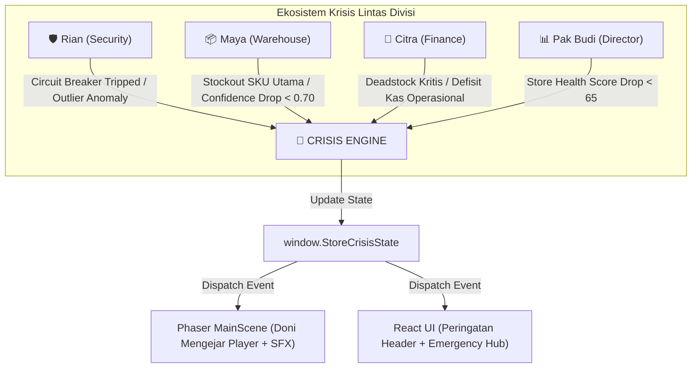
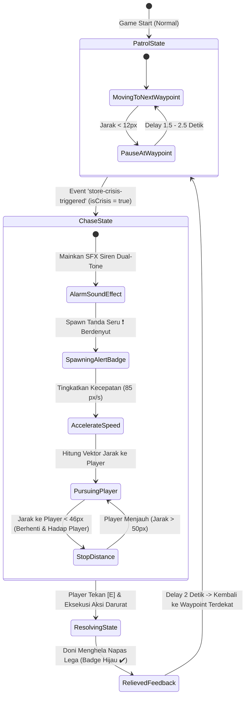

# 🚨 Virtual HQ — Proposal Arsitektur & Spesifikasi "Koordinator Operasional" (Dynamic Urgency & Crisis Hub)

**Dokumen Perencanaan Arsitektur, Logika AI Patrol/Follow, & Emergency Dashboard**  
**Versi Dokumen:** 1.0 (Comprehensive Proposal)  
**Target Lokasi:** `virtual_hq/COORDINATOR_URGENCY_PROPOSAL.md`  
**Konteks Proyek:** ChibiRex Virtual HQ (Phaser 3 + React + FastAPI REST Backend)  
**Karakter Baru:** **Doni (Koordinator Operasional / Floor Marshal)** — Menggunakan Spritesheet Karakter ke-7 (`charIdx: 7`).

---

## 1. Ringkasan Eksekutif & Karakteristik NPC

Kantor virtual Toko 74 saat ini dihuni oleh NPC fungsional yang bekerja statis di meja/zona masing-masing (Rexa di ruang copilot, Citra di War Room, Maya di hot-desk gudang, Rian di gerbang server, dan Pak Budi di depan smart screen).

Untuk menghidupkan suasana kantor menjadi **Lingkungan Operasional yang Hidup & Responsif (*Living Autonomous Office*)**, kita menambahkan 1 NPC baru bernama **Doni (Koordinator Operasional)** dengan dua kepribadian/state dinamis:

```
┌───────────────────────────────────────────────────────────────────────────────────────┐
│                       DUAL-STATE SIKLUS HIDUP KOORDINATOR DONI                         │
└───────────────────────────────────────────┬───────────────────────────────────────────┘
                                            │
                    ┌───────────────────────┴───────────────────────┐
                    ▼                                               ▼
         [STATE 1: NORMAL PATROL]                        [STATE 2: URGENT CRISIS]
         • Patroli jalan santai (45 px/s)                • Muncul tanda seru merah (❗️) berkedip
         • Memutari lorong & koridor kantor              • Bunyi alarm/klaxon darurat (SFX Audio)
         • Animasi 4-arah (walk down/up/left/right)      • Gerak lari mengejar Player (85 px/s)
         • Dialog ramah perihal kelancaran toko          • Membuka Emergency Hub lintas divisi [E]
```

---

## 2. Pemetaan Skenario Urgent (Urgency Triggers)

Kondisi darurat tidak terjadi secara acak (*random*), melainkan berakar langsung pada **anomali domain bisnis** dari backend REST API ChibiRex yang dikelola oleh masing-masing NPC spesialis:



---

### A. Matriks Kondisi Darurat Lintas Divisi

| Divisi / NPC Sumber | ID Krisis | Parameter Ambang Batas (Trigger Threshold) | Dampak Operasional Jika Dibiarkan | Aksi Resolusi Cepat (1-Click Action) | Target Endpoint API |
| :--- | :--- | :--- | :--- | :--- | :--- |
| **🛡️ Rian**<br>*(Security & Guardrail)* | `CRISIS_CIRCUIT_BREAKER_TRIPPED` | • Circuit Breaker berstatus `TRIPPED`<br>• Transaksi anomali > 3-Sigma<br>• Total PO > Rp 50.000.000 | Seluruh penerbitan PO ke SAP S/4HANA terkunci mati. Toko tidak dapat melakukan restock. | **"Emergency Reset Breaker"**<br>Mereset status circuit breaker kembali ke NORMAL. | `POST /guardrails/circuit-breaker/reset` |
| **📦 Maya**<br>*(Auditor Stok & Gudang)* | `CRISIS_STOCKOUT_FAST_MOVING` | • Stok fisik SKU Kopi Arabika = 0 unit<br>• ATAU Data Confidence Score anjlok < 0.70 | Pelanggan Toko 74 gagal bertransaksi; potensi kehilangan pendapatan harian > Rp 8.000.000. | **"Bypass & Emergency Restock"**<br>Memaksa draf PO darurat 50 karton Arabika langsung ke meja approval. | `POST /purchase-orders/emergency` |
| **💼 Citra**<br>*(Financial Strategist)* | `CRISIS_DEADSTOCK_CASH_LOCK` | • Dana tertahan di deadstock > Rp 15.000.000<br>• Sisa kas lancar toko < Rp 5.000.000 | Toko mengalami defisit kas likuiditas; tidak mampu membayar pengadaan esensial minggu ini. | **"Force Suppression & Realokasi"**<br>Membatalkan seluruh pesanan sirup lambat dan mengalihkan 100% modal ke kas aktif. | `POST /stores/74/reallocation/execute` |
| **📊 Pak Budi**<br>*(Store Director)* | `CRISIS_STORE_HEALTH_CRASH` | • *Overall Store Health Score* < 65 / 100<br>• Risiko stockout simultan > 4 SKU | Toko 74 masuk dalam daftar evaluasi kritis Direksi Regional; reputasi toko tercoreng. | **"Dispatch Task Force Toko"**<br>Mengaktifkan protokol intervensi darurat Store Health. | `POST /stores/74/taskforce/deploy` |

---

### B. Desain Struktur Data Global (`window.StoreCrisisState`)

Untuk menghubungkan React UI, Phaser Game, dan REST API secara reaktif, kita menyusun kontrak data global:

```typescript
interface StoreCrisisPayload {
    isCrisis: boolean;
    crisisId: 'CRISIS_CIRCUIT_BREAKER_TRIPPED' | 'CRISIS_STOCKOUT_FAST_MOVING' | 'CRISIS_DEADSTOCK_CASH_LOCK' | 'CRISIS_STORE_HEALTH_CRASH' | null;
    severity: 'NORMAL' | 'WARNING' | 'CRITICAL';
    sourceNPC: 'rian' | 'maya' | 'citra' | 'budi';
    sourceName: string;
    title: string;
    headline: string;
    description: string;
    metrics: {
        label: string;
        currentValue: string;
        thresholdValue: string;
        badgeColor: string;
    };
    action: {
        label: string;
        apiEndpoint: string;
        apiMethod: 'POST' | 'PUT';
        payload: Record<string, any>;
    };
    timestamp: number;
}
```

```javascript
// Contoh State Aktif saat Krisis Rian Terjadi:
window.StoreCrisisState = {
    isCrisis: true,
    crisisId: 'CRISIS_CIRCUIT_BREAKER_TRIPPED',
    severity: 'CRITICAL',
    sourceNPC: 'rian',
    sourceName: 'Rian (Security Sentinel)',
    title: '🚨 CIRCUIT BREAKER TRIPPED!',
    headline: 'Sistem Pengaman Membekukan Seluruh Pengadaan Toko',
    description: 'Terdeteksi lonjakan draf transaksi 3.2-Sigma senilai Rp 58.200.000 yang melampaui limit kuota harian Rp 50.000.000. Rian memerlukan otorisasi manajer untuk membuka kunci breaker.',
    metrics: {
        label: 'Nilai Transaksi Terdeteksi',
        currentValue: 'Rp 58.200.000',
        thresholdValue: 'Maks. Rp 50.000.000',
        badgeColor: '#ef4444',
    },
    action: {
        label: '⚡ Reset Circuit Breaker Sekarang',
        apiEndpoint: '/guardrails/circuit-breaker/reset',
        apiMethod: 'POST',
        payload: { store: 74, reason: 'Manager Emergency Authorization' },
    },
    timestamp: Date.now(),
};
```

---

## 3. Logika Perilaku AI NPC Doni (AI Behavior State Machine)

Doni dikendalikan oleh *Finite State Machine (FSM)* dengan 2 mode operasional utama:



---

### A. Rute Navigasi Patroli Normal (Waypoint Pathing)

Peta kantor berukuran $24 \times 16\text{ tile}$ ($768 \times 512\text{ px}$). Koridor tengah adalah area bebas rintangan terbaik. Kita merancang jalur patroli tertutup (*closed-loop corridor circuit*) yang menghubungkan seluruh zona penting kantor:

```
[Ruang Rexa]      [Ruang War Room]        [Ruang Manajer]
 (Row 2-6)           (Row 2-6)               (Row 2-6)
     │                   │                       │
═════╪═══════════════════╪═══════════════════════╪═════  (Row 7: Sekat Dinding & Pintu)
     │   WP 1 (220, 260) │     WP 2 (384, 260)   │     WP 3 (560, 260)
     ├───◄───────────────┼─────◄─────────────────┤
     │                   │     [Smart TV]        │
     │                   │                       │
     ▼                   │                       ▲
     │   WP 6 (220, 380) │     WP 5 (384, 380)   │     WP 4 (560, 380)
     ├───►───────────────┼─────►─────────────────┤
     │                   │                       │
[Pantry & Lounge]   [Lobby Utama]           [Hot-Desk Gudang Maya]
```

* **Daftar Koordinat Waypoint Doni:**
  1. `WP1 (x: 220, y: 260)`: Depan pintu masuk Rexa & konsol Rian.
  2. `WP2 (x: 384, y: 260)`: Persimpangan tengah depan TV.
  3. `WP3 (x: 560, y: 260)`: Depan pintu masuk Ruang Manajer.
  4. `WP4 (x: 560, y: 380)`: Depan meja hot-desk audit Maya.
  5. `WP5 (x: 384, y: 380)`: Koridor selatan dekat pintu masuk utama.
  6. `WP6 (x: 220, y: 380)`: Area santai pantry & coffee bar.

* **Logika Pergerakan Patroli:**
  - Kecepatan jalan: `PATROL_SPEED = 45 px/s`.
  - Animasi jalan 4-arah (`doni-walk-down`, `doni-walk-left`, `doni-walk-right`, `doni-walk-up`) dipilih secara otomatis berdasarkan komponen vektor kecepatan terbesar ($|v_x| > |v_y|$).
  - Ketika tiba di waypoint (jarak $< 12\text{ px}$), Doni berhenti sejenak selama $1.5 - 2.5\text{ detik}$ (animasi idle) sebelum melanjutkan ke waypoint berikutnya.

---

### B. Logika Mengejar Player (Pursuit & Follow AI)

Saat krisis aktif (`isCrisis = true`):
1. **Akselerasi Kecepatan:** Kecepatan Doni dinaikkan menjadi `CHASE_SPEED = 85 px/s` (sedikit di bawah kecepatan lari Player $120\text{ px/s}$ agar adil dan sinematik).
2. **Perhitungan Vektor Pengejaran:**
   ```javascript
   const dx = this.player.x - this.doniSprite.x;
   const dy = this.player.y - this.doniSprite.y;
   const dist = Math.hypot(dx, dy);

   const STOP_DIST = 46; // Jarak henti agar tidak menabrak atau menimpa player
   if (dist > STOP_DIST) {
       const angle = Math.atan2(dy, dx);
       this.doniSprite.setVelocity(Math.cos(angle) * CHASE_SPEED, Math.sin(angle) * CHASE_SPEED);
       // Tentukan animasi hadap berdasarkan sudut pergerakan
       this._updateDoniWalkAnimation(dx, dy);
   } else {
       this.doniSprite.setVelocity(0, 0);
       // Hadapkan wajah Doni tepat ke posisi Player berada
       this._faceTowardsTarget(this.doniSprite, dx, dy, 'doni');
   }
   ```
3. **Penyelesaian Krisis (Resolution):**
   - Ketika Player menekan `[E]` dan menyelesaikan aksi darurat di modal:
     - State `isCrisis` diubah menjadi `false`.
     - Tanda seru merah `❗️` lenyap, digantikan ikon hijau `✔️` selama 2 detik dengan suara *chime* lembut.
     - Doni menampilkan dialog gelembung singkat: *"Terima kasih Manager! Krisis berhasil dinetralisir. Saya kembali patroli."*
     - Doni berjalan santai kembali ke waypoint terdekat dan menyambung rute patrolinya.

---

## 4. Sistem Notifikasi (Visual & Audio Alert)

### A. Indikator Visual: Floating Warning Beacon ("❗️")

Di atas kepala Doni, dibuat kontainer visual berkedalaman tinggi (`depth: 101`):

```
          ┌─────────────┐
          │     ❗️      │  <-- Emoji Tanda Seru Merah (Ukuran 20px)
          └──────┬──────┘
         ┌───────┴───────┐
         │  URGENT ALERT │  <-- Pill Merah Neon Berkedip (#ef4444)
         └───────────────┘
                 ▼
         [Kepala Sprite Doni]
```

* **Spesifikasi Animasi Visual:**
  1. **Denyut Skala & Vertikal (Pulse & Float Tween):**
     - Skala badge membesar dari `1.0` ke `1.25` setiap 280ms (`yoyo: true`, `repeat: -1`).
     - Posisi vertikal mengapung naik-turun setinggi $6\text{ px}$ untuk memberikan kesan urgensi melayang.
  2. **Strobe Flash (Lampu Darurat Darat):**
     - Latar belakang pill bergantian antara merah pekat (`0xef4444`) dan kuning amber (`0xf59e0b`) setiap 150ms.
     - Lingkaran aura merah semi-transparan (`alpha: 0.25`) memancar di bawah kaki Doni.

---

### B. Sistem Audio Alarm: Zero-Asset Web Audio API Synthesizer

Untuk menjamin suara alarm **pasti berbunyi tanpa risiko error file hilang (*404 asset missing*) atau CORS**, kita menggunakan generator suara sintetis murni menggunakan Web Audio API:

```javascript
/**
 * Membunyikan suara alarm darurat klaxon dua nada (Dual-Tone Siren Klaxon)
 * Menggunakan Web Audio API bawaan browser (100% tanpa file eksternal)
 */
function playEmergencyKlaxonSFX() {
    try {
        const AudioCtx = window.AudioContext || window.webkitAudioContext;
        if (!AudioCtx) return;
        const ctx = new AudioCtx();

        // Nada 1: 880 Hz (A5 - High Urgency)
        const osc1 = ctx.createOscillator();
        const gain1 = ctx.createGain();
        osc1.type = 'sawtooth';
        osc1.frequency.setValueAtTime(880, ctx.currentTime);
        osc1.frequency.exponentialRampToValueAtTime(587.33, ctx.currentTime + 0.22); // Turun ke D5

        gain1.gain.setValueAtTime(0.2, ctx.currentTime);
        gain1.gain.exponentialRampToValueAtTime(0.01, ctx.currentTime + 0.35);

        osc1.connect(gain1);
        gain1.connect(ctx.destination);

        osc1.start(ctx.currentTime);
        osc1.stop(ctx.currentTime + 0.35);

        // Nada Pantul (Echo Beep) setelah 180ms
        setTimeout(() => {
            const osc2 = ctx.createOscillator();
            const gain2 = ctx.createGain();
            osc2.type = 'sine';
            osc2.frequency.setValueAtTime(987.77, ctx.currentTime);
            gain2.gain.setValueAtTime(0.15, ctx.currentTime);
            gain2.gain.exponentialRampToValueAtTime(0.01, ctx.currentTime + 0.25);
            osc2.connect(gain2);
            gain2.connect(ctx.destination);
            osc2.start(ctx.currentTime);
            osc2.stop(ctx.currentTime + 0.25);
        }, 180);
    } catch (e) {
        console.warn('[Audio] SFX Klaxon tidak dapat diputar:', e);
    }
}
```

> [!TIP]
> SFX ini hanya dipicu satu kali saat krisis pertama kali meletus (atau diulang setiap 8 detik jika belum direspons pemain), sehingga tidak membuat pemain merasa bising.

---

## 5. Antarmuka UI Interaktif: Emergency Crisis Hub Modal

Saat Player berada di dekat Doni yang sedang panik (< 50px), muncul prompt berkedip:  
`🚨 [Tekan E: Tinjau Krisis Darurat Toko]`

Ketika tombol `[E]` ditekan, Player dibekukan (`_freezePlayer()`) dan modal darurat **"Emergency Crisis Hub"** terbuka di atas layar.

```
┌────────────────────────────────────────────────────────────────────────┐
│ 🚨 STORE CRISIS DISPATCH — STORE #74              [URGENT] [TUTUP ✕] │
├────────────────────────────────────────────────────────────────────────┤
│ 🏃 DONI (KOORDINATOR OPERASIONAL):                                     │
│ "Manager! Syukurlah Anda ada di sini! Sistem di divisi Rian baru saja   │
│ mengalami trip darurat. Seluruh antrean PO ke SAP S/4HANA terhenti!    │
│ Kita harus mengambil keputusan sebelum operasional toko lumpuh total!" │
├────────────────────────────────────────────────────────────────────────┤
│ 🛡️ SUMBER KRISIS: Divisi Keamanan & Kepatuhan (Rian)                   │
│                                                                        │
│ Masalah Utama: CIRCUIT BREAKER TRIPPED (3.2-Sigma Outlier)             │
│ • Nilai Terdeteksi: Rp 58.200.000 (Melampaui Kuota Rp 50.000.000)      │
│ • Status SAP Gateway: TERKUNCI / REJECT AUTOMATION                     │
│ • Dampak Langsung: 3 Draf PO Esensial tertahan tidak bisa dikirim      │
├────────────────────────────────────────────────────────────────────────┤
│ ⚡ PROTOKOL RESOLUSI CEPAT:                                            │
│                                                                        │
│   [ ⚡ EKSEKUSI RESET CIRCUIT BREAKER (OTORISASI MANAJER) ]             │
│   (Mengirim POST /guardrails/circuit-breaker/reset & netralisir status)│
│                                                                        │
│   [ 📞 Telepon Rian via Interkom ]     [ 🏃 Ke Meja Rian Langsung ]    │
└────────────────────────────────────────────────────────────────────────┘
```

### A. Keunggulan Cross-Functional Crisis Hub
1. **Penyelesaian Terpusat (*Single Point of Resolution*):** Player tidak perlu berlari melintasi map ke meja Rian jika sedang terburu-buru; mereka bisa mengeksekusi tombol otorisasi langsung di modal Doni.
2. **Koneksi ke Interkom:** Terdapat opsi tombol pintas *"📞 Telepon [Nama NPC]"* yang langsung membuka interkom Smartphone ke NPC terkait.
3. **Visual Feedback Langsung:** Begitu tombol resolusi diklik, backend dipanggil, state krisis ternetralisir, modal menutup secara otomatis dengan konfirmasi sukses, dan Doni kembali berjalan santai.

---

## 6. Formula Matematis Spritesheet & Aset Doni

Doni menggunakan **Karakter ke-7 (`CHAR_IDX_DONI = 7`)** pada baris 4–7 kolom 9–11 dari spritesheet `32x32folk.png`:

$$\text{Set Index} = \lfloor 7 / 4 \rfloor = 1$$
$$\text{Col In Set} = 7 \pmod 4 = 3$$
$$\text{Row Offset} = \left(1 \times 4 + \text{dirIdx}\right) \times 12$$
$$\text{Base Frame} = \text{Row Offset} + \left(3 \times 3\right) = \text{Row Offset} + 9$$

* **Pemetaan Frame Animasi Doni:**
  * **Down (Arah Bawah):** Base frame $= (4 \times 12) + 9 = 57$.  
    Walk: `[57, 58, 59]`, Idle: `58`.
  * **Left (Arah Kiri):** Base frame $= (5 \times 12) + 9 = 69$.  
    Walk: `[69, 70, 71]`, Idle: `70`.
  * **Right (Arah Kanan):** Base frame $= (6 \times 12) + 9 = 81$.  
    Walk: `[81, 82, 83]`, Idle: `82`.
  * **Up (Arah Atas):** Base frame $= (7 \times 12) + 9 = 93$.  
    Walk: `[93, 94, 95]`, Idle: `94`.

Visual karakter 7 di spritesheet ini menampilkan seorang pria muda berjaket lapangan cokelat-oranye dinamis, sangat cocok dengan identitas seorang Koordinator Lapangan.

---

## 7. Rencana Tahapan Eksekusi (Implementation Roadmap)

Setelah dokumen ini Anda setujui, pengembangan akan dilakukan dalam 4 tahap sistematis:

* **Tahap 1 — State Management & Simulasi Krisis (`CrisisContext` / Store State):**
  - Membuat model state `window.StoreCrisisState`.
  - Membuat fungsi helper `triggerStoreCrisis(crisisId)` dan `resolveStoreCrisis()`.
  - Menambahkan tombol simulasi pemicu darurat (Opsional / Debug Menu / Hotkey `K` untuk testing).

* **Tahap 2 — Implementasi Karakter Doni di Phaser (`MainScene.js`):**
  - Mendaftarkan animasi `doni-walk-*` dan `doni-idle-*` menggunakan frame `[57..95]`.
  - Membuat AI Waypoint Patroli (6 titik koridor).
  - Membuat AI Follow Player saat `isCrisis = true`.
  - Membuat *Floating Urgency Beacon (❗️)* dan Web Audio Klaxon SFX.

* **Tahap 3 — Pembuatan Komponen UI Emergency Crisis Hub (`CrisisCommandModal.jsx`):**
  - Membuat modal responsif gaya "Tactical Red Alert".
  - Menghubungkan tombol aksi resolusi cepat ke API backend ChibiRex.
  - Menghubungkan penutupan modal ke pemulihan state Doni.

* **Tahap 4 — Verifikasi Build & Polish:**
  - Memastikan tidak ada tabrakan waypoint dengan hitbox dinding atau meja.
  - Memastikan jarak henti (*stopping distance*) Doni nyaman bagi Player.
  - Uji build produksi Vite (`npm run build`).

---

**Dokumen ini siap dijadikan pedoman mutlak untuk mengeksekusi fitur Koordinator Operasional & Sistem Krisis Terpadu pada ChibiRex Virtual HQ.**
