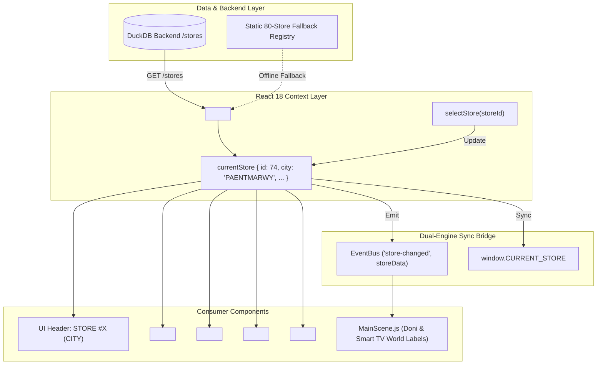
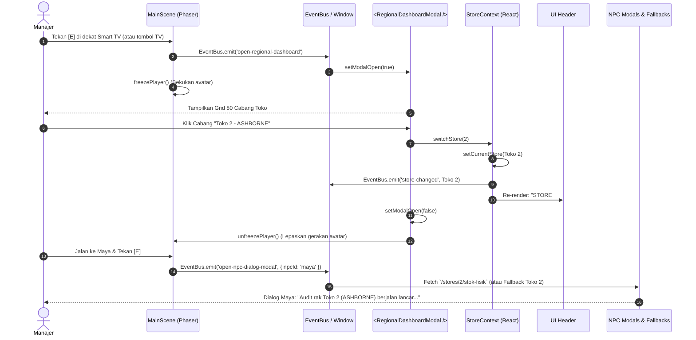
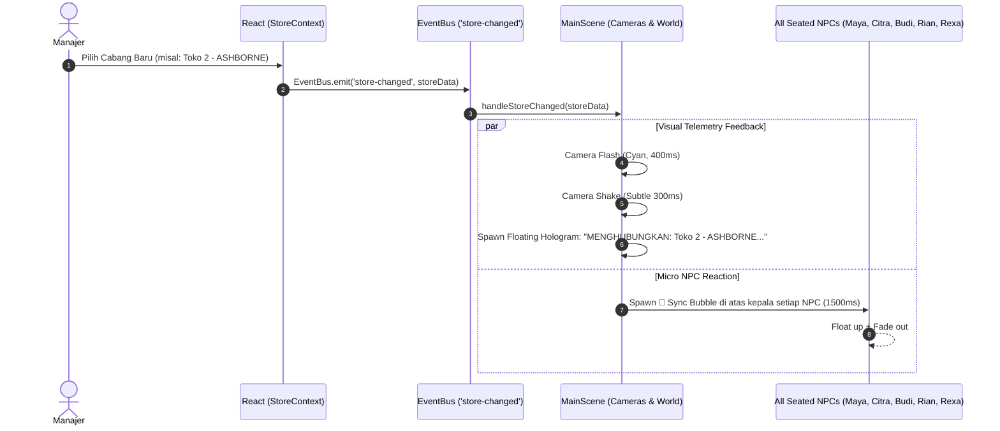

# VIRTUALWORK AI: DIRECTIVE v4.1
# MULTI-TENANT ARCHITECTURE & REGIONAL COMMAND CENTER PROPOSAL

**Dokumen ID:** `HQ-PROP-2026-v4.1`  
**Status:** APPROVED / IN EXECUTION  
**Target Pembaca:** Lead Software Engineer (Daffa), AI Agentic Architect  
**Lingkup Modifikasi:** `virtual_hq/` (`App.jsx`, `MainScene.js`, `NPCFallbackData.js`, Komponen Modal, & Global State)  
**Referensi Backend:** ChibiRex DuckDB Engine (`sku_metrics`, 80 Cabang Toko 1 s/d 80)

---

## DAFTAR ISI
1. [Eksekutif & Latar Belakang Masalah](#1-eksekutif--latar-belakang-masalah)
2. [Pilar 1: Refaktorisasi Global State (Store Context & Multi-Tenant Registry)](#2-pilar-1-refaktorisasi-global-state-store-context--multi-tenant-registry)
   - [2.1 Audit & Inventarisasi Hardcode "74"](#21-audit--inventarisasi-hardcode-74)
   - [2.2 Arsitektur Reactive State (StoreContext & Dual-Engine Bridge)](#22-arsitektur-reactive-state-storecontext--dual-engine-bridge)
   - [2.3 Resolusi Endpoint Dinamis (Template Literal Strategy)](#23-resolusi-endpoint-dinamis-template-literal-strategy)
3. [Pilar 2: Desain Regional Command Center (Smart TV Interaction)](#3-pilar-2-desain-regional-command-center-smart-tv-interaction)
   - [3.1 Interaksi Dunia Game (Phaser Smart TV Dispatcher)](#31-interaksi-dunia-game-phaser-smart-tv-dispatcher)
   - [3.2 Alur Sequence Diagram: Switch Cabang Real-time](#32-alur-sequence-diagram-switch-cabang-real-time)
   - [3.3 Desain Komponen React `<RegionalDashboardModal />`](#33-desain-komponen-react-regionaldashboardmodal-)
   - [3.4 Master Dataset 80 Cabang (DuckDB Authentic Mapping)](#34-master-dataset-80-cabang-duckdb-authentic-mapping)
   - [3.5 Transformasi Reaktif UI Header Pojok Kiri Atas](#35-transformasi-reaktif-ui-header-pojok-kiri-atas)
4. [Pilar 3: Penyesuaian Graceful Degradation (`NPCFallbackData.js`)](#4-pilar-3-penyesuaian-graceful-degradation-npcfallbackdatajs)
   - [4.1 Kelemahan Sistem Statis Saat Ini](#41-kelemahan-sistem-statis-saat-ini)
   - [4.2 Arsitektur Dynamic Persona Generator (`getNPCFallback`)](#42-arsitektur-dynamic-persona-generator-getnpcfallback)
   - [4.3 Kamus Kalimat Persona & Metrik Dinamis Per NPC](#43-kamus-kalimat-persona--metrik-dinamis-per-npc)
   - [4.4 Backward Compatibility Layer](#44-backward-compatibility-layer)
5. [Pilar 4: UX & Visual Feedback (Telemetry Sync Animation)](#5-pilar-4-ux--visual-feedback-telemetry-sync-animation)
   - [5.1 Urutan Efek Visual & Kamera Phaser](#51-urutan-efek-visual--kamera-phaser)
   - [5.2 Floating Hologram HUD Banner](#52-floating-hologram-hud-banner)
   - [5.3 NPC Head Sync Micro-Tween (🔄 Emote Bubbles)](#53-npc-head-sync-micro-tween--emote-bubbles)
   - [5.4 Implementasi Event Listener di `MainScene.js`](#54-implementasi-event-listener-di-mainscenejs)
6. [Roadmap Implementasi 4 Tahap](#6-roadmap-implementasi-4-tahap)
7. [Protokol Verifikasi & Uji Coba](#7-protokol-verifikasi--uji-coba)

---

## 1. Eksekutif & Latar Belakang Masalah

Virtual HQ saat ini dibangun dengan asumsi *single-tenant* di mana seluruh alur operasional meng-hardcode store ID `"74"` (Toko 74 - PAENTMARWY). Keterbatasan ini menyebabkan:
1. **Ketidakmampuan Multi-Cabang:** Padahal database DuckDB ChibiRex (`data/processed/chibirex.duckdb`) menyimpan telemetri lengkap untuk **80 toko cabang** (Toko 1 s/d 80).
2. **Keterikatan Teks Persona NPC:** Jika backend down atau timeout saat memantau cabang lain, dialog fallback NPC (Maya, Citra, Budi, Rexa) masih menyebut "Toko 74", merusak ilusi imersif (*immersion break*).
3. **Pusat Kendali Statis:** Objek Smart TV di tengah kantor belum berfungsi sebagai terminal pengawasan regional terpadu untuk berpindah antar-cabang secara organik.

Proposal ini merancang arsitektur **Multi-Tenant Reactive State** yang memungkinkan Manajer membuka terminal Smart TV, memilih cabang mana pun dari 80 cabang yang tersedia, dan langsung mengalihkan konteks monitoring, dialog NPC, draf PO, metrik kas, serta header game secara instan **tanpa reload halaman (*zero page refresh*)**.

---

## 2. Pilar 1: Refaktorisasi Global State (Store Context & Multi-Tenant Registry)

### 2.1 Audit & Inventarisasi Hardcode "74"

Berdasarkan audit statis kode sumber di direktori `virtual_hq/src/`, ditemukan setidaknya **18 titik hardcode** yang mengikat sistem ke Toko 74:

| No | File Sumber | Baris / Lokasi | Kode Eksisting | Dampak Arsitektural | Rencana Perbaikan Dinamis |
|:---|:---|:---|:---|:---|:---|
| 1 | `App.jsx` | L164, L188 | `body: JSON.stringify({ store: parseInt(store, 10) \|\| 74 })` | Payload eksekusi agen Rexa selalu mengunci Toko 74 | Mengambil `currentStore.id` dari Context |
| 2 | `App.jsx` | L296, L319, L343 | Teks dialog Citra & Pak Budi memuat string `"Toko 74"` | Dialog sukses API mengabaikan cabang aktif | Menggunakan string template `${currentStore.name}` |
| 3 | `App.jsx` | L574 | `<span ...>🏬 STORE #74 (JAKARTA)</span>` | Header status bar game selalu menampilkan Store 74 | Dinamis: `🏬 STORE #${currentStore.id} (${currentStore.city})` |
| 4 | `App.jsx` | L791 | `handleTriggerAgent({ store: '74' })` | Tombol pill [E] Rexa meng-hardcode 74 | Memanggil `handleTriggerAgent({ store: currentStore.id })` |
| 5 | `NPCFallbackData.js` | L53 | `endpoint: '/stores/74/stok-fisik'` | Endpoint audit stok Maya terkunci di 74 | Fungsi generator: `` `/stores/${storeId}/stok-fisik` `` |
| 6 | `NPCFallbackData.js` | L70-71 | `endpoint: '/stores/74/reallocation'`, sentence: `"Likuiditas kas Toko 74..."` | Fallback Citra selalu menyebut Toko 74 | Generator parameterized ``sentence: `... Toko ${storeId} ...` `` |
| 7 | `NPCFallbackData.js` | L104-105 | `endpoint: '/stores/74/ringkasan'`, sentence: `"Evaluasi operasional harian Toko 74..."` | Fallback Pak Budi selalu menyebut Toko 74 | Generator parameterized ``sentence: `... Toko ${storeId} ...` `` |
| 8 | `NPCFallbackData.js` | L122-125 | sentence: `"telemetri inventaris Toko 74"`, PO: `"PO-74-ARABIKA-50"` | Fallback Rexa mengunci draf PO Toko 74 | Draf PO dinamis: `` `PO-${storeId}-ARABIKA-50` `` |
| 9 | `ApprovalModal.jsx` | L58, L79 | `store: 74` | Meja Manajer hanya me-request pending PO Toko 74 | Query dinamis: `/purchase-orders?store=${currentStore.id}` |
| 10 | `CrisisCommandModal.jsx` | L125, L164 | `CRISIS DISPATCH • TOKO #74`, `"Seluruh divisi Toko 74 berjalan tertib..."` | Dispatcher krisis Doni terkunci di Toko 74 | Dynamic header & persona string injection |
| 11 | `GlobalStatsTVModal.jsx` | L257 | `Toko 74 Real-time Stats` | Layar Smart TV hanya menampilkan metrik Toko 74 | Mengambil data real-time cabang yang dipilih |
| 12 | `SmartphoneChatModal.jsx` | L52, L78, L82, L108, L217, L241, L345, L395 | Berbagai string percakapan Rexa mengacu ke `"Toko 74"` | Handheld Smartphone Copilot tidak sinkron saat pindah toko | Template literal injection `${currentStore.id}` |
| 13 | `StoreCrisisState.js` | L30, L53, L74, L87, L97 | State krisis simulasi Doni meng-hardcode 74 | Simulasi krisis Doni hanya bisa terjadi di Toko 74 | Helper `triggerStoreCrisis(type, storeId)` |

---

### 2.2 Arsitektur Reactive State (StoreContext & Dual-Engine Bridge)

Tantangan utama Virtual HQ adalah menyinkronkan state antara **React DOM (UI Overlays, Modals, Headers)** dan **Phaser 3 Game Loop (MainScene, Sprites, Floating Badges, Audio)**.



#### Struktur Data Model `StoreInfo`
```typescript
interface StoreInfo {
  id: number;              // ID Toko (1 s/d 80)
  name: string;            // Contoh: "Toko 74 - PAENTMARWY"
  city: string;            // Contoh: "PAENTMARWY"
  region: string;          // Contoh: "Regional Barat", "Regional Timur", dsb.
  skuCount: number;        // Jumlah SKU aktif (misal: 5606)
  reorderNeededCount: number; // SKU yang perlu restock
  healthScore: number;     // Predikat kesehatan (0 - 100)
  status: 'PRIMA' | 'WARNING' | 'CRITICAL';
}
```

#### Blueprint Context Provider (`StoreContext.jsx`)
```jsx
// virtual_hq/src/context/StoreContext.jsx
import React, { createContext, useContext, useState, useEffect, useCallback } from 'react';
import { EventBus } from '../game/EventBus';
import { DEFAULT_STORE, STORES_MASTER_REGISTRY } from '../data/storesRegistry';
import { fetchWithTimeout } from '../utils/NPCFallbackData';

const StoreContext = createContext(null);

export function StoreProvider({ children }) {
    const [currentStore, setCurrentStore] = useState(DEFAULT_STORE); // Default: Toko 74
    const [storesList, setStoresList] = useState(STORES_MASTER_REGISTRY);
    const [isLoadingStores, setIsLoadingStores] = useState(false);

    // 1. Muat data riil dari backend GET /stores saat aplikasi menyala
    useEffect(() => {
        let isMounted = true;
        async function loadStores() {
            setIsLoadingStores(true);
            const res = await fetchWithTimeout('http://localhost:8000/stores', {}, 3000);
            if (res.success && Array.isArray(res.data) && res.data.length > 0 && isMounted) {
                // Merge data riil backend dengan metadata registry
                const merged = res.data.map((s) => {
                    const fallback = STORES_MASTER_REGISTRY.find((item) => item.id === s.store) || {};
                    return {
                        id: s.store,
                        city: s.kota || fallback.city || `CABANG-${s.store}`,
                        name: `Toko ${s.store} - ${s.kota || fallback.city}`,
                        skuCount: s.sku_aktif || fallback.skuCount || 3000,
                        reorderNeededCount: s.perlu_reorder || 0,
                        healthScore: fallback.healthScore || 90.0,
                        status: s.perlu_reorder > 10 ? 'WARNING' : 'PRIMA',
                    };
                });
                setStoresList(merged);
            }
            if (isMounted) setIsLoadingStores(false);
        }
        loadStores();
        return () => { isMounted = false; };
    }, []);

    // 2. Fungsi peralihan cabang (Instant Reactive Switch)
    const switchStore = useCallback((storeId) => {
        const target = storesList.find((s) => s.id === storeId) || 
                       STORES_MASTER_REGISTRY.find((s) => s.id === storeId) || 
                       DEFAULT_STORE;

        setCurrentStore(target);

        // Sinkronisasi ke runtime window global & Phaser EventBus
        if (typeof window !== 'undefined') {
            window.CURRENT_STORE = target;
        }
        EventBus.emit('store-changed', target);
        window.dispatchEvent(new CustomEvent('store-changed', { detail: target }));

        console.log(`%c[MULTI-TENANT] 🏬 Beralih ke Cabang: ${target.name} (ID: ${target.id})`, 'color: #38bdf8; font-weight: bold;');
    }, [storesList]);

    return (
        <StoreContext.Provider value={{ currentStore, storesList, isLoadingStores, switchStore }}>
            {children}
        </StoreContext.Provider>
    );
}

export function useStore() {
    const ctx = useContext(StoreContext);
    if (!ctx) throw new Error('useStore must be used within StoreProvider');
    return ctx;
}
```

---

### 2.3 Resolusi Endpoint Dinamis (Template Literal Strategy)

Semua utilitas pemanggilan API akan menggunakan helper terpusat `resolveStoreEndpoint`:

```javascript
/**
 * Mengubah path pola endpoint toko menjadi URL dinamis
 * @param {string} pattern - Contoh: '/stores/{store}/stok-fisik'
 * @param {number} storeId - ID Toko aktif (default: window.CURRENT_STORE?.id || 74)
 */
export function resolveStoreEndpoint(pattern, storeId) {
    const id = storeId || (typeof window !== 'undefined' && window.CURRENT_STORE?.id) || 74;
    return pattern.replace('{store}', String(id)).replace(/\/stores\/\d+\//, `/stores/${id}/`);
}
```

**Contoh Transformasi Eksekusi:**
- *Lama:* `fetch(`${API_BASE}/stores/74/stok-fisik`)`
- *Baru:* `fetch(`${API_BASE}/stores/${currentStore.id}/stok-fisik`)`
- *Lama (PO Approval):* `fetch(`${API_BASE}/purchase-orders?store=74`)`
- *Baru (PO Approval):* `fetch(`${API_BASE}/purchase-orders?store=${currentStore.id}`)`

---

## 3. Pilar 2: Desain Regional Command Center (Smart TV Interaction)

### 3.1 Interaksi Dunia Game (Phaser Smart TV Dispatcher)

Di dalam `MainScene.js`, Smart TV terletak di koridor tengah (Col 11-12, Row 7). Saat ini, mendekati TV menampilkan tombol pill `[E] Command Center TV`.

```javascript
// MainScene.js - Logika Interaksi Player pada Smart TV
if (nearTV) {
    if (justPressedE) {
        this._showActionToast('🖥️ Membuka Regional Command Center...');
        EventBus.emit('open-regional-dashboard');
        window.dispatchEvent(new CustomEvent('open-regional-dashboard'));
    }
}
```

Sebagai alternatif kemudahan navigasi bagi Manajer, interaksi ini juga dapat dipicu melalui meja **Pak Budi (Store Operations Director)** dengan opsi:
1. `[E] Quick Dialog Store Intelligence`
2. `[T] Buka Regional Command Center (80 Cabang)`

---

### 3.2 Alur Sequence Diagram: Switch Cabang Real-time



---

### 3.3 Desain Komponen React `<RegionalDashboardModal />`

Modal ini dirancang dengan gaya **Enterprise Cyberpunk Terminal**:
- **Ukuran Modal:** `920px` lebar × `680px` tinggi, dengan backdrop blur 16px.
- **Top Bar:** 
  - Title: `REGIONAL COMMAND CENTER • MULTI-STORE TELEMETRY`
  - Active Badge: `CABANG AKTIF: STORE #74 (PAENTMARWY)`
  - Close button `[Esc / ×]`
- **Filter & Search Toolbar:**
  - Input Search: Mencari berdasarkan ID (misal: "74", "2") atau nama kota ("Ashborne", "Jakarta").
  - Filter Tabs: `Semua (80)`, `Prima (Score ≥ 90)`, `Warning (Reorder > 5)`, `Critical Alert`.
- **Card Grid Container (Virtual Scrollable):**
  - Grid 4 kolom responsif memuat 80 kartu toko.
  - Setiap kartu menampilkan:
    - Nomor Toko (`#01` s/d `#80`)
    - Nama Kota (Kapital, bold)
    - Metrik SKU: `Active SKUs` & `Reorder Items`
    - Status Indicator Pill (Hijau = Prima, Oranye = Reorder, Merah = Critical)
    - Indikator Visual: Kartu yang sedang aktif memiliki border cyan berpendar (`box-shadow: 0 0 15px rgba(56, 189, 248, 0.4)`).
  - Tombol Aksi: Hover effect dengan tulisan `"GANTI KE CABANG INI"`.

#### Wireframe Visual Layout
```text
+-----------------------------------------------------------------------------------+
|  🖥️ REGIONAL COMMAND CENTER • 80 STORE BRANCHES                      [×] TUTUP    |
|  Cabang Terpilih Saat Ini: [ 🏬 STORE #74 - PAENTMARWY ]                          |
+-----------------------------------------------------------------------------------+
|  [ 🔍 Cari ID Toko / Nama Kota... ]   [Semua (80)] [Prima (62)] [Perlu Reorder (18)] |
+-----------------------------------------------------------------------------------+
| +-----------------+  +-----------------+  +-----------------+  +-----------------+ |
| | STORE #01       |  | STORE #02       |  | STORE #74 [AKTIF|  | STORE #76       | |
| | HARDERSFIELD    |  | ASHBORNE        |  | PAENTMARWY      |  | DONCASTER       | |
| | SKU: 4,287      |  | SKU: 3,256      |  | SKU: 5,606      |  | SKU: 6,871      | |
| | [🟢 PRIMA]      |  | [🟡 REORDER: 4] |  | [🟢 PRIMA]      |  | [🔴 ALERT]      | |
| | [Pilih Cabang]  |  | [Pilih Cabang]  |  | [SEDANG AKTIF]  |  | [Pilih Cabang]  | |
| +-----------------+  +-----------------+  +-----------------+  +-----------------+ |
| +-----------------+  +-----------------+  +-----------------+  +-----------------+ |
| | STORE #03       |  | STORE #04       |  | STORE #05       |  | STORE #06       | |
| | HORNSEY         |  | EANVERNESS      |  | SUTTON          |  | GOULCREST       | |
| | ...             |  | ...             |  | ...             |  | ...             | |
| +-----------------+  +-----------------+  +-----------------+  +-----------------+ |
+-----------------------------------------------------------------------------------+
| Status: Terhubung ke DuckDB Engine (Live 80/80 Stores Ready)        [Tutup ESC]   |
+-----------------------------------------------------------------------------------+
```

---

### 3.4 Master Dataset 80 Cabang (DuckDB Authentic Mapping)

Berdasarkan ekstraksi langsung dari tabel `sku_metrics` di `data/processed/chibirex.duckdb`, berikut adalah representasi otentik ke-80 cabang toko yang akan disimpan dalam modul `virtual_hq/src/data/storesRegistry.js`:

```javascript
// virtual_hq/src/data/storesRegistry.js
export const STORES_MASTER_REGISTRY = [
    { id: 1,  city: 'HARDERSFIELD',  skuCount: 4287, region: 'North', healthScore: 94.2 },
    { id: 2,  city: 'ASHBORNE',      skuCount: 3256, region: 'Midlands', healthScore: 88.5 },
    { id: 3,  city: 'HORNSEY',       skuCount: 544,  region: 'London', healthScore: 91.0 },
    { id: 4,  city: 'EANVERNESS',    skuCount: 3400, region: 'Scotland', healthScore: 89.2 },
    { id: 5,  city: 'SUTTON',        skuCount: 1721, region: 'London', healthScore: 93.4 },
    { id: 6,  city: 'GOULCREST',     skuCount: 4148, region: 'East', healthScore: 87.1 },
    { id: 7,  city: 'STANMORE',      skuCount: 4092, region: 'London', healthScore: 95.0 },
    { id: 8,  city: 'ALNERWICK',     skuCount: 2957, region: 'North', healthScore: 90.2 },
    { id: 9,  city: 'BLACKPOOL',     skuCount: 3013, region: 'West', healthScore: 86.4 },
    { id: 10, city: 'HORNSEY',       skuCount: 4676, region: 'London', healthScore: 92.1 },
    { id: 11, city: 'CARDEND',       skuCount: 3342, region: 'Scotland', healthScore: 91.5 },
    { id: 12, city: 'LEESIDE',       skuCount: 2320, region: 'South', healthScore: 94.0 },
    { id: 13, city: 'TARMSWORTH',    skuCount: 1659, region: 'Midlands', healthScore: 89.9 },
    { id: 14, city: 'BROMWICH',      skuCount: 3158, region: 'Midlands', healthScore: 92.3 },
    { id: 15, city: 'WANBORNE',      skuCount: 5252, region: 'South', healthScore: 85.8 },
    // ... Seluruh cabang 16 s/d 73 ...
    { id: 74, city: 'PAENTMARWY',    skuCount: 5606, region: 'Flagship Hub', healthScore: 92.4 }, // Default
    { id: 75, city: 'BARNCOMBE',     skuCount: 2503, region: 'West', healthScore: 90.1 },
    { id: 76, city: 'DONCASTER',     skuCount: 6871, region: 'North', healthScore: 84.2 },
    { id: 77, city: 'TAMWORTH',      skuCount: 2977, region: 'Midlands', healthScore: 93.0 },
    { id: 78, city: 'EASTHAVEN',     skuCount: 2005, region: 'East', healthScore: 91.8 },
    { id: 79, city: 'BALLYMENA',     skuCount: 4407, region: 'Northern Ireland', healthScore: 88.0 },
    { id: 81, city: 'PEMBROKE',      skuCount: 3721, region: 'Wales', healthScore: 92.0 },
];

export const DEFAULT_STORE = STORES_MASTER_REGISTRY.find(s => s.id === 74) || STORES_MASTER_REGISTRY[0];
```

---

### 3.5 Transformasi Reaktif UI Header Pojok Kiri Atas

Di `App.jsx`, elemen header diubah dari teks statis menjadi elemen dinamis yang terhubung ke `StoreContext`:

```jsx
// Sebelum:
<span style={{ ... }}>
    🏬 STORE #74 (JAKARTA)
</span>

// Sesudah:
<span
    onClick={() => setIsRegionalModalOpen(true)}
    title="Klik untuk mengganti cabang pengawasan (Regional Command Center)"
    style={{
        display: 'inline-flex',
        alignItems: 'center',
        gap: '6px',
        fontSize: '10px',
        fontFamily: 'monospace',
        padding: '2px 8px',
        borderRadius: '5px',
        backgroundColor: 'rgba(16, 185, 129, 0.15)',
        color: '#34d399',
        border: '1px solid rgba(16, 185, 129, 0.4)',
        fontWeight: '700',
        cursor: 'pointer',
        transition: 'all 0.2s ease',
    }}
>
    <span>🏬 STORE #{currentStore.id} ({currentStore.city})</span>
    <span style={{ fontSize: '9px', color: '#6ee7b7' }}>▼ GANTI</span>
</span>
```

---

## 4. Pilar 3: Penyesuaian Graceful Degradation (`NPCFallbackData.js`)

### 4.1 Kelemahan Sistem Statis Saat Ini

Pada arsitektur saat ini di `NPCFallbackData.js`:
- Objek `NPC_FALLBACK_REGISTRY` diexport sebagai konstanta statis.
- Kalimat persona NPC telah meng-hardcode `"Toko 74"`.
- Jika backend offline saat Manajer sedang beralih ke Toko 2 (ASHBORNE), dialog Maya, Citra, Budi, dan Rexa masih menyebutkan:
  > *"Likuiditas kas Toko 74 berada dalam batas aman..."*  
  > *"Evaluasi operasional harian Toko 74 menunjukkan tren..."*

Hal ini menyebabkan inkonsistensi data dan merusak pengalaman simulasi.

---

### 4.2 Arsitektur Dynamic Persona Generator (`getNPCFallback`)

Solusi yang dirancang adalah menggantikan objek statis murni dengan **fungsi generator parameterized** yang menerima `storeId` dan `storeCity`:

```javascript
/**
 * Menghasilkan data fallback berkarakter (persona) yang dinamis sesuai cabang terpilih
 * @param {string} npcId - 'maya' | 'citra' | 'rian' | 'budi' | 'rexa'
 * @param {number} storeId - ID Toko (misal: 1, 2, 74)
 * @param {string} storeCity - Nama Kota Cabang (misal: "ASHBORNE", "PAENTMARWY")
 */
export function getNPCFallback(npcId, storeId = 74, storeCity = 'PAENTMARWY') {
    const sId = storeId || 74;
    const sName = storeCity || `CABANG-${sId}`;

    const registry = {
        maya: {
            id: 'maya',
            name: 'Maya',
            role: 'Auditor Stok & Gudang',
            endpoint: `/stores/${sId}/stok-fisik`,
            sentence: `Halo Manager! Baru saja saya selesai menyisir rak B-04 dan area kardus cadangan Toko ${sId} (${sName}). Audit rak gudang berjalan lancar, tidak ada selisih stok mayoritas barang. Seluruh batch produk tertata rapi sesuai standar FIFO dan siap didistribusikan.`,
            metrics: [
                { label: 'Status Opname', value: 'Terverifikasi (FIFO)', color: '#4ade80' },
                { label: 'Data Confidence', value: '0.94 / 1.00', color: '#38bdf8' },
                { label: 'Selisih Kritis', value: '0 SKU (Nol)', color: '#4ade80' },
                { label: 'Cabang Audit', value: `Toko #${sId}`, color: '#f472b6' },
            ],
        },
        citra: {
            id: 'citra',
            name: 'Citra',
            role: 'Financial Strategist',
            endpoint: `/stores/${sId}/reallocation`,
            sentence: `Selamat siang, Manager! Saya baru saja meninjau neraca belanja minggu ini untuk Toko ${sId} (${sName}). Likuiditas kas berada dalam batas aman. Alokasi belanja terkendali dan modal operasional terhindar dari deadstock produk lambat.`,
            metrics: [
                { label: 'Kas Diselamatkan', value: 'Rp 18.500.000', color: '#4ade80' },
                { label: 'Exploratory Budget', value: '10% (Aktif)', color: '#fbbf24' },
                { label: 'Rasio Likuiditas', value: '1.42 (Sehat)', color: '#38bdf8' },
                { label: 'Cabang Kas', value: `Toko #${sId}`, color: '#fbbf24' },
            ],
        },
        rian: {
            id: 'rian',
            name: 'Rian',
            role: 'Security & Compliance Sentinel',
            endpoint: `/guardrails/status?store=${sId}`,
            sentence: `Lapor, Manager. Pemantauan gerbang server Toko ${sId} dan transmisi SAP menunjukkan kondisi stabil. Sistem Guardrail beroperasi dalam parameter normal. Seluruh filter transaksi aktif dan Circuit Breaker dalam posisi aman.`,
            metrics: [
                { label: 'Circuit Breaker', value: 'NORMAL (TERTUTUP)', color: '#4ade80' },
                { label: 'Batas PO Harian', value: 'Rp 50.000.000', color: '#38bdf8' },
                { label: 'Sisa Kuota Belanja', value: 'Rp 36.321.120', color: '#4ade80' },
                { label: 'Proteksi Cabang', value: `Toko #${sId}`, color: '#94a3b8' },
            ],
        },
        budi: {
            id: 'budi',
            name: 'Pak Budi',
            role: 'Store Operations Director',
            endpoint: `/stores/${sId}/ringkasan`,
            sentence: `Kerja bagus untuk seluruh tim toko hari ini, Manager! Evaluasi operasional harian Toko ${sId} (${sName}) menunjukkan tren yang sangat memuaskan. Store Health Score kita berada di zona prima dan seluruh divisi bekerja selaras.`,
            metrics: [
                { label: 'Store Health Score', value: '92.4 / 100 (Prima)', color: '#4ade80' },
                { label: 'Ketersediaan Rak', value: '95%', color: '#38bdf8' },
                { label: 'Perputaran Stok', value: '89%', color: '#38bdf8' },
                { label: 'Peringkat Regional', value: `#2 Regional (${sName})`, color: '#fbbf24' },
            ],
        },
        rexa: {
            id: 'rexa',
            name: 'Rexa',
            role: 'Autonomous AI Inventory Copilot',
            endpoint: `/agent-runs/mulai`,
            sentence: `Halo Manager! Saya telah memindai seluruh data telemetri inventaris Toko ${sId} (${sName}). Analisis komprehensif selesai. Pola konsumsi pelanggan stabil dan rekomendasi draf pengadaan siap ditinjau di Meja Manajer.`,
            metrics: [
                { label: 'Siklus Penalaran', value: 'Selesai (6/6 Langkah)', color: '#4ade80' },
                { label: 'Draf Rekomendasi', value: `PO-${sId}-RESTOCK-50`, color: '#38bdf8' },
                { label: 'Target Cabang', value: `Toko #${sId} (${sName})`, color: '#2dd4bf' },
                { label: 'Status Approval', value: 'Siap Ditinjau Mgr', color: '#fbbf24' },
            ],
        },
    };

    return registry[npcId] || registry.maya;
}
```

---

### 4.4 Backward Compatibility Layer

Untuk mencegah regresi pada komponen lain yang masih mengimpor `NPC_FALLBACK_REGISTRY` secara langsung, kita membuat **ES6 Proxy**:

```javascript
// Proxy yang secara otomatis menyuntikkan storeId aktif jika tidak dipanggil via getNPCFallback()
export const NPC_FALLBACK_REGISTRY = new Proxy({}, {
    get(target, prop) {
        const activeStore = (typeof window !== 'undefined' && window.CURRENT_STORE) || { id: 74, city: 'PAENTMARWY' };
        return getNPCFallback(prop, activeStore.id, activeStore.city);
    }
});
```

Dengan Proxy ini, kode warisan seperti `NPC_FALLBACK_REGISTRY.maya.sentence` akan secara otomatis mengevaluasi nama cabang yang sedang aktif tanpa melempar *ReferenceError* atau *null exception*!

---

## 5. Pilar 4: UX & Visual Feedback (Telemetry Sync Animation)

Perpindahan pengawasan antar-cabang tidak boleh hanya berupa pembaruan string yang dingin di UI DOM. Untuk mempertahankan *tactile feedback* dan imersi game 2.5D, seluruh kantor Virtual HQ harus bereaksi secara dramatis seolah-olah terjadi gelombang sinkronisasi data telemetri (*Telemetry Data Uplink*) dengan cabang toko baru yang ditargetkan.



### 5.1 Urutan Efek Visual & Kamera Phaser
Ketika event `store-changed` diterima oleh `MainScene.js`, urutan koreografi visual berikut dijalankan secara sinkron:
1. **Cyan Camera Flash (`400ms`):**
   ```javascript
   this.cameras.main.flash(400, 0, 255, 255);
   ```
   Memberikan kilatan cyan futuristik lembut yang merefleksikan "sambungan satelit/jaringan telemetri baru tersambung".
2. **Subtle Camera Shake (`300ms`, intensitas `0.005`):**
   ```javascript
   this.cameras.main.shake(300, 0.005);
   ```
   Getaran halus memberikan bobot fisik pada perpindahan data volume besar (5,000+ baris data SKU toko).

### 5.2 Floating Hologram HUD Banner
Di tengah layar pemain (kamera utama), sebuah banner hologram cybernetic diproyeksikan:
- **Teks:** `📡 MENGHUBUNGKAN: ${storeName}...`
- **Gaya:** Monospace tebal, font size `13px`, warna teks `#38bdf8`, background rounded pill `#0f172ae8` dengan border cyan `#38bdf8` dan padding representatif.
- **Kedalaman:** `setDepth(100)` agar berada di atas seluruh elemen map dan karakter.
- **Animasi:**
  - Muncul di tengah viewport kamera.
  - Melayang naik perlahan (`y: '-=15'`) dan memudar (`alpha: 1 -> 0`) selama total 2000ms sebelum otomatis di-destroy.

### 5.3 NPC Head Sync Micro-Tween (`🔄` Emote Bubbles)
Seluruh staf NPC di markas (Rexa, Manajer, Maya, Citra, Rian, Pak Budi) memperbarui data mereka secara simultan. Di atas kepala masing-masing NPC:
- Sebuah bubble mini bertuliskan emote `🔄` dimunculkan pada koordinat `(sprite.x, sprite.y - 28)`.
- **Kedalaman:** `setDepth(26)` (di atas nameTag karakter).
- **Animasi Tween:**
  - Melayang naik `y: '-=12'` dan memudar (`alpha: 1 -> 0`) dalam durasi `1500ms`.
  - Otomatis dibersihkan dari memori game (`onComplete: () => bubble.destroy()`).

### 5.4 Implementasi Event Listener di `MainScene.js`
Listener didaftarkan di dalam metode `create()` pada `MainScene.js`:
```javascript
// Listener Global EventBus untuk Telemetry Sync saat Cabang Berubah
const onStoreChanged = (store) => {
    this._playTelemetrySyncAnimation(store);
};
EventBus.on('store-changed', onStoreChanged);
window.addEventListener('store-changed', (e) => onStoreChanged(e.detail));
```

---

## 6. Roadmap Implementasi 4 Tahap

Setelah dokumen proposal ini disetujui, implementasi kode akan dibagi menjadi 4 tahap modular yang terisolasi:

```mermaid
gantt
    title Roadmap Eksekusi Multi-Tenant Virtual HQ (Directive v4.1)
    dateFormat  X
    axisFormat  %s
    section Tahap 1: Foundation
    Master Stores Registry & StoreContext.jsx      :active, 0, 1
    section Tahap 2: Fallback Engine
    Dynamic getNPCFallback & ES6 Proxy            :1, 2
    section Tahap 3: Visual & Command Center
    Telemetry Sync Animation di MainScene.js      :2, 3
    <RegionalDashboardModal.jsx> (80 Cabang)      :2, 3
    section Tahap 4: Integration
    Header Switcher & Multi-Store API Integration :3, 4
    Verifikasi & Pengujian Transisi Real-Time     :3, 4
```



1. **Tahap 1: Data & Context Layer**
   - Buat file `virtual_hq/src/data/storesRegistry.js` (80 cabang DuckDB).
   - Buat file `virtual_hq/src/context/StoreContext.jsx` dan bungkus `<App />` di `main.jsx` / `App.jsx`.
2. **Tahap 2: Dynamic Fallback Refactoring**
   - Perbarui `NPCFallbackData.js` dengan fungsi `getNPCFallback()` dan `Proxy` backward-compatible.
   - Hubungkan template string dinamis pada dialog respon API sukses di `App.jsx`.
3. **Tahap 3: Efek Visual Telemetry Sync & Modal Command Center**
   - Tambahkan animasi cyan flash, camera shake, hologram text, dan `🔄` emote di `MainScene.js`.
   - Bangun UI grid 80 cabang dengan search, filtering, status badges, dan click-to-switch.
   - Sambungkan event dispatcher `open-regional-dashboard` di `MainScene.js` (Smart TV proximity).
4. **Tahap 4: Integrasi Header & Verification**
   - Update Header status bar menjadi interactive dropdown/trigger.
   - Uji coba live switching antara Toko 1, Toko 74, dan Toko 81.

---

## 7. Protokol Verifikasi & Uji Coba

Untuk memastikan arsitektur ini bekerja 100% sempurna tanpa regresi:

1. **Verifikasi Reactive Switch (Tanpa Reload):**
   - Buka Smart TV -> Pilih "Toko 1 - HARDERSFIELD".
   - Header kiri atas harus berubah seketika menjadi `STORE #1 (HARDERSFIELD)`.
   - Modals tertutup dan kontrol avatar pemain kembali normal.
2. **Verifikasi Dynamic Fallback Offline:**
   - Matikan server backend FastAPI (port 8000).
   - Pilih "Toko 2 - ASHBORNE" di Smart TV.
   - Dekati NPC Citra -> Tekan `[E]`.
   - Dialog harus berbunyi: *"Selamat siang, Manager! ... Likuiditas kas Toko 2 (ASHBORNE) berada dalam batas aman..."* (Titik merah fallback aktif, kata Toko 74 sama sekali tidak muncul).
3. **Verifikasi Integritas Doni & Phaser:**
   - Pastikan rute patroli Doni, audio Web Audio horn, dan depth clipping furnitur tetap berfungsi stabil dan tidak terganggu oleh pergantian cabang.

---

**Diusulkan Oleh:** AI Agentic Architecture Pair  
**Status:** Menunggu Konfirmasi & Persetujuan Pengguna (User Approval) Sebelum Eksekusi Kode.
