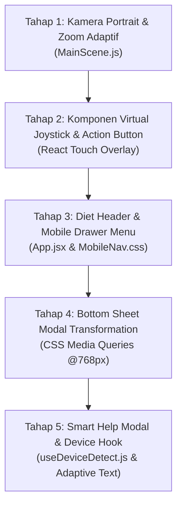

# BLUEPRINT ARSITEKTUR MOBILE-FIRST & PORTRAIT UX (DIRECTIVE v4.9)
**SISTEM:** CHIBIREX VIRTUAL HQ — LIVING OFFICE ECOSYSTEM  
**STATUS DOKUMEN:** FULL PROJECT AUDIT & MOBILE ARCHITECTURE BLUEPRINT  
**TARGET IMPLEMENTASI:** AI Coding Assistant (Claude 3.5 Sonnet / Daffa) & Mobile UX Architect  
**TANGGAL AUDIT:** 25 Oktober 2026  
**VERSI DOKUMEN:** v1.0.0 (Master Blueprint)

---

## 1. EXECUTIVE SUMMARY & HASIL AUDIT MENYELURUH

Aplikasi **Virtual HQ ChibiRex** telah berhasil mencapai status *Desktop Fullscreen Sejati* pada Directive v4.7 dan v4.8. Namun, saat diakses melalui perangkat seluler (smartphone dalam orientasi **Portrait / Vertikal** dengan lebar layar 360px – 430px), audit komprehensif kami menemukan serangkaian tantangan visual dan interaksi kritis:

1. **Header Overflow Severity (Lebar Kebutuhan: ~1305px vs Layar Mobile: ~390px):**
   Header Desktop saat ini menampung 9 elemen horizontal (Logo, Title, Store Switcher, Central Status Badge, API Status, Date Capsule, Proximity Badges, Rexa Chat Button, Doni Hub Button). Pada layar smartphone, elemen-elemen ini bertumpuk secara kacau (*element collision*), terpotong, atau saling menimpa.
2. **Ketiadaan Input Sentuh (Touch Input Void):**
   Game sepenuhnya bergantung pada keyboard fisik (`WASD`, panah, dan tombol `E`). Pengguna smartphone tanpa keyboard fisik tidak memiliki cara untuk menggerakkan avatar ataupun memicu interaksi proximity.
3. **Penyempitan Ruang Pandang Portrait (The "Toilet Paper Roll" Effect):**
   Formula kamera zoom saat ini (`Math.max(zoomX, zoomY) * 1.05`) mengutamakan dimensi terbesar. Pada layar vertikal tinggi (rasio 9:16), zoom terkunci di angka ekstrem ~1.73x. Akibatnya, pada layar selebar 390px, pemain hanya melihat ~7 tile (225px) dari total 24 tile lebar kantor. Meja Rexa, Meja Manajer, dan NPC di sisi kiri/kanan menjadi tidak terlihat.
4. **Modal Desktop yang Kaku (Rigid Centered Modals):**
   Seluruh modal dialog dirancang sebagai kotak melayang di tengah layar (`maxWidth: 680px`). Pada mobile, layout ini terasa sempit, sulit dijangkau oleh jempol, dan data tabel DuckDB (80 toko) terpotong.

### Visi Transformasi Mobile-First:
Membangun pengalaman simulasi kantor seluler yang **alami untuk dua jempol (The Ergonomic Thumb Zone)**, **bebas distorsi**, dan **100% tanpa kehilangan fitur (Zero Feature Loss)** melalui 5 Pilar Arsitektur di bawah ini.

---

## 2. PILAR 1: "DIET HEADER" & MOBILE RESPONSIVE NAVBAR

### 2.1. Audit & Perbandingan Layout Header (Desktop vs Mobile)

```
┌─────────────────────────────────────────────────────────────────────────────────────────────────────────────────────────────┐
│ DESKTOP HEADER (> 768px): Membutuhkan ~1305px Lebar Horizontal (Sangat Lebar)                                              │
│ [🦖 CHIBIREX HQ v2.0 | 🏬 STORE #74 PAENTMARWY ▼ GANTI]  [● STANDBY]  [● API :8000 | 📅 31 Des | 📱 Chat [C] | 🏃 Doni Hub] │
└─────────────────────────────────────────────────────────────────────────────────────────────────────────────────────────────┘

                                             ▼ DITRANSFORMASIKAN MENJADI ▼

┌─────────────────────────────────────────────────────────────────────────────┐
│ MOBILE NAVBAR (< 768px Portrait): Ramping, 48px Tinggi, Bersih              │
│ [🦖 CHIBIREX · #74]               [📅 31 Des]              [ ☰ MENU ]       │
└─────────────────────────────────────────────────────────────────────────────┘
```

### 2.2. Spesifikasi "Diet Header" pada Layar Mobile (< 768px)
Elemen yang dipertahankan di bar navigasi atas mobile:
1. **Sisi Kiri:**
   * Ikon 🦖 ChibiRex (28×28px).
   * Tipografi ringkas: `CHIBIREX`.
   * Mini Store Pill: `🏬 #74` (dapat diklik untuk langsung membuka Regional Command).
2. **Sisi Tengah:**
   * Kapsul Tanggal ringkas: `📅 31 Des` (menampilkan tanggal aktif Time Engine).
3. **Sisi Kanan:**
   * **Tombol Hamburger Menu `[ ☰ ]`** (38×38px, cyber-glass button dengan indikator status dot krisis jika ada ancaman aktif).

---

### 2.3. Mobile Cyber-Drawer (Off-Canvas Menu Sheet)
Ketika tombol `[ ☰ ]` ditekan oleh pemain, sebuah panel samping elegan (*slide-out drawer*) atau *top-dropdown panel* muncul dengan animasi spring halus (`backdrop-filter: blur(20px)`), menampung seluruh fitur utilitas yang dipindahkan dari desktop:

* **Seksi Identitas Toko & Wilayah:**
  * Menampilkan nama kota lengkap: `Store #74 — PAENTMARWY (Jawa Barat)`.
  * Tombol `[ Ganti Cabang (80 Cabang DuckDB) ]` yang memicu `<RegionalDashboardModal />`.
* **Seksi Status Operasional Kantor:**
  * Central Status Badge lengkap (`● STANDBY`, `⚡ REXA IN PATROL`, `📋 REVIEW PO`, `🚨 KRISIS AKTIF`).
  * Status Konektivitas REST API ChibiRex (`● API :8000 Online`).
* **Seksi Pintasan Fitur Cepat:**
  * Tombol Pintasan `📱 Buka Rexa Smartphone Copilot`.
  * Tombol Pintasan `🏃 Akses Emergency Doni Hub`.
  * Tombol Pintasan `⏳ Kontrol Waktu (+1H, +7H, Reset)`.
  * Tombol Pintasan `⌨️ Panduan Kontrol & Pintasan (X)`.

---

## 3. PILAR 2: "THE THUMB ZONE" (VIRTUAL JOYSTICK & SMART ACTION)

### 3.1. Ergonomi Alami Dua Jempol (The Natural Mobile Grip)
Pada genggaman smartphone satu atau dua tangan, area jangkauan jempol paling nyaman (*The Thumb Zone*) berada di **sepertiga bawah layar**.

```
┌──────────────────────────────────────────────────┐
│ [         DIET HEADER (48px)                   ] │
│                                                  │
│                                                  │
│            CANVAS VIEWPORT KANTOR                │
│                                                  │
│                                                  │
│                                                  │
│                                                  │
│ ┌──────────────────────┐  ┌────────────────────┐ │
│ │  ( VIRTUAL JOYSTICK) │  │ (CONTEXTUAL ACTION)│ │
│ │   [ JEMPOL KIRI ]    │  │  [ JEMPOL KANAN ]  │ │
│ │  Gerak 360° Bebas    │  │  Tombol Pintar 'E' │ │
│ └──────────────────────┘  └────────────────────┘ │
└──────────────────────────────────────────────────┘
```

---

### 3.2. Spesifikasi Teknis Virtual Joystick (Jempol Kiri)
Virtual Joystick dirancang sebagai overlay HTML5/React modern transparan yang mengapung di atas kanvas Phaser:
* **Posisi:** `position: absolute; bottom: 36px; left: 24px; z-index: 45;`
* **Base (Lingkaran Luar):**
  * Diameter: `110px`.
  * Desain: Lingkaran kaca gelap (`rgba(15, 23, 42, 0.45)`), border `1.5px solid rgba(56, 189, 248, 0.3)`, efek glow halus saat disentuh.
* **Knob (Handle Dalam):**
  * Diameter: `48px`.
  * Desain: Gradien neon cyan/indigo (`linear-gradient(135deg, #38bdf8 0%, #6366f1 100%)`), bayangan `0 0 16px rgba(56, 189, 248, 0.6)`.
* **Logika Perhitungan Fisika (`EventBus.emit('player-virtual-joystick-move')`):**
  * Mendeteksi sentuhan multi-touch (`pointerdown`, `pointermove`, `pointerup`).
  * Menghitung vektor delta $(dx, dy)$ dan jarak $dist = \sqrt{dx^2 + dy^2}$.
  * Membatasi jarak pergeseran knob maksimal $R = 40\text{px}$.
  * Menghitung sudut rotasi $\theta = \text{atan2}(dy, dx)$.
  * Menghitung kecepatan proporsional:
    $$vx = \cos(\theta) \times \text{PLAYER\_SPEED} \times \min(1, \frac{dist}{R})$$
    $$vy = \sin(\theta) \times \text{PLAYER\_SPEED} \times \min(1, \frac{dist}{R})$$
  * Di `MainScene.js`, kecepatan ini langsung diterapkan pada `this.player.setVelocity(vx, vy)`.
  * Saat sentuhan dilepas, knob kembali ke $(0, 0)$, kecepatan menjadi $(0, 0)$, dan karakter memainkan animasi idle sesuai arah hadap terakhir.

---

### 3.3. Spesifikasi Teknis Contextual Smart Action Button (Jempol Kanan)
Sebagai pengganti tombol fisik `E` pada keyboard, tombol aksi pintar ditempatkan di jangkauan jempol kanan:
* **Posisi:** `position: absolute; bottom: 36px; right: 24px; z-index: 45;`
* **Dimensi:** Lingkaran besar `68 × 68 px` (sangat nyaman ditekan tanpa perlu melihat layar).
* **Karakteristik Kontekstual Dinamis:**

| Jarak ke Target (< 50px) | Label Tombol | Warna & Efek Visual | Tindakan saat Ditekan |
| :--- | :--- | :--- | :--- |
| **Tidak ada target (Default)** | `STANDBY`<br>`⚡` | Redup (`opacity: 0.35`), Slate gelap, tanpa glow | Memberikan haptic feedback ringan / info singkat |
| **Dekat Meja Rexa** | `ANALISIS`<br>`🦖` | Amber menyala (`#fbbf24`), Pulse Glow | Memicu Analisis Toko AI & Draft PO |
| **Dekat Meja Manajer** | `REVIEW PO`<br>`📋` | Cyan menyala (`#38bdf8`), Pulse Glow | Membuka Review PO SAP S/4HANA |
| **Dekat Smart TV** | `INSPEKSI`<br>`📺` | Ungu futuristik (`#c084fc`), Neon Glow | Membuka Regional Dashboard 80 Cabang |
| **Dekat Doni (Koordinator)** | `DONI HUB`<br>`🚨` | Merah darurat (`#ef4444`), Strobe Glow | Membuka Crisis Command Hub |
| **Dekat Staf (Maya, Citra, dll)**| `DIALOG`<br>`💬` | Emerald menyala (`#34d399`), Soft Glow | Membuka Dialog Audit Cepat Staf |
| **Dekat Mesin Kopi** | `SEDUR KOPI`<br>`☕`| Cokelat Amber (`#f59e0b`), Warm Glow | Menyeduh Espresso (Fokus +100%) |
| **Dekat Kursi Rapat / Kerja** | `DUDUK`<br>`🪑` | Sky Blue (`#38bdf8`), Soft Glow | Duduk di Kursi (atau "BANGKIT" jika duduk) |

> [!TIP]
> **Zero Learning Curve:** Tombol ini otomatis memicu event yang sama persis dengan penekanan tombol `E` di desktop. Pemain seluler cukup berjalan mendekati objek dan menekan satu tombol besar bercahaya ini.

---

## 4. PILAR 3: BOTTOM SHEET MODAL TRANSFORMATION

### 4.1. Filosofi Desain Bottom Sheet
Pada desktop, modal mengambang di tengah layar terlihat pas. Namun pada layar smartphone yang tinggi dan sempit, **Bottom Sheet** adalah standar industri tertinggi (digunakan oleh iOS Apple Maps, Spotify, Grab, Gojek).

```
┌──────────────────────────────────────────────────────────┐
│ [Latar Belakang Game Blur: rgba(5, 8, 18, 0.7)]          │
│                                                          │
│ ┌──────────────────────────────────────────────────────┐ │
│ │                     [── HANDLE BAR ──]               │ │
│ │ 🏢 REGIONAL COMMAND CENTER (80 TOKO)             [✕] │ │
│ │ 🔍 [Cari ID Toko, Kota, atau Region...]              │ │
│ │ ──────────────────────────────────────────────────── │ │
│ │ [KONTEN SCROLLABLE]:                                 │ │
│ │ • Store #74 PAENTMARWY - Rp 112.4M [Buka Pengawasan] │ │
│ │ • Store #1  JAKARTA PUSAT - Rp 98.1M [Buka Pengawas] │ │
│ │ • Store #2  SURABAYA BARAT - Rp 87.4M [Buka Pengawa] │ │
│ │                                                      │ │
│ └──────────────────────────────────────────────────────┘ │
└──────────────────────────────────────────────────────────┘
```

---

### 4.2. Aturan CSS Terpadu (Mobile Media Query `@media (max-width: 768px)`)

Untuk seluruh modal (`HelpControlsModal`, `ApprovalModal`, `NPCDialogModal`, `RegionalDashboardModal`, `TimeSimulationModal`, `CrisisCommandModal`):

```css
@media (max-width: 768px) {
    /* 1. Ubah Overlay agar menempel ke dasar layar */
    .modal-overlay,
    .help-modal-overlay,
    .npc-dialog-backdrop,
    .regional-modal-overlay {
        align-items: flex-end !important; /* Dorong kartu ke bawah */
        padding: 0 !important;
    }

    /* 2. Transformasi Kartu Modal menjadi Bottom Sheet */
    .modal-card,
    .help-modal-card,
    .npc-dialog-card,
    .regional-modal-card {
        width: 100% !important;
        max-width: 100% !important;
        height: auto !important;
        max-height: 86vh !important; /* Tutupi maksimal 86% layar agar bagian atas tetap terlihat */
        border-bottom-left-radius: 0 !important;
        border-bottom-right-radius: 0 !important;
        border-top-left-radius: 22px !important;
        border-top-right-radius: 22px !important;
        border-left: none !important;
        border-right: none !important;
        border-bottom: none !important;
        animation: slideUpBottomSheet 0.28s cubic-bezier(0.16, 1, 0.3, 1) !important;
    }

    /* 3. Handle Bar Interaktif */
    .bottom-sheet-handle {
        display: block !important;
        width: 44px;
        height: 5px;
        background: rgba(148, 163, 184, 0.4);
        border-radius: 9999px;
        margin: 8px auto 4px auto;
    }
}

@keyframes slideUpBottomSheet {
    from {
        transform: translateY(100%);
    }
    to {
        transform: translateY(0);
    }
}
```

---

### 4.3. Penanganan Khusus Tabel Data DuckDB (Regional Command)
Pada `RegionalDashboardModal.jsx`, terdapat tabel perbandingan inventaris dan omzet 80 toko.
* **Strategi Responsif Mobile:**
  1. Kontainer tabel dibungkus dengan `-webkit-overflow-scrolling: touch; overflow-x: auto;`.
  2. Kolom sekunder yang tidak krusial (seperti *Variance Ratio* atau *Safety Stock Gap*) disembunyikan otomatis pada viewport `< 640px`.
  3. Menyediakan mode tampilan **"Card List View"** alternatif pada mobile di mana setiap toko ditampilkan sebagai kartu sentuh ringkas (*touch-friendly card*).

---

## 5. PILAR 4: ADAPTIVE CAMERA ZOOM (PORTRAIT VISION)

### 5.1. Analisis Krisis Aspek Rasio
* **Dimensi Peta Kantor Fisik:** $768\text{ px} \times 512\text{ px}$ (Rasio: $1.50$ Landscape).
* **Layar Desktop (16:9):** Lebar besar ($1920\text{px}$), tinggi cukup ($1080\text{px}$). Aspek Rasio: $1.77$.
* **Layar Smartphone Portrait (9:16 / 9:19.5):** Lebar sempit ($390\text{px}$), tinggi panjang ($844\text{px}$). Aspek Rasio: $0.46$.

#### Mengapa Rumus Saat Ini Gagal Total di Mobile?
Formula saat ini:
$$\text{targetZoom} = \max\left(\frac{W_{\text{viewport}}}{768}, \frac{H_{\text{viewport}}}{512}\right) \times 1.05$$
Pada iPhone 14 Pro ($390 \times 844\text{px}$):
* $\frac{390}{768} = 0.507$
* $\frac{844}{512} = 1.648$
* $\text{calculatedZoom} = \max(0.507, 1.648) = 1.648$
* $\text{targetZoom} = 1.648 \times 1.05 = \mathbf{1.73x}$!

Pada zoom **$1.73x$** dengan lebar layar hanya **$390\text{px}$**, lebar dunia game yang tampak adalah:
$$\text{Lebar Terlihat} = \frac{390}{1.73} = \mathbf{225\text{ px}} \quad (\approx 7\text{ tile})$$
Pemain berdiri di tengah dan **hanya bisa melihat 7 tile ke samping**. Meja kerja di kiri dan kanan terpotong sepenuhnya!

---

### 5.2. Formula Matematis Baru: Aspect-Ratio Aware Camera Zoom

Di [`virtual_hq/src/game/scenes/MainScene.js`](file:///d:/Documents/ChibiRex/ChibiRex/virtual_hq/src/game/scenes/MainScene.js), kita perbarui `_updateResponsiveCamera`:

```javascript
_updateResponsiveCamera(width, height) {
    if (!this.cameras || !this.cameras.main) return;

    const MAP_WIDTH  = MAP_COLS * TILE_SIZE; // 768 px
    const MAP_HEIGHT = MAP_ROWS * TILE_SIZE; // 512 px

    const currentW = width || this.scale.width || (typeof window !== 'undefined' ? window.innerWidth : 960);
    const currentH = height || this.scale.height || (typeof window !== 'undefined' ? window.innerHeight : 640);
    const aspectRatio = currentW / currentH;

    let targetZoom;

    // ── KONDISI 1: MOBILE PORTRAIT / VERTIKAL (aspectRatio < 1.0) ──────────
    if (aspectRatio < 1.0) {
        // Pada layar sempit memanjang, kita WAJIB memprioritaskan lebar horizontal.
        // Target: setidaknya 15-16 tile (480px - 512px) terlihat secara horizontal
        // agar meja staf dan lorong kantor terlihat jelas bagi pemain.
        const desiredWorldWidth = Math.min(MAP_WIDTH, 512);
        const horizontalZoom = currentW / desiredWorldWidth;

        // Batasi zoom portrait antara 0.85x (HP kecil) hingga 1.25x (HP besar)
        targetZoom = Phaser.Math.Clamp(horizontalZoom, 0.85, 1.25);
    } 
    // ── KONDISI 2: DESKTOP / TABLET LANDSCAPE (aspectRatio >= 1.0) ─────────
    else {
        const zoomX = currentW / MAP_WIDTH;
        const zoomY = currentH / MAP_HEIGHT;
        const calculatedZoom = Math.max(zoomX, zoomY);
        targetZoom = Phaser.Math.Clamp(calculatedZoom * 1.05, 1.35, 2.25);
    }

    this.cameras.main.setZoom(targetZoom);
    this.cameras.main.setBounds(0, 0, MAP_WIDTH, MAP_HEIGHT);
}
```

**Hasil Transformasi Visual:**
Pada layar iPhone ($390\text{px}$), kamera mengadopsi zoom $\approx 0.95x$, memperluas area pandang horizontal menjadi $\frac{390}{0.95} = \mathbf{410\text{ px}}$ ($\approx 13$ tile). Seluruh War Room meeting, lorong, dan meja NPC langsung terlihat dengan proporsional!

---

## 6. PILAR 5: SMART HELP MODAL (ADAPTIVE TEXT & TOUCH DETECTION)

### 6.1. Custom Hook: `useDeviceDetect.js`
Sebuah utility hook baru untuk mendeteksi kapabilitas sentuh dan ukuran layar pengguna secara real-time:

```javascript
// src/utils/useDeviceDetect.js
import { useState, useEffect } from 'react';

export function useDeviceDetect() {
    const [isTouch, setIsTouch] = useState(false);
    const [isMobileScreen, setIsMobileScreen] = useState(false);

    useEffect(() => {
        const checkDevice = () => {
            const hasTouch = 
                ('ontouchstart' in window) || 
                (navigator.maxTouchPoints > 0) || 
                (window.matchMedia && window.matchMedia('(pointer: coarse)').matches);
            
            const isSmall = window.innerWidth <= 768;

            setIsTouch(Boolean(hasTouch));
            setIsMobileScreen(isSmall);
        };

        checkDevice();
        window.addEventListener('resize', checkDevice);
        return () => window.removeEventListener('resize', checkDevice);
    }, []);

    return { isTouch, isMobileScreen };
}
```

---

### 6.2. Adaptasi Teks & Panduan di `<HelpControlsModal.jsx>`

Modal panduan bantuan akan secara cerdas menyesuaikan instruksi yang ditampilkan:

#### Tampilan jika Menggunakan Desktop (Keyboard / Mouse):
* **Navigasi:** *"Gunakan tombol **WASD** atau **Tombol Panah** untuk bergerak menjelajah kantor."*
* **Interaksi:** *"Tekan tombol **E** saat berada didekat objek/rekan kerja (< 50px) untuk berinteraksi."*
* **Pintasan Cepat:** *"Tekan **X** untuk membuka panduan ini, **C** untuk smartphone chat."*

#### Tampilan jika Menggunakan Mobile / Tablet (Touchscreen):
* **Navigasi:** *"Gunakan **Virtual Joystick** transparan di sudut kiri bawah untuk bergerak bebas 360°."*
* **Interaksi:** *"Tekan **Tombol Aksi Dinamis** di sudut kanan bawah saat mendekati objek. Tombol akan menyala dan berganti label sesuai konteks (Analisis, Review, Dialog, Duduk)."*
* **Pintasan Cepat:** *"Ketuk tombol **[ ☰ ]** di pojok kanan atas untuk membuka menu utilitas, ganti cabang, dan simulasi waktu."*

---

## 7. RENCANA KERJA & ROADMAP IMPLEMENTASI (FASE EKSEKUSI v5.0)

Pekerjaan implementasi akan dibagi menjadi 5 tahap sistematis:



### Rincian Berkas yang Akan Dibuat / Dimodifikasi:
1. **Berkas Baru:**
   * `virtual_hq/src/utils/useDeviceDetect.js` (Deteksi sentuh & breakpoint seluler).
   * `virtual_hq/src/components/VirtualJoystick.jsx` (Komponen joystick sentuh analog jempol kiri).
   * `virtual_hq/src/components/SmartActionButton.jsx` (Tombol aksi pintar kontekstual jempol kanan).
   * `virtual_hq/src/components/MobileDrawerMenu.jsx` (Drawer menu pengganti overflow desktop header).
2. **Berkas Dimodifikasi:**
   * `virtual_hq/src/game/scenes/MainScene.js` (Formula zoom portrait & listener joystick movement).
   * `virtual_hq/public/style.css` (Media query styling bottom sheet & mobile full-bleed).
   * `virtual_hq/src/App.jsx` (Integrasi joystick, action button, mobile drawer, dan diet header).
   * `virtual_hq/src/components/HelpControlsModal.jsx` (Integrasi teks adaptif touch vs keyboard).

---

## 8. KRITERIA KEBERHASILAN (MOBILE ACCEPTANCE CRITERIA)

- [ ] Pada resolusi smartphone portrait (misal 390×844 px), kanvas game terisi penuh tanpa terpotong atau gepeng.
- [ ] Peta kantor terlihat luas secara horizontal (minimal 14 tile tampak) sehingga pemain dapat melihat meja kerja NPC di samping.
- [ ] Header atas ramping (tinggi 48px), tidak ada teks/badge yang tumpang tindih, dan menu drawer `[ ☰ ]` dapat dibuka dengan mulus.
- [ ] Pemain dapat menggerakkan karakter secara halus 360° menggunakan jempol kiri via Virtual Joystick.
- [ ] Tombol aksi di jempol kanan menyala otomatis saat berada didekat objek/NPC dengan label yang tepat, dan mengetuknya memicu interaksi yang identik dengan tombol `E`.
- [ ] Seluruh modal (Help, Dialog, Approval, Regional 80 Toko, Time Simulation, Krisis) muncul sebagai Bottom Sheet dari bawah layar yang ramah jempol.
- [ ] Tabel data DuckDB pada Regional Command dapat digulir horizontal tanpa merusak layout layar.
- [ ] Teks pada Help Modal otomatis menampilkan instruksi sentuh saat dibuka di perangkat mobile.
- [ ] Validasi syntax `esbuild` 0 error dan Vite dev server tetap aktif melayani `http://localhost:8080/`.

---

**STATUS DOKUMEN:** Dokumen blueprint arsitektur Mobile-First ini telah selesai disusun secara komprehensif sebagai acuan mutlak sebelum tahap penulisan kode dimulai. Menunggu arahan instruksi eksekusi resmi dari Lead Engineer!
