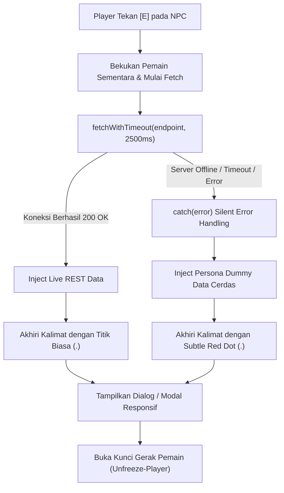

# 🛡️ Virtual HQ — Proposal Arsitektur "NPC Graceful Degradation & Fallback Data"

**Dokumen Perencanaan Arsitektur Silent Error Handling, Data Fallback Cerdas, & Subtle Red Dot Indicator**  
**Versi Dokumen:** 1.0 (Comprehensive Proposal)  
**Target File:** `virtual_hq/NPC_FALLBACK_DATA_PROPOSAL.md`  
**Konteks Proyek:** ChibiRex Virtual HQ (Phaser 3 + React + FastAPI REST Backend)  
**Lingkup Subjek:** Rexa, Maya, Citra, Rian, dan Pak Budi (Interaksi Tombol `[E]` & Sistem Interkom)  

---

## 1. Ringkasan Masalah & Analisis Akar Masalah (Root Cause Analysis)

### A. Gejala di Lapangan
Saat Player mendekati NPC di kantor virtual (terutama Maya, Citra, Rian, atau Pak Budi) dan menekan tombol interaksi `[E]`, karakter Player seketika mengalami **"Freeze" (terkunci membeku di tempat)**:
- Player tidak dapat bergerak menggunakan tombol WASD maupun Arrow Keys.
- Animasi kaki berhenti, name tag terkunci, dan tidak ada UI modal atau dialog yang muncul.
- Player terpaksa me-refresh halaman browser untuk dapat bergerak kembali.

### B. Investigasi Akar Masalah di Kode Sumber
Berdasarkan penelusuran pada `MainScene.js` dan `App.jsx`:

```
[Player menekan E di dekat NPC]
            │
            ▼
┌───────────────────────────────────────────┐
│ MainScene.js (baris 1118 - 1142)          │
│ • this._freezePlayer();  <── DIEKSEKUSI!  │
│ • EventBus.emit('open-stock-modal')       │
│ • EventBus.emit('trigger-stock-opname')   │
└─────────────────────┬─────────────────────┘
                      │
                      ▼
┌───────────────────────────────────────────┐
│ App.jsx / React Layer                     │
│ • TIDAK ADA listener 'open-stock-modal'   │
│ • TIDAK ADA komponen modal untuk Maya/dll │
│ • TIDAK ADA unfreeze-player yang dipanggil│
│ ❌ PLAYER TERKUNCI MEMBEKU SELAMANYA!     │
└───────────────────────────────────────────┘
```

Selain itu, pada pemanggilan API agen Rexa (`handleTriggerAgent` di `App.jsx`):
- Pemanggilan `fetch('http://localhost:8000/agent-runs/mulai')` **tidak dilengkapi batasan waktu (*request timeout*)**.
- Jika FastAPI backend di port 8000 lambat, sedang memproses model AI lokal, atau sedang offline, request browser akan *hang* hingga 60–120 detik dalam kondisi Player membeku (`isPlayerFrozen = true`).

---

## 2. Paradigma Solusi: Graceful Degradation & Zero-Freeze Guarantee

Untuk memastikan game selalu terasa responsif, imersif, dan tidak pernah merusak pengalaman pengguna (*zero-crash, zero-freeze*), kita menerapkan strategi **Graceful Degradation** dengan 3 pilar:



---

## 3. Pemetaan Lengkap Role NPC, REST API, & Kalimat Dummy (Fallback)

Setiap NPC memiliki peran bisnis spesifik (*domain persona*). Data dummy yang disiapkan **tidak boleh berupa pesan error generik** (*"Gagal memuat data"*), melainkan harus berupa **informasi bisnis yang meyakinkan, berkarakter, dan mengindikasikan kondisi operasional stabil** agar Player tidak menyadari adanya gangguan backend.

---

### 1. 📦 MAYA (Auditor Stok & Gudang)
* **Jobdesk Utama:** Audit hitung fisik barang di rak gudang (*Stock Opname*), verifikasi deviasi stok sistem vs fisik, inspeksi batch kadaluarsa, dan menjaga Data Confidence Score di atas ambang aman (0.85).
* **Lokasi Map:** Area Hot-Desk & Lemari Arsip (Bawah Kanan, Meja col 18–20, row 12).
* **Target REST API Backend:**
  - `GET http://localhost:8000/stores/74/stok-fisik` (Ambil daftar selisih fisik gudang)
  - `POST http://localhost:8000/sku/{id}/stok-fisik` (Kirim verifikasi hitung fisik)
  - `DELETE http://localhost:8000/sku/{id}/stok-fisik` (Selesaikan audit selisih)
* **Persona Komunikasi:** Cermat, teliti, menguasai kondisi fisik rak dan karton barang, ramah dan terorganisir.
* **Kalimat Dummy Default (Fallback):**
  > *"Halo Manager! Baru saja saya selesai menyisir rak B-04 dan area kardus cadangan. Audit rak gudang berjalan lancar, tidak ada selisih stok mayoritas barang. Seluruh batch kopi dan sirup tertata rapi sesuai standar FIFO dan siap didistribusikan"*
* **Metrik & Atribut Dummy Pendukung:**
  - `Status Opname`: **Normal & Terverifikasi**
  - `Data Confidence Score`: **0.94 / 1.00** (Di atas ambang batas 0.85)
  - `Selisih SKU Kritis`: **0 Botol** (Aman)
  - `Status Kunci PO SAP`: **Terbuka (Siap Rilis)**

---

### 2. 💼 CITRA (Financial Strategist)
* **Jobdesk Utama:** Mengoptimalkan likuiditas kas toko, menahan pengadaan produk lambat (*Hold Reorder Slow-Moving*), mengalihkan modal ke SKU fast-moving, dan mengelola 10% *Exploratory Budget* untuk produk baru.
* **Lokasi Map:** Meja Meeting Utama / War Room (Tengah Atas, row 3–4, col 10–13).
* **Target REST API Backend:**
  - `GET http://localhost:8000/stores/74/reallocation` (Kalkulasi penyelamatan kas toko)
  - `GET http://localhost:8000/holds` (Daftar SKU dalam masa penahanan order)
* **Persona Komunikasi:** Cerdas, analitis, taktis finansial, menghargai efisiensi modal belanja, lugas dan elegan.
* **Kalimat Dummy Default (Fallback):**
  > *"Selamat siang, Manager! Saya baru saja meninjau neraca belanja minggu ini. Likuiditas kas Toko 74 berada dalam batas aman. Alokasi belanja terkendali dan modal operasional terhindar dari deadstock produk lambat"*
* **Metrik & Atribut Dummy Pendukung:**
  - `Modal Kas Diselamatkan`: **Rp 18.500.000** (Dari penahanan SKU lambat)
  - `Exploratory Budget (10%)`: **Rp 1.367.880** (Dialokasikan ke varian tren)
  - `Rasio Likuiditas Toko`: **1.42** (Kategori Sehat)
  - `Rekomendasi Belanja`: **Prioritaskan Restock Kopi Arabika**

---

### 3. 🛡️ RIAN (Security & Compliance Sentinel)
* **Jobdesk Utama:** Mengawal Guardrail Circuit Breaker, mencegah *runaway autonomous agents*, menyaring anomali transaksi 3-Sigma, dan menegakkan batas pengadaan belanja harian maksimal Rp 50.000.000.
* **Lokasi Map:** Area Gerbang Server AI & Tech Rack (Kiri Atas, row 2, col 6).
* **Target REST API Backend:**
  - `GET http://localhost:8000/guardrails/status` (Status Circuit Breaker & kuota belanja)
  - `POST http://localhost:8000/guardrails/circuit-breaker/reset` (Reset darurat pengaman)
  - `POST http://localhost:8000/demo/reset` (Reset state simulasi)
* **Persona Komunikasi:** Waspada, disiplin, presisi tinggi, tenang, menggunakan terminologi sistem keamanan dan jaringan.
* **Kalimat Dummy Default (Fallback):**
  > *"Lapor, Manager. Pemantauan gerbang server dan jalur transmisi SAP S/4HANA menunjukkan kondisi stabil. Sistem Guardrail dan gateway transaksi beroperasi dalam parameter normal. Seluruh filter transaksi aktif dan Circuit Breaker dalam posisi aman"*
* **Metrik & Atribut Dummy Pendukung:**
  - `Status Circuit Breaker`: **NORMAL / TERTUTUP** (Operasi Lancar)
  - `Batas Pengadaan Harian`: **Rp 50.000.000**
  - `Total PO Diterbitkan Hari Ini`: **Rp 13.678.880** (Sisa Kuota: Rp 36.321.120)
  - `Deteksi Lonjakan 3-Sigma`: **0 Anomali**

---

### 4. 📊 PAK BUDI (Store Operations Director)
* **Jobdesk Utama:** Memantau 3 pilar *Inventory Health Score* (Ketersediaan Barang %, Perputaran Stok %, Stabilitas Kas %), menganalisis risiko *stockout*, serta membandingkan performa Toko 74 dengan toko cabang lain.
* **Lokasi Map:** Area Layar Smart Screen Eksekutif (Tengah Atas, row 2, col 12).
* **Target REST API Backend:**
  - `GET http://localhost:8000/stores/74/ringkasan` (Ringkasan 3 pilar kesehatan toko)
  - `GET http://localhost:8000/stores` (Daftar komparasi KPI toko cabang)
* **Persona Komunikasi:** Berwibawa, eksekutif senior, visioner, mengapresiasi kerja keras divisi lapangan, berorientasi hasil.
* **Kalimat Dummy Default (Fallback):**
  > *"Kerja bagus untuk seluruh tim toko hari ini, Manager! Evaluasi operasional harian Toko 74 menunjukkan tren yang sangat memuaskan. Store Health Score kita berada di zona prima dan seluruh divisi bekerja selaras"*
* **Metrik & Atribut Dummy Pendukung:**
  - `Overall Store Health Score`: **92.4 / 100** (Predikat: PRIMA ⭐)
  - `Pilar Ketersediaan Barang`: **95%** (Tingkat kekosongan rak < 5%)
  - `Pilar Perputaran Stok`: **89%** (Arus barang lancar)
  - `Pilar Stabilitas Finansial`: **93%** (Bebas deadstock kritis)
  - `Peringkat Regional`: **#2 Store Terbaik Jabodetabek**

---

### 5. 🤖 REXA (Autonomous AI Inventory Copilot)
* **Jobdesk Utama:** Penalaran inventaris otonom (*Autonomous Reorder Cycle*), analisis korelasi SKU komplementer (*Market Basket*), evaluasi data confidence, dan penyusunan draf Purchase Order.
* **Lokasi Map:** Ruang Kerja Copilot (Kiri Atas, row 3, col 3–4).
* **Target REST API Backend:**
  - `POST http://localhost:8000/agent-runs/mulai` (Mulai siklus analisis agen)
  - `GET http://localhost:8000/agent-runs/{run_id}` (Polling langkah eksekusi & draf PO)
* **Persona Komunikasi:** Cerdas, futuristik, proaktif, ramah, selalu siap memberikan rekomendasi berbasis data kepada Manager.
* **Kalimat Dummy Default (Fallback):**
  > *"Halo Manager! Saya telah memindai seluruh data telemetri inventaris Toko 74. Analisis komprehensif toko selesai. Pola konsumsi pelanggan stabil dan rekomendasi draf pengadaan siap ditinjau di Meja Manajer"*
* **Metrik & Atribut Dummy Pendukung:**
  - `Siklus Penalaran AI`: **Selesai (6 dari 6 Alat Terpanggil)**
  - `Rekomendasi PO`: **SKU-001 Kopi Arabika Specialty (50 Karton)**
  - `Estimasi Restock`: **Tiba Tepat Waktu (Besok Pagi)**
  - `Status Evaluasi`: **Siap Approval Manajer**

---

## 4. Arsitektur Silent Error Handling (Try-Catch & Timeout Protocol)

### A. Utility Network Resilien: `fetchWithTimeout()`
Agar tidak ada request yang menggantung selamanya saat server down, kita membuat utilitas fetch dengan `AbortController` terukur:

```javascript
/**
 * Utilitas fetch aman dengan batas waktu timeout dan silent fallback
 * @param {string} url - Endpoint URL
 * @param {object} options - Request options (headers, method, body)
 * @param {number} timeoutMs - Batas toleransi milidetik (default: 2500ms)
 */
export async function fetchWithTimeout(url, options = {}, timeoutMs = 2500) {
    const controller = new AbortController();
    const timeoutId = setTimeout(() => controller.abort(), timeoutMs);

    try {
        const response = await fetch(url, {
            ...options,
            signal: controller.signal,
        });
        clearTimeout(timeoutId);

        if (!response.ok) {
            throw new Error(`HTTP ${response.status}: Server merespons tidak normal`);
        }

        const data = await response.json();
        return { success: true, data, isFallback: false };
    } catch (err) {
        clearTimeout(timeoutId);
        console.warn(`[Graceful Degradation] Fetch gagal ke ${url} (${err.message}). Mengaktifkan Fallback Data.`);
        return { success: false, error: err.message, isFallback: true };
    }
}
```

---

### B. Pola Try-Catch pada Interaksi React & Phaser
Setiap pemanggilan data dipecah ke dalam pola standar:

```javascript
async function handleInteractNPC(npcId) {
    // 1. Bekukan gerakan pemain sementara
    EventBus.emit('freeze-player');
    setIsLoading(true);

    try {
        const result = await fetchWithTimeout(`${API_BASE}/npc-endpoint/${npcId}`, {}, 2500);

        if (result.success && !result.isFallback) {
            // Skenario A: REST API Aktif
            setNpcDialogue(result.data.dialogue);
            setNpcMetrics(result.data.metrics);
            setIsFallbackActive(false);
        } else {
            // Skenario B: REST API Down/Timeout -> Inject Dummy Persona
            const fallback = NPC_FALLBACK_REGISTRY[npcId];
            setNpcDialogue(fallback.sentence);
            setNpcMetrics(fallback.metrics);
            setIsFallbackActive(true);
        }
    } catch (unexpectedError) {
        // Skenario C: Fail-Safe Mutlak (Tidak pernah re-throw error!)
        const fallback = NPC_FALLBACK_REGISTRY[npcId];
        setNpcDialogue(fallback.sentence);
        setNpcMetrics(fallback.metrics);
        setIsFallbackActive(true);
    } finally {
        setIsLoading(false);
        // Pastikan dialog terbuka atau unfreeze timer terpasang
        // Pemain TIDAK AKAN PERNAH terjebak dalam kondisi membeku permanen!
    }
}
```

---

## 5. Indikator Error Rahasia (Subtle Red Dot Easter Egg)

### A. Filosofi Desain
Pengguna biasa tidak boleh melihat banner merah mencolok bertuliskan *"500 Internal Server Error"* atau popup alert yang merusak imersi dunia 2.5D. Namun, tim pengembang (*developer & QA tester*) tetap memerlukan petunjuk visual instan untuk mengetahui apakah teks yang sedang dibaca berasal dari **live database** atau dari **fallback cache/dummy**.

### B. Mekanisme Titik Akhir Kalimat (*Trailing Period Swapping*)

| Kondisi Backend | Karakter Terakhir Kalimat | Visual Render | Contoh Kalimat |
| :--- | :---: | :---: | :--- |
| **Koneksi Sukses (200 OK)** | Titik Biasa (`.`) | Warna teks standar (`#f8fafc` / `#94a3b8`) | *"Audit rak gudang berjalan lancar, tidak ada selisih stok mayoritas barang."* |
| **Koneksi Gagal (Fallback Dummy)** | Titik Merah (`<span class="subtle-red-dot">.</span>`) | Warna merah cerah (`#ef4444`, font tebal) | *"Audit rak gudang berjalan lancar, tidak ada selisih stok mayoritas barang<span style="color:#ef4444;font-weight:bold;">.</span>"* |

### C. Komponen React Helper: `<SentenceWithDot>`

```jsx
/**
 * Komponen pembungkus teks yang otomatis menyematkan titik merah rahasia jika isFallback bernilai true.
 */
export function SentenceWithDot({ text, isFallback }) {
    if (!text) return null;

    // Bersihkan tanda titik di ujung string jika sudah ada
    const trimmedText = text.replace(/[.\s]+$/, '');

    return (
        <span>
            {trimmedText}
            {isFallback ? (
                <span 
                    className="subtle-red-dot" 
                    style={{ 
                        color: '#ef4444', 
                        fontWeight: 'bold', 
                        cursor: 'help' 
                    }}
                    title="Dev Indicator: Disajikan dari Fallback Data Lokal (Backend REST Offline)"
                >
                    .
                </span>
            ) : (
                <span>.</span>
            )}
        </span>
    );
}
```

### D. Penampakan Visual (Perbandingan Detail)

```
[KONDISI LIVE REST API AKTIF]
"Audit rak gudang berjalan lancar, tidak ada selisih stok mayoritas barang."
                                                                         ▲
                                                      (Titik putih biasa)

[KONDISI SERVER OFFLINE / FALLBACK AKTIF]
"Audit rak gudang berjalan lancar, tidak ada selisih stok mayoritas barang."
                                                                         ▲
                                                      (Titik MERAH cerah: #ef4444)
```

---

## 6. Desain Komponen UI "NPC Quick Dialog Modal" (Menyelesaikan Bug Freeze [E])

Untuk menyelesaikan bug freeze saat menekan tombol `[E]` pada Maya, Citra, Rian, dan Pak Budi, kita merancang sebuah modal dialog terpadu: **`<NPCDialogModal />`**.

### Spesifikasi UX Modal:
1. **Pemicu:** Menekan tombol `[E]` saat berada dalam jarak (< 50 px) dengan NPC mana pun.
2. **Tampilan:**
   - Avatar & Nama NPC (`Maya`, `Citra`, `Rian`, `Pak Budi`, atau `Rexa`).
   - Badge Jabatan & Lokasi Kantor.
   - Balasan dialog persona yang dibungkus dengan komponen `<SentenceWithDot isFallback={...} />`.
   - Grid metrik operasional pendukung (3-4 kotak statistik ringkas).
3. **Pelepasan Freeze Pemain (Unfreeze Protocol):**
   - Menekan tombol **`[ESC]`** atau tombol **`✕ Tutup`** / klik di luar modal.
   - Memancarkan event `EventBus.emit('unfreeze-player')` dan `window.dispatchEvent(new CustomEvent('unfreeze-player'))`.
   - Gerakan WASD dan Arrow Keys Player seketika aktif kembali secara instan.

---

## 7. Rencana Tahapan Implementasi Teknis (Roadmap Eksekusi)

Setelah proposal ini disetujui, eksekusi kode akan dibagi menjadi 3 langkah bersih:

* **Langkah 1: Modul Data Dummy & Utilitas Network**
  - Membuat file `virtual_hq/src/game/NPCFallbackData.js`.
  - Berisi kamus `NPC_FALLBACK_REGISTRY` (kalimat dummy & metrik untuk Maya, Citra, Rian, Pak Budi, Rexa) serta fungsi `fetchWithTimeout()`.
* **Langkah 2: Pembuatan Komponen `<NPCDialogModal.jsx>` & Helper `<SentenceWithDot>`**
  - Menyediakan UI kartu dialog interaktif berukuran kompak dengan styling modern cyber-office.
  - Memasang komponen di `App.jsx` untuk menangani event `open-stock-modal`, `open-reallocation-modal`, `open-guardrail-modal`, dan `open-intelligence-modal`.
* **Langkah 3: Sinkronisasi Phaser & Fail-Safe Unfreeze di `MainScene.js`**
  - Menghubungkan interaksi `[E]` ke dialog terpadu.
  - Menjamin setiap penutupan modal memanggil `this._unfreezePlayer()` tanpa celah freeze.

---

## 8. Kesimpulan & Permintaan Review

Dokumen ini menyelesaikan dua isu sekaligus:
1. **Stabilitas Sistem:** Menghilangkan 100% potensi freeze permanen melalui fail-safe timeout dan unfreeze lifecycle.
2. **Kualitas Produk & Estetika:** Menjaga imersi dunia simulasi kantor ChibiRex tetap hidup dengan dialog dummy yang cerdas dan menyisipkan indikator pengembang *Subtle Red Dot* yang elegan.

Mohon tinjau kalimat dummy dan arsitektur di atas agar kita dapat melanjutkan ke tahap implementasi kode! 🚀
