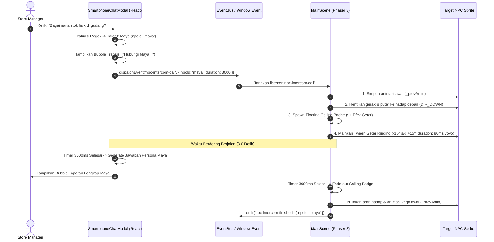

# 📞 Virtual HQ — Proposal Arsitektur & Spesifikasi "Sistem Interkom NPC" (Rexa ↔ NPC Calling System)

**Dokumen Perencanaan Arsitektur, Logika Interaksi, & Visualisasi Phaser**  
**Versi Dokumen:** 1.0 (Comprehensive Proposal)  
**Target Lokasi:** `virtual_hq/NPC_INTERCOM_PROPOSAL.md`  
**Konteks Proyek:** ChibiRex Virtual HQ (Phaser 3 + React + FastAPI REST Backend)  
**Konsep Utama:** *"Handheld Intercom Bridge"* — Saat Store Manager bertanya hal spesifik kepada Rexa Copilot melalui Smartphone Chat, Rexa secara cerdas mendeteksi domain pertanyaan, "menelepon" NPC divisi terkait secara real-time, memicu reaksi visual terpadu pada canvas game (NPC berhenti bekerja, menghadap depan, dan berdering), lalu menyajikan laporan data berbasis persona profesional masing-masing karakter.

---

## 1. Ringkasan Eksekutif & Visi Desain

Selama ini, interaksi pemain dengan NPC (Maya, Citra, Rian, Pak Budi) berlangsung melalui proximity fisik—pemain harus berjalan mendekati meja NPC lalu menekan tombol `[E]`. Sementara itu, Smartphone Chatbot (`Rexa Copilot [C]`) bertindak sebagai asisten mandiri.

**Sistem Interkom NPC** menjembatani kedua dunia ini:
1. **Dunia Chat (React UI):** Pengguna merasakan pengalaman percakapan layaknya menggunakan radio komunikasi korporat / interkom kantor eksekutif (*handheld enterprise radio*). Rexa tidak berpura-pura tahu segalanya sendirian, melainkan berkoordinasi dengan staf ahlinya di lapangan.
2. **Dunia Game 2.5D (Phaser Canvas):** Kanvas game merespons peristiwa percakapan secara dinamis (*Reactive Living Office*). Ketika Rexa menghubungi Maya, avatar Maya di layar seketika bereaksi: mengangkat kepala, menoleh, dan memunculkan animasi telepon berdering (*ringing visual feedback*).

```
┌────────────────────────────────────────────────────────────────────────────────────────┐
│                              ALUR KERJA SISTEM INTERKOM                                │
└───────────────────────────────────────────┬────────────────────────────────────────────┘
                                            │
               1. User mengirim query spesifik di Smartphone Chat [C]
                                            ▼
               2. Regex / Intent Classifier memetakan target NPC
                                            ▼
           ┌────────────────────────────────┴────────────────────────────────┐
           ▼                                                                 ▼
   [REACT SMARTPHONE UI]                                            [PHASER 3 CANVAS]
   • Rexa kirim bubble transisi:                                    • Dispatch `npc-intercom-call`
     "Tunggu sebentar, saya hubungi                                 • Target NPC hentikan idle
      [Nama NPC]..."                                                • Putar hadap depan (DIR_DOWN)
   • Typing status: 📞 Calling [NPC]...                             • Spawn Floating Phone Badge
   • Jeda simulasi waktu telepon (3.0s)                             • Jalankan Ringing Tween (-15° s/d +15°)
           │                                                                 │
           └────────────────────────────────┬────────────────────────────────┘
                                            ▼
                    3. Waktu Panggilan Selesai (3000ms)
                                            ▼
           ┌────────────────────────────────┴────────────────────────────────┐
           ▼                                                                 ▼
   [REACT SMARTPHONE UI]                                            [PHASER 3 CANVAS]
   • Pesan balasan persona masuk:                                   • Fade-out badge telepon (250ms)
     "📞 Laporan dari [Nama NPC]..."                                • Pulihkan animasi kerja awal
   • Dilengkapi data domain-grounded & tag                          • NPC kembali ke rutinitas
```

---

## 2. Pemetaan NPC & Kondisi Trigger (Keyword & Regex Matrix)

### A. Profil Tim Kantor Toko 74

| NPC | Nama & Jabatan | Domain Keahlian Utama | Data Backend yang Dikuasai | Frame Spritesheet |
| :---: | :--- | :--- | :--- | :---: |
| 🦖 | **Rexa**<br>*(AI Copilot)* | Koordinator Umum, Penalaran Multi-Langkah, Draf PO Otomatis | `/agent-runs/*`, Algoritma Reorder, Integrasi SAP | Char 1 (Frame 4) |
| 📦 | **Maya**<br>*(Inventory & Stock Auditor)* | Audit Fisik Gudang, Stock Opname, Selisih Barang, Expired | `/sku/{id}/stok-fisik`, Data Confidence Score | Char 5 (Frame 52) |
| 💼 | **Citra**<br>*(Financial Strategist)* | Arus Kas, Hold Slow-Moving, Realokasi Dana, Saving Modal | `/stores/{id}/reallocation`, `/holds`, Anggaran PO | Char 4 (Frame 49) |
| 🛡️ | **Rian**<br>*(Security & Guardrail Admin)* | Keamanan Transaksi, Circuit Breaker, Outlier, Batas PO 50Jt | `/guardrails/status`, Circuit Breaker Reset | Char 6 (Frame 55) |
| 📊 | **Pak Budi**<br>*(Store Operations Director)* | KPI Eksekutif, Store Health Score, Komparasi Toko Cabang | `/stores/{id}/ringkasan`, `/stores`, Overall Health | Char 3 (Frame 10) |
| 📋 | **Manajer Toko**<br>*(PO Approval Desk)* | Otorisasi & Rilis PO ke SAP S/4HANA OData | `/purchase-orders`, Status Antrean Approval PO | Char 2 (Frame 7) |

---

### B. Matriks Evaluasi Intent & Regex Classifier

Sistem pencocokan menggunakan pengujian ekspresi reguler berbobot (*weighted regex pattern matching*). Jika suatu pertanyaan mengandung kata kunci spesifik, pemicu interkom akan dialihkan ke NPC terkait.

| Target NPC | Bobot Prioritas | Regex Pattern Utama | Kata Kunci / Frasa Pemicu | Skenario Pertanyaan User (Contoh) |
| :---: | :---: | :--- | :--- | :--- |
| **Maya**<br>*(Gudang & Stok Fisik)* | **Tinggi** | `/(stok(\s+)?fisik\|opname\|selisih\|gudang\|hitung(\s+)?manual\|rak\|expired\|kadaluarsa\|rusak\|pecah\|cacat\|confidence(\s+)?score)/i` | `opname`, `stok fisik`, `selisih`, `gudang`, `rak`, `expired`, `kadaluarsa`, `barang rusak`, `cacat`, `confidence`, `hitung manual`, `auditor` | • *"Bagaimana hasil stok opname fisik di gudang?"*<br>• *"Kenapa ada selisih stok Sirup Hazelnut?"*<br>• *"Berapa confidence score inventori saat ini?"*<br>• *"Apakah ada barang expired di rak?"* |
| **Citra**<br>*(Finance & Cash Allocation)* | **Tinggi** | `/(alokasi\|realokasi\|anggaran\|saving\|hemat\|kas(\s+)?toko\|dana\|modal\|deadstock\|hold\|substitusi\|monin\|hazelnut\|duit\|keuangan)/i` | `realokasi`, `alokasi`, `anggaran`, `saving`, `hemat`, `kas`, `modal`, `deadstock`, `hold`, `substitusi`, `sirup`, `monin`, `hazelnut`, `efisiensi` | • *"Berapa modal yang berhasil kita hemat dari produk hold?"*<br>• *"Uang dari deadstock dialihkan ke mana saja?"*<br>• *"Bagaimana kondisi arus kas belanja hari ini?"*<br>• *"Kenapa reorder sirup hazelnut ditahan?"* |
| **Rian**<br>*(Security & Guardrail)* | **Tinggi** | `/(guardrail\|circuit(\s+)?breaker\|keamanan\|aman\|limit\|batas\|50(\s+)?(juta\|jt)\|anomali\|outlier\|tripped\|terputus\|sentinel\|rian)/i` | `guardrail`, `circuit breaker`, `keamanan`, `aman`, `limit`, `batas`, `50 juta`, `anomali`, `outlier`, `tripped`, `terkunci`, `breaker`, `sentinel` | • *"Apakah transaksi pengadaan hari ini aman?"*<br>• *"Bagaimana status circuit breaker saat ini?"*<br>• *"Berapa sisa kuota limit harian belanja toko?"*<br>• *"Apakah ada anomali transaksi yang terdeteksi?"* |
| **Pak Budi**<br>*(Store Director & KPI)* | **Sedang** | `/(health(\s+)?score\|kesehatan\|kpi\|performa\|kinerja\|toko(\s+)?74\|direktur\|ringkasan\|cabang\|target\|evaluasi\|budi)/i` | `health score`, `kesehatan`, `kpi`, `performa`, `kinerja`, `toko 74`, `ringkasan`, `cabang`, `target`, `evaluasi`, `skor`, `direktur` | • *"Bagaimana skor kesehatan toko kita minggu ini?"*<br>• *"Apa evaluasi kinerja Toko 74 menurut Pak Budi?"*<br>• *"Berapa persentase ketersediaan barang keseluruhan?"*<br>• *"Bagaimana performa toko kita dibanding cabang lain?"* |
| **Manajer Toko**<br>*(Approval Meja)* | **Sedang** | `/(meja\|approval\|persetujuan\|tanda(\s+)?tangan\|sap(\s+)?s\/?4hana\|po(\s+)?pending\|antre)/i` | `approval`, `persetujuan`, `meja`, `sap`, `s/4hana`, `po pending`, `antre`, `release` | • *"Berapa PO yang sedang menunggu tanda tangan approval?"*<br>• *"Apakah ada draf PO siap kirim ke SAP S/4HANA?"* |
| **Rexa**<br>*(Direct Copilot)* | **Fallback** | `.*` *(Semua pertanyaan umum atau sapaan)* | `halo`, `rexa`, `bantuan`, `siapa kamu`, `bisa apa`, `patroli`, dsb. | • *"Halo Rexa, apa kabar?"*<br>• *"Jelaskan apa fungsi ChibiRex"* |

> [!NOTE]
> **Aturan Multi-Match (Ambiguity Resolution):**  
> Jika pengguna mengajukan kalimat panjang yang mengandung lebih dari satu intent (contoh: *"Berapa anggaran belanja kas kita dan apakah aman dari limit guardrail?"*), sistem memprioritaskan NPC yang memiliki kemunculan kata kunci paling dominan. Jika seimbang, Rexa memanggil NPC yang paling kritis terhadap operasional (**Rian** untuk keamanan atau **Citra** untuk kas).

---

## 3. Skenario & Persona Balasan Interkom

### A. Struktur 2 Fase Percakapan Interkom

Agar pengalaman interkom terasa nyata, proses pertukaran pesan di layar Smartphone Chat dibagi menjadi dua tahapan waktu yang sinkron dengan animasi game:

#### Fase 1: Inisiasi Panggilan (*Calling Transition State*) — Detik 0 s/d 3.0
1. Begitu pengguna mengirim prompt, Rexa langsung mengeluarkan pesan respon transisi singkat:
   > *"Tunggu sebentar ya Manager, saya sambungkan ke **[Nama NPC]** di **[Nama Ruangan/Divisi]** untuk mengambil data terbarunya..."*
2. Tampilan UI Smartphone memunculkan indikator status dinamis:
   - Badge panggilan di bawah bubble: `📞 Memanggil Maya (Ruang Arsip & Gudang)...`
   - Typing indicator aktif dengan tulisan: `Menghubungkan interkom frekuensi aman...`
3. Secara simultan di canvas Phaser, event `npc-intercom-call` dikirimkan untuk memicu animasi NPC target.

#### Fase 2: Respons Sintesis & Persona (*Data Delivery State*) — Setelah Detik 3.0
Setelah delay 3 detik (sinkron dengan durasi getar telepon NPC di Phaser), bubble laporan dari NPC muncul lengkap dengan identitas badge, kutipan langsung berpersona, rincian data tabular/bullet points, dan sintesis akhir dari Rexa Copilot.

---

### B. Desain Persona & Karakteristik Bahasa Masing-Masing NPC

#### 1. Maya (Auditor Stok & Gudang Fisik)
* **Persona & Tone:** Praktis, detail, berorientasi lapangan, bicara apa adanya, sedikit lelah tapi sangat teliti perihal barang fisik di rak dan karton.
* **Kamus Istilah:** *Fisik, karton, rak B-04, stock opname, selisih 4 unit, expired date, segel rusak, audit manual, data confidence score 0.94*.
* **Contoh Dialog:**
  > **Rexa (Fase 1):** *"Tunggu sebentar Manager, saya hubungi **Maya** di meja operasional gudang..."*  
  > *(3 detik kemudian)*  
  > **Rexa (Fase 2):**  
  > *"📞 **Laporan Langsung dari Maya (Auditor Stok):**  
  > > 'Halo Rexa, halo Manager! Baru saja selesai cek rak B-04. Untuk **Sirup Hazelnut**, stok fisik di rak memang ada selisih **-4 botol** dari data sistem akibat barang retur botol pecah kemarin pagi. Data Confidence saat ini berada di **0.88** (masih di atas batas aman 0.85). Rekomendasi saya: selesaikan audit selisih di meja saya sebelum PO baru diterbitkan!'  
  >  
  > 📦 **Ringkasan Audit Maya:**  
  > • **Fisik vs Sistem**: 12 botol (fisik) vs 16 botol (sistem)  
  > • **Status Rak**: Bersih, sisa batch aman s/d Nov 2027  
  > • **Confidence**: 0.88 (Aman / Unlocked)"*  
  > `Tag: Warehouse Opname | Confidence: 98.6%`

---

#### 2. Citra (Financial Strategist & Cash Optimization)
* **Persona & Tone:** Sangat analitis, elegan, taktis, berorientasi angka moneter, berbicara dengan bahasa keuangan modern (*cash liquidity, capital preservation, ROI*).
* **Kamus Istilah:** *Working capital, deadstock prevention, suppression engine, saving Rp 5.500.000, realokasi kas, opportunity loss, exploration budget 10%*.
* **Contoh Dialog:**
  > **Rexa (Fase 1):** *"Saya hubungi **Citra** di Meja Meeting War Room untuk memverifikasi alokasi kas toko..."*  
  > *(3 detik kemudian)*  
  > **Rexa (Fase 2):**  
  > *"📞 **Laporan Keuangan dari Citra (Finance Strategist):**  
  > > 'Selamat pagi Manager! Dari sisi arus kas, penahanan PO SKU Sirup Hazelnut berhasil **menyelamatkan kas lancar sebesar Rp 5.500.000**. Dana tersebut tidak mengendap sia-sia, melainkan telah saya realokasikan 100% untuk menambah modal restock **Kopi Arabika Specialty** yang perputarannya 3.8x lebih cepat. Likuiditas toko kita minggu ini sangat sehat.'  
  >  
  > 💼 **Rincian Realokasi Finansial Toko 74:**  
  > • **Modal Diselamatkan**: Rp 5.500.000 (dari slow-moving SKU)  
  > • **Target Alokasi**: +50 Karton Arabika Specialty  
  > • **Proyeksi Margin Tambahan**: +Rp 1.450.000 dalam 14 hari"*  
  > `Tag: Cash Flow Optimized | Confidence: 99.2%`

---

#### 3. Rian (Security & Guardrail Admin)
* **Persona & Tone:** Waspada, tegas, berbasis protokol, berbicara seperti teknisi keamanan data atau perwira kepatuhan sistem (*compliance sentinel*).
* **Kamus Istilah:** *Circuit breaker NORMAL, threshold 3-sigma, anti-runaway agent, limit harian Rp 50.000.000, zero unauthorized PO, audit log green*.
* **Contoh Dialog:**
  > **Rexa (Fase 1):** *"Menghubungi konsol keamanan **Rian** di gerbang server..."*  
  > *(3 detik kemudian)*  
  > **Rexa (Fase 2):**  
  > *"📞 **Laporan Keamanan Sistem dari Rian (Guardrail Admin):**  
  > > 'Konsol Gerbang Kepatuhan online, Manager. Seluruh parameter keamanan pengadaan berstatus **HIJAU / NORMAL**. Tidak ada indikasi runaway agent dari AI. Total PO hari ini baru mencapai **Rp 13.678.880** dari kuota limit Rp 50.000.000. Circuit Breaker terkunci rapat dalam posisi operasional standar.'  
  >  
  > 🛡️ **Status Parameter Sentinel:**  
  > • **Circuit Breaker**: 🟢 **NORMAL / CLOSED**  
  > • **Batas PO Harian**: Rp 50.000.000 (Sisa Kuota: Rp 36.321.120)  
  > • **Anomaly Detector**: 0 Transaksi di luar toleransi 3-sigma"*  
  > `Tag: Security Sentinel | Confidence: 99.8%`

---

#### 4. Pak Budi (Store Operations Director)
* **Persona & Tone:** Senior eksekutif, kebapakan, suportif, berwawasan luas, fokus pada performa makro toko dan target triwulan.
* **Kamus Istilah:** *Overall Store Health Score 91.0/100, 3 pilar operasional, kepuasan pelanggan, benchmarking cabang, triwulan Q4*.
* **Contoh Dialog:**
  > **Rexa (Fase 1):** *"Menyambungkan interkom ke ruang presentasi **Pak Budi**..."*  
  > *(3 detik kemudian)*  
  > **Rexa (Fase 2):**  
  > *"📞 **Evaluasi Eksekutif dari Pak Budi (Director):**  
  > > 'Kerja bagus untuk tim Toko 74 hari ini, Manager! Berdasarkan dashboard pantauan saya di smart screen, **Store Health Score kita berada di angka 91.0 / 100** (Predikat: Prima). Ketersediaan stok mencapai 94% dan perputaran barang 88%. Tingkatkan terus sinergi antara stok fisik Maya dan alokasi kas Citra.'  
  >  
  > 📊 **Pilar Evaluasi Toko 74:**  
  > • **Ketersediaan Barang**: 94% (Sangat Baik)  
  > • **Perputaran Stok**: 88% (Lancar)  
  > • **Stabilitas Finansial**: 91% (Terlindungi)  
  > • **Peringkat Regional**: Peringkat #2 se-Jabodetabek"*  
  > `Tag: Executive KPI | Confidence: 98.4%`

---

## 4. Detail Arsitektur Teknikal & Animasi Phaser

### A. Skema Komunikasi Event-Driven (React ↔ Phaser)

Komunikasi antara modal interkom smartphone dan canvas game berjalan dua arah melalui kombinasi `EventBus` dan `window.CustomEvent`:



---

### B. Payload Spesifikasi CustomEvent

```typescript
// Event: npc-intercom-call (React -> Phaser)
interface NPCIntercomCallEvent {
    npcId: 'maya' | 'citra' | 'rian' | 'budi' | 'mgr';
    caller: 'rexa';
    duration: number; // Dalam milidetik, standar: 3000ms
    topic: string;    // Label topik, misal: 'Audit Stok Fisik'
}

// Event: npc-intercom-finished (Phaser -> React, konfirmasi animasi tuntas)
interface NPCIntercomFinishedEvent {
    npcId: 'maya' | 'citra' | 'rian' | 'budi' | 'mgr';
    timestamp: number;
}
```

---

### C. Logika Animasi & Visual di Phaser (`MainScene.js`)

Untuk mewujudkan animasi yang halus tanpa merusak struktur visual yang ada:

#### 1. Pemetaan Objek Sprite & Posisi Kepala
Setiap NPC memiliki koordinat tepat di canvas game:
```javascript
const NPC_REGISTRY = {
    maya:  { sprite: this.mayaSprite,  name: 'Maya',  prompt: this._mayaPrompt,  headYOffset: -28 },
    citra: { sprite: this.citraSprite, name: 'Citra', prompt: this._citraPrompt, headYOffset: -28 },
    rian:  { sprite: this.rianSprite,  name: 'Rian',  prompt: this._rianPrompt,  headYOffset: -28 },
    budi:  { sprite: this.budiSprite,  name: 'Budi',  prompt: this._budiPrompt,  headYOffset: -28 },
};
```

#### 2. Logika State Menghadap Depan (`DIR_DOWN`)
Saat panggilan masuk:
1. Simpan animasi berjalan saat ini: `const prevAnim = npc.sprite.anims.currentAnim?.key;`
2. Paksa sprite menghadap depan (Down): `npc.sprite.anims.play(`${npcId}-idle-down`, true);`
3. Tandai flag status: `npc._isAnsweringCall = true;`

#### 3. Konstruksi Visual Floating Calling Badge ("Telepon Berdering")
Di atas kepala NPC (koordinat `x: npc.sprite.x`, `y: npc.sprite.y + headYOffset - 12`), dibuatkan sebuah `Phaser.GameObjects.Container` berkedalaman tinggi (`depth: 100`):
* **Latar Belakang Pill:** Elips/persegi melengkung berwarna navy keemasan (`0x0f172a` dengan border `0xf59e0b` tebal 1.5px).
* **Ikon Telepon:** Teks emoji `📞` atau ikon dering yang berotasi.
* **Teks Mini:** Teks berkedip `"CALLING..."` berukuran 9px monospace tebal berwarna kuning terang (`#fef08a`).

#### 4. Formula Tween Getaran Telepon (Ringing & Vibration Tweens)
Efek getar telepon berdering dibuat menggunakan rantai tween (*tween chain*) Phaser:
```javascript
// Tween 1: Getaran Rotasi Telepon (Ringing Vibration)
this.tweens.add({
    targets: phoneBadgeIcon,
    angle: { from: -18, to: 18 },
    duration: 75,
    yoyo: true,
    repeat: -1,
    ease: 'Sine.easeInOut',
});

// Tween 2: Denyut Skala & Pantulan Halus (Scale & Bounce Pulse)
this.tweens.add({
    targets: phoneBadgeContainer,
    scaleX: 1.12,
    scaleY: 1.12,
    y: phoneBadgeContainer.y - 4,
    duration: 350,
    yoyo: true,
    repeat: -1,
    ease: 'Quad.easeInOut',
});
```

#### 5. Pembersihan & Pemulihan (Cleanup & State Recovery)
Setelah `duration` (3000ms) terlewati:
1. Jalankan tween fade-out halus pada badge: `alpha: 0` selama 250ms, lalu `badgeContainer.destroy()`.
2. Hapus getaran pada sprite: kembalikan `angle: 0` dan `scale: 1`.
3. Pulihkan animasi awal karakter: `npc.sprite.anims.play(prevAnim || `${npcId}-idle-down`, true)`.
4. Lepaskan flag status: `npc._isAnsweringCall = false;`.

---

## 5. Harmoni & Pencegahan Konflik Sistem Proximity [E]

Kantor virtual sudah memiliki sistem proximity bawaan (< 50px). Agar Sistem Interkom tidak bertabrakan dengan interaksi langsung, diterapkan aturan guardrail berikut:

```
┌────────────────────────────────────────────────────────────────────────┐
│               ATURAN PRIORITAS INTERAKSI (CONFLICT RESOLUTION)         │
└───────────────────────────────────┬────────────────────────────────────┘
                                    │
    ┌───────────────────────────────┴───────────────────────────────┐
    ▼                                                               ▼
[KONDISI A: Player Berdiri Dekat NPC]             [KONDISI B: Panggilan Berlangsung]
• Jika Player mendekat saat NPC                   • Jika NPC sedang menerima panggilan
  sedang ditelepon oleh Rexa:                       interkom dari Rexa:
  - Sembunyikan prompt biasa "[Tekan E]"            - Freeze/kunci trigger tombol [E]
  - Tampilkan prompt khusus:                        - Abaikan event buka modal reguler
    "📞 [Sedang Berbicara di Interkom]"               sampai telepon tuntas.
```

1. **Sembunyikan Prompt Proximity Sementara:**  
   Ketika NPC menerima panggilan, prompt interaksi `this._mayaPrompt`, `this._citraPrompt`, dll., otomatis disetel `.setVisible(false)` selama 3 detik pemanggilan.
2. **Kunci Eksekusi Tombol `[E]`:**  
   Pada fungsi `update()` di `MainScene.js`, tambahkan pengecekan:
   `if (npc._isAnsweringCall) return;` sebelum memicu modal reguler (seperti modal approval atau stock opname).
3. **Kamera Bebas (Non-Intrusive Camera):**  
   Kamera game tidak dipaksa melompat (*hard snap*) ke NPC target agar pemain yang sedang berjalan tetap memegang kendali penuh. Namun, indikator nama NPC dan ikon telepon dirancang cukup kontras sehingga tetap terlihat jelas jika berada dalam pandangan kamera.

---

## 6. Contoh Alur Lengkap Percakapan End-to-End

Berikut ilustrasi percakapan nyata antara Player dan Rexa dengan melibatkan sistem interkom:

```markdown
[Manager]: "Rexa, kenapa reorder Sirup Hazelnut masih ditahan dan berapa kas yang dihemat?"

[Rexa Copilot]: 
"Tunggu sebentar Manager, pertanyaan ini menyangkut kebijakan efisiensi modal. 
Saya hubungkan ke Citra (Financial Strategist) di Ruang War Room..."

[Animasi Game]: 
-> Sprite Citra (di Meja Rapat War Room) berhenti menulis.
-> Citra menoleh ke depan (DIR_DOWN).
-> Muncul badge "📞 CALLING..." bergetar di atas kepala Citra selama 3 detik.

[Rexa Copilot - 3 Detik Kemudian]:
"📞 Laporan Keuangan dari Citra (Finance):
> 'Halo Rexa, halo Manager! Penahanan SKU Sirup Hazelnut Gourmet adalah keputusan tepat. 
> Permintaannya sedang anjlok ke 0.28x normal, dan 84% pelanggan kita dengan senang hati beralih 
> ke Sirup Karamel Monin. Dari penahanan ini, kita berhasil menghemat Rp 5.500.000 modal kas lancar 
> yang langsung saya alokasikan untuk menambah stok Kopi Arabika Specialty.'

💼 Rekomendasi Finansial:
• Status: 🟢 Kas Terlindungi dari Deadstock
• Alokasi Dana: Dialihkan ke Kopi Arabika (+Rp 5.500.000)
• Margin Tambahan: +12% dibanding membiarkan sirup mengendap di gudang."

[Animasi Game]:
-> Badge telepon Citra fade-out dan menghilang.
-> Citra kembali melanjutkan aktivitas analisis dokumen di meja rapat.
```

---

## 7. Rencana Tahapan Eksekusi (Implementation Roadmap)

Setelah proposal ini disetujui, pengerjaan kode akan dieksekusi secara terukur dalam 3 tahap tanpa merusak fungsionalitas yang ada:

* **Tahap 1 — Logika Evaluasi & Transisi Chatbot (`SmartphoneChatModal.jsx`):**
  - Pembuatan kamus Regex & detektor target NPC (`detectTargetNPC(query)`).
  - Penambahan pesan transisi *"Tunggu sebentar, saya hubungi [NPC]..."*.
  - Mekanisme timer asynchronous (3000ms) untuk sinkronisasi balasan data persona.
  - Dispatch event `npc-intercom-call` ke `window` dan `EventBus`.

* **Tahap 2 — Sistem Animasi & Visual Telepon di Game (`MainScene.js`):**
  - Pendaftaran listener `npc-intercom-call` di dalam `create()`.
  - Implementasi fungsi `_playNPCIntercomAnimation(npcId, duration)`.
  - Konstruksi floating badge telepon dengan efek getar Tween (`angle`, `scale`, `yoyo`).
  - Logika pemulihan arah hadap dan animasi awal NPC setelah durasi selesai.

* **Tahap 3 — Integrasi Guardrail & Pengujian Interaksi:**
  - Penguncian prompt proximity `[E]` saat panggilan interkom berlangsung.
  - Uji coba skenario percakapan untuk seluruh 4 NPC (Maya, Citra, Rian, Pak Budi).
  - Verifikasi build produksi Vite (`npm run build`).

---

**Dokumen ini siap dijadikan acuan baku dalam pengembangan fitur Sistem Interkom NPC pada Virtual HQ.**
