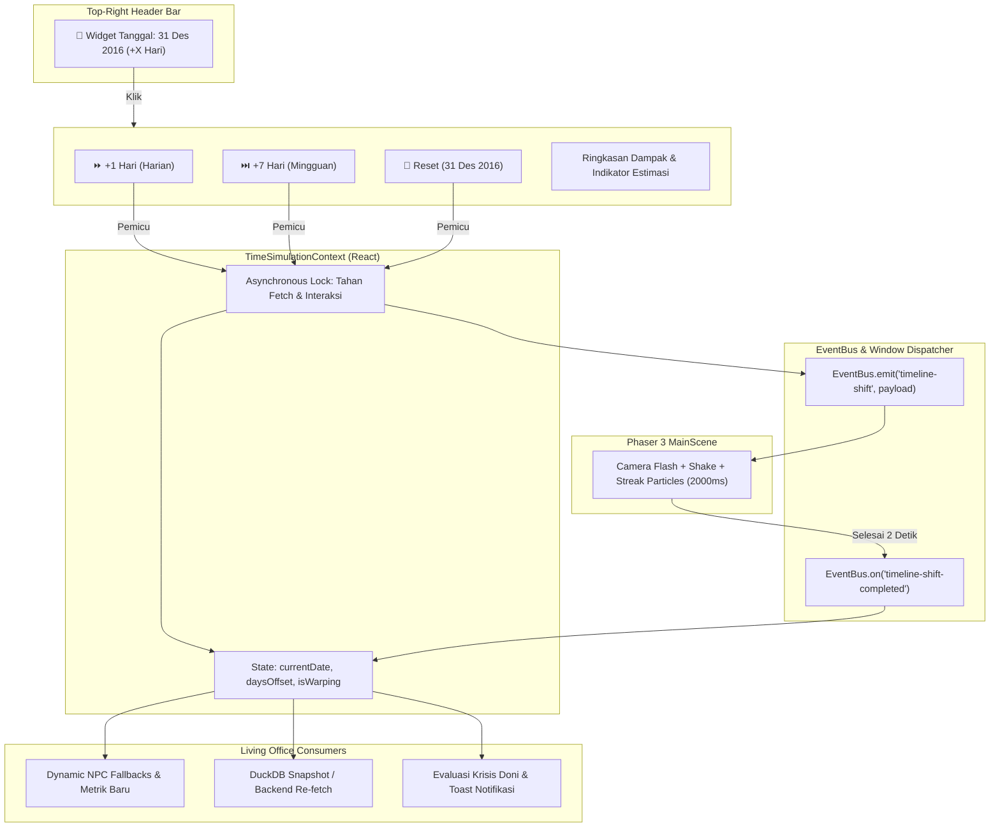
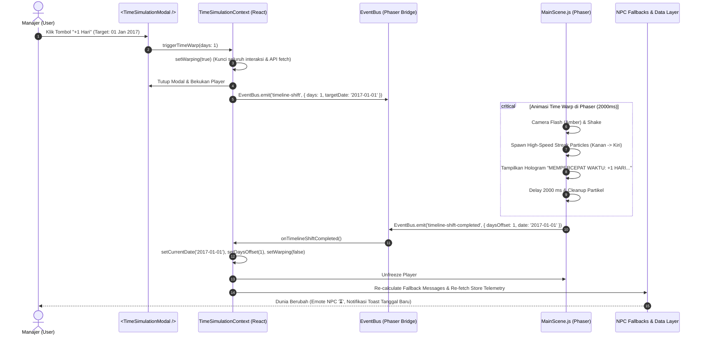
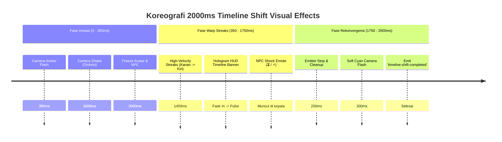

# VIRTUALWORK AI: DIRECTIVE v4.2
# TIME SIMULATION ENGINE & VFX ARCHITECTURE PROPOSAL

**Dokumen ID:** `TIME-PROP-2026-v4.2`  
**Status:** PROPOSAL / FOR ARCHITECTURAL REVIEW  
**Target Pembaca:** Lead Software Engineer (Daffa), AI Agentic Architect  
**Lingkup Modifikasi:** `virtual_hq/` (`App.jsx`, `MainScene.js`, `StoreContext.jsx`, `TimeSimulationContext.jsx`, `TimeSimulationModal.jsx`, `NPCFallbackData.js`)  
**Basis Data & Tanggal Baseline:** DuckDB ChibiRex (`data/processed/chibirex.duckdb`), Snapshot Bibitor per **31 Desember 2016** (`2016-12-31`)

---

## DAFTAR ISI
1. [Eksekutif & Latar Belakang Masalah](#1-eksekutif--latar-belakang-masalah)
2. [Pilar 1: Analisis & Arsitektur UI React (Time Engine Control)](#2-pilar-1-analisis--arsitektur-ui-react-time-engine-control)
   - [2.1 Analisis Logika Simulasi Waktu (Temporal State Model)](#21-analisis-logika-simulasi-waktu-temporal-state-model)
   - [2.2 Desain UI Header Widget (`📅 31 Des 2016`)](#22-desain-ui-header-widget--31-des-2016)
   - [2.3 Desain Komponen React `<TimeSimulationModal.jsx>`](#23-desain-komponen-react-timesimulationmodaljsx)
   - [2.4 Alur Komunikasi State & Asynchronous Warp Lock (Anti-Race Condition)](#24-alur-komunikasi-state--asynchronous-warp-lock-anti-race-condition)
3. [Pilar 2: Desain Efek Visual "Timeline Shift" di Phaser (`MainScene.js`)](#3-pilar-2-desain-efek-visual-timeline-shift-di-phaser-mainscenejs)
   - [3.1 Event Dispatcher & Listener Setup di Phaser](#31-event-dispatcher--listener-setup-di-phaser)
   - [3.2 Koreografi Efek Visual "Cahaya Bergetar & Distorsi Temporal"](#32-koreografi-efek-visual-cahaya-bergetar--distorsi-temporal)
   - [3.3 Desain Efek "Angin Kencang / Time Warp Streaks" (Anti-Lag & Zero Memory Leak)](#33-desain-efek-angin-kencang--time-warp-streaks-anti-lag--zero-memory-leak)
   - [3.4 Evaluasi Arsitektur Partikel: `ParticleEmitter` vs `Procedural Graphics Pool`](#34-evaluasi-arsitektur-partikel-particleemitter-vs-procedural-graphics-pool)
4. [Pilar 3: Sinkronisasi Data & Reaksi Living NPC](#4-pilar-3-sinkronisasi-data--reaksi-living-npc)
   - [4.1 Logika Perhitungan Konsumsi Stok Harian ($V_s$ Velocity Decay)](#41-logika-perhitungan-konsumsi-stok-harian-v_s-velocity-decay)
   - [4.2 Dinamika Dialog & Metrik Fallback Persona Per NPC Pasca-Warp](#42-dinamika-dialog--metrik-fallback-persona-per-npc-pasca-warp)
   - [4.3 Reaksi Visual & Emoticon Karakter di Dunia Game](#43-reaksi-visual--emoticon-karakter-di-dunia-game)
5. [Struktur File Baru & Modifikasi Kode](#5-struktur-file-baru--modifikasi-kode)
6. [Roadmap Eksekusi 4 Tahap](#6-roadmap-eksekusi-4-tahap)
7. [Protokol Pengujian & Validasi Kinerja](#7-protokol-pengujian--validasi-kinerja)

---

## 1. Eksekutif & Latar Belakang Masalah

Dalam ekosistem *inventory management* ChibiRex, data analitik Bibitor (`data/processed/chibirex.duckdb`) memiliki tanggal acuan akhir (*as-of date*) pada **31 Desember 2016** (`2016-12-31`). Pada arsitektur saat ini di Virtual HQ:
1. **Dunia yang Membeku dalam Waktu:** Seluruh data stok, health score, dan draf PO berada pada status statis di tanggal snapshot tersebut. Manajer tidak dapat melihat bagaimana keputusan PO dan guardrail berdampak terhadap perputaran barang dari hari ke hari.
2. **Ketiadaan Pengujian Skenario Temporal:** Untuk mendemonstrasikan keunggulan AI Rexa dan guardrail Doni, sistem memerlukan mekanisme percepatan waktu (+1 Hari untuk konsumsi harian, +7 Hari untuk evaluasi restocking mingguan) agar perubahan status stok (misal: stok menipis menjadi `REORDER`, cash balance berubah, atau alert stockout muncul) dapat diuji secara live.
3. **Kebutuhan Imersi & Pengalaman Visual (Game-Feel):** Perubahan tanggal simulasi tidak boleh sekadar berupa penggantian angka statis di UI, melainkan harus diiringi **efek visual dramatis "Timeline Shift / Time Warp"** di kanvas 2D RPG Phaser 3 (distorsi kamera, kilatan cahaya spektrum temporal, dan partikel garis kecepatan tinggi/streaks) tanpa menyebabkan penurunan frame rate (lag) atau kebocoran memori (*memory leak*).

Proposal ini merancang arsitektur **Time Simulation Engine & Timeline Shift VFX** yang menghubungkan UI React (widget kontrol & modal kalkulasi), jembatan event Phaser `EventBus`, serta re-sinkronisasi data dinamis persona NPC dan status krisis secara mulus.

---

## 2. Pilar 1: Analisis & Arsitektur UI React (Time Engine Control)



### 2.1 Analisis Logika Simulasi Waktu (Temporal State Model)

Sistem simulasi waktu dibangun di atas model matematika tanggal diskrit berbasis **UTC/WIB** dengan *epoch anchor* pada tanggal `2016-12-31`:

1. **Konstanta Acuan:**
   ```javascript
   export const BASELINE_DATE_STR = '2016-12-31';
   export const BASELINE_DATE = new Date('2016-12-31T00:00:00Z');
   ```

2. **State Global (`TimeSimulationContext`):**
   - `currentSimulatedDate`: Objek `Date` atau string format `YYYY-MM-DD` (Default: `2016-12-31`).
   - `daysOffset`: Integer penambahan hari dari baseline (Default: `0`).
   - `isWarping`: Boolean status animasi aktif (Default: `false`). Selama `isWarping === true`, seluruh pemanggilan API eksternal dan tombol pemicu baru dibekukan (*locked*).
   - `historyLog`: Riwayat lompatan waktu untuk keperluan audit manajerial.

3. **Operasi Mutasi Waktu:**
   - **`advanceTime(days)`:** Menambahkan `days` ke `daysOffset`, menghitung tanggal baru:
     $$\text{Tanggal Baru} = \text{Baseline Date} + (\text{daysOffset} + \text{days}) \times 86.400.000\text{ ms}$$
   - **`resetTimeToDefault()`:** Mengembalikan `daysOffset` menjadi `0` dan tanggal kembali ke `2016-12-31`.

4. **Helper Pemformatan Tanggal Bahasa Indonesia:**
   ```javascript
   export function formatIndonesianDate(dateInput) {
       const d = new Date(dateInput);
       const months = [
           'Jan', 'Feb', 'Mar', 'Apr', 'Mei', 'Jun',
           'Jul', 'Agu', 'Sep', 'Okt', 'Nov', 'Des'
       ];
       const day = String(d.getUTCDate()).padStart(2, '0');
       const month = months[d.getUTCMonth()];
       const year = d.getUTCFullYear();
       return `${day} ${month} ${year}`;
   }
   ```

---

### 2.2 Desain UI Header Widget (`📅 31 Des 2016`)

Widget tanggal disematkan di baris kanan atas header (`App.jsx`), sejajar dengan tag koordinat `POS` dan status `API: :8000`:

- **Tampilan Visual:**
  - Kapsul kaca futuristik (*cyberpunk glass pill*): background `rgba(15, 23, 42, 0.85)`, border amber lembut `rgba(245, 158, 11, 0.4)`.
  - Ikon kalender: `📅`.
  - Teks utama: Tanggal aktif yang diformat (misal: `31 Des 2016` atau `07 Jan 2017`).
  - Badge offset interaktif: Menampilkan `[H+0]` saat di baseline, atau `[H+1]`, `[H+7]` berwarna oranye/hijau saat waktu dimajukan.
  - Efek Hover: Border berpendar amber (`box-shadow: 0 0 12px rgba(245, 158, 11, 0.35)`), kursor pointer, dan tooltip `"Klik untuk membuka Kontrol Simulasi Waktu"`.

```jsx
{/* Wireframe Mockup Header Widget */}
<div
    onClick={handleOpenTimeModal}
    className="time-widget-pill"
    style={{
        display: 'inline-flex',
        alignItems: 'center',
        gap: '6px',
        padding: '3px 10px',
        borderRadius: '9999px',
        background: daysOffset > 0 ? 'rgba(245, 158, 11, 0.18)' : 'rgba(30, 41, 59, 0.75)',
        border: daysOffset > 0 ? '1px solid rgba(245, 158, 11, 0.6)' : '1px solid rgba(148, 163, 184, 0.25)',
        color: daysOffset > 0 ? '#fbbf24' : '#e2e8f0',
        fontSize: '11px',
        fontFamily: 'monospace',
        fontWeight: '700',
        cursor: 'pointer',
        transition: 'all 0.15s ease',
    }}
    title="Buka Kontrol Simulasi Waktu (+1 Hari, +7 Hari, Reset)"
>
    <span>📅</span>
    <span>{formatIndonesianDate(currentSimulatedDate)}</span>
    <span style={{ fontSize: '9px', padding: '1px 5px', borderRadius: '4px', background: 'rgba(0,0,0,0.3)', color: '#38bdf8' }}>
        {daysOffset === 0 ? 'BASELINE' : `+${daysOffset}H`}
    </span>
    <span style={{ fontSize: '9px', color: '#94a3b8' }}>▼</span>
</div>
```

---

### 2.3 Desain Komponen React `<TimeSimulationModal.jsx>`

Modal ini dirancang dengan gaya **Enterprise Temporal Control Hub** berukuran lebar `640px` dengan backdrop blur `14px`:

#### Wireframe Visual Layout
```text
+-----------------------------------------------------------------------------------+
|  ⏳ TEMPORAL SIMULATION ENGINE • TIMELINE ACCELERATOR                  [×] TUTUP    |
|  Status Acuan: [ 🏬 STORE #74 - PAENTMARWY ]                                      |
+-----------------------------------------------------------------------------------+
|  [ TANGGAL AKTIF SAAT INI ]                                                       |
|  📅 SENIN, 31 DESEMBER 2016                                [ HARI KE-0 (BASELINE) ] |
+-----------------------------------------------------------------------------------+
|  PILIH AKSI LOMPATAN WAKTU:                                                       |
|                                                                                   |
|  +------------------------------+   +------------------------------+             |
|  |  ⏩ +1 HARI (SIKLUS HARIAN)  |   |  ⏭️ +7 HARI (SIKLUS MINGGU) |             |
|  |  Konsumsi stok harian toko   |   |  Restocking & alokasi mingguan|             |
|  |  Target: 01 Jan 2017         |   |  Target: 07 Jan 2017         |             |
|  +------------------------------+   +------------------------------+             |
|                                                                                   |
|  +------------------------------------------------------------------------------+ |
|  |  🔄 RESET KE BASELINE (Kembali ke 31 Des 2016 / Data Original DuckDB)         | |
|  +------------------------------------------------------------------------------+ |
+-----------------------------------------------------------------------------------+
|  📊 PROYEKSI PERUBAHAN PASCA-LOMPATAN:                                            |
|  • Penurunan Stok Harian   : Est. ~180 unit/hari (berdasarkan Vs rata-rata toko) |
|  • Potensi SKU Reorder Baru: +2 s/d +5 SKU mendekati ambang batas minimum         |
|  • Kuota Guardrail SAP     : Reset kuota belanja harian per pergantian hari        |
+-----------------------------------------------------------------------------------+
|  Catatan: Selama lompatan waktu, dunia game akan memutar efek visual Time Warp.    |
|  [Tutup ESC]                                                    [Status: READY]   |
+-----------------------------------------------------------------------------------+
```

#### Komponen Utama Modal:
1. **Active Timeline Status Header:** Menampilkan tanggal simulasi saat ini, hari dalam minggu, dan selisih hari (`+daysOffset`).
2. **Action Grid Cards:** Tiga tombol aksi interaktif dengan efek hover berpendar amber/cyan.
3. **Projection Insights Card:** Memberikan proyeksi perubahan operasional sebelum Manajer mengeksekusi lompatan waktu.
4. **Warp State Overlay:** Saat tombol lompat diklik, modal menampilkan indikator transisi *"Memutar Waktu..."* sebelum menutup dan menyerahkan kendali visual ke kanvas Phaser.

---

### 2.4 Alur Komunikasi State & Asynchronous Warp Lock (Anti-Race Condition)

Salah satu risiko arsitektural terbesar adalah terjadinya *race condition*, di mana React langsung memanggil endpoint API baru saat kanvas game masih memutar animasi lompatan waktu. Hal ini dapat menyebabkan data berubah secara prematur sebelum efek visual selesai.

Untuk mengatasinya, diterapkan **Protokol Asynchronous Warp Lock (4 Langkah)**:



---

## 3. Pilar 2: Desain Efek Visual "Timeline Shift" di Phaser (`MainScene.js`)

Efek visual perpindahan waktu dirancang untuk memberikan sensasi sinematik seperti melompat melalui celah waktu (*temporal distortion / warp speed*).

### 3.1 Event Dispatcher & Listener Setup di Phaser

Di dalam fungsi `create()` pada `MainScene.js`, didaftarkan listener khusus:

```javascript
// virtual_hq/src/game/scenes/MainScene.js (Metode create)
EventBus.on('timeline-shift', (data) => this._playTimelineShiftAnimation(data), this);
window.addEventListener('timeline-shift', (e) => this._playTimelineShiftAnimation(e.detail));
```

---

### 3.2 Koreografi Efek Visual "Cahaya Bergetar & Distorsi Temporal"

Total durasi sekuens animasi adalah tepat **2000 milidetik (2,0 detik)**, dibagi ke dalam 3 fase terkoordinasi:



1. **Fase Inisiasi (0 s/d 350 ms):**
   - **Kamera Flash Spektrum Amber:**  
     `this.cameras.main.flash(350, 245, 158, 11)` (Kuning keemasan melambangkan akselerasi waktu).
   - **Kamera Shake Frekuensi Tinggi:**  
     `this.cameras.main.shake(1600, 0.007)` (Getaran halus berkecepatan tinggi yang menciptakan ilusi distorsi gravitasi/ruang waktu).
   - **Avatar Freeze:** Memastikan pemain tidak bergerak selama partikel melintas.

2. **Fase Puncak Time Warp (350 s/d 1750 ms):**
   - Garis-garis partikel transparan (*speed streaks*) melesat kencang melintasi layar dari sisi kanan ke sisi kiri.
   - Di tengah layar, dimunculkan banner teks hologram transparan:  
     `"⚡ DISTORSI TEMPORAL: +${days} HARI (${formattedDate})"`
   - Emote gelembung temporal (`⏳` atau `⚡`) di-spawn di atas kepala seluruh NPC.

3. **Fase Rekonvergensi & Pendaratan (1750 s/d 2000 ms):**
   - Partikel berhenti di-spawn dan partikel aktif meluncur keluar layar.
   - **Kamera Flash Lembut Cyan:**  
     `this.cameras.main.flash(300, 56, 189, 248)` (Biru cyan melambangkan kembalinya stabilisasi telemetri ke masa sekarang).
   - Pembersihan memori total (`destroy`) seluruh objek partikel.
   - Pengiriman sinyal penyelesaian `EventBus.emit('timeline-shift-completed')`.

---

### 3.3 Desain Efek "Angin Kencang / Time Warp Streaks" (Anti-Lag & Zero Memory Leak)

Garis-garis partikel transparan (*speed lines / streaks*) harus memberikan ilusi angin kencang atau warp hyper-drive, namun **wajib memiliki footprint memori mendekati nol** agar performa pada browser laptop kantor tetap berada pada 60 FPS stabil.

#### Spesifikasi Garis Partikel (Streaks):
- **Arah Gerak:** Sisi Kanan layar ($X \approx 980$) melesat lurus ke Sisi Kiri layar ($X < -100$).
- **Kecepatan Horizontal ($V_x$):** Ekstrim negatif, berkisar antara `-900 px/s` hingga `-1600 px/s`.
- **Variasi Vertikal ($Y$):** Tersebar acak merata di seluruh ketinggian viewport ($Y: 0$ hingga $540$).
- **Dimensi Fisik:** Sangat tipis secara vertikal (`1 px` s/d `2 px`) dan memanjang horizontal (`40 px` s/d `140 px`) untuk meniru efek *motion blur*.
- **Warna & Transparansi:** Spektrum Cyan-Gold (`#38bdf8`, `#fbbf24`, `#ffffff`), alpha `0.35` s/d `0.85` dengan mode `BLEND_ADD` (efek cahaya menyala).

---

### 3.4 Evaluasi Arsitektur Partikel: `ParticleEmitter` vs `Procedural Graphics Pool`

Dua opsi arsitektur teknis dianalisis secara mendalam untuk memilih solusi paling aman terhadap memori:

| Parameter Evaluasi | Opsi A: `Phaser.GameObjects.Particles` | Opsi B: `Procedural Graphics Pool` |
| :--- | :--- | :--- |
| **Mekanisme Rendering** | GPU WebGL Batching (1 Draw Call) | CPU Canvas / Batch DrawPath Loop |
| **Pencegahan Memory Leak** | Membutuhkan explicit `emitter.stop()` dan `destroy()` | Membutuhkan loop pooling array manual |
| **Kinerja CPU pada 60 FPS** | Sangat Ringan (< 1% CPU, ditangani GPU) | Sedang (Perhitungan $X$ per frame di CPU) |
| **Visual Quality & Motion Blur** | Sangat Halus (Native particle life & alpha interpolation) | Terpatah-patah jika frame drop |
| **Ketergantungan Aset Gambar** | Membutuhkan texture 1x1 atau `textures.generate` | Murni `this.add.graphics()` tanpa tekstur |

#### Keputusan Desain & Rekomendasi Arsitektur:
Kami merekomendasikan **Pendekatan Hybrid Terproteksi (Opsi A dengan Programmatic 1x1 Texture + Auto-Cleanup Timer)**:

1. **Pembuatan Tekstur Programatik:** Menggunakan 1 piksel putih programatik tanpa memuat file PNG eksternal:
   ```javascript
   if (!this.textures.exists('warp_streak_pixel')) {
       const canvas = document.createElement('canvas');
       canvas.width = 4;
       canvas.height = 2;
       const ctx = canvas.getContext('2d');
       ctx.fillStyle = '#ffffff';
       ctx.fillRect(0, 0, 4, 2);
       this.textures.addCanvas('warp_streak_pixel', canvas);
   }
   ```
2. **Konfigurasi Emitter Ringan (Maksimal 60 Partikel Aktif):**
   ```javascript
   const emitter = this.add.particles(cameraWidth + 20, 0, 'warp_streak_pixel', {
       y: { min: 0, max: cameraHeight },
       speedX: { min: -1100, max: -1800 },
       speedY: { min: -10, max: 10 },
       scaleX: { min: 15, max: 40 }, // Menghasilkan efek garis panjang (60px - 160px)
       scaleY: { min: 0.8, max: 1.5 },
       alpha: { start: 0.9, end: 0 },
       tint: [0x38bdf8, 0x818cf8, 0xfbbf24, 0xffffff],
       blendMode: 'ADD',
       lifespan: { min: 600, max: 900 },
       frequency: 18, // Hanya spawn ~50 partikel per detik
       maxParticles: 90,
   });
   emitter.setDepth(999);
   ```
3. **Protokol Pembersihan Memori Mutlak (Anti-Leak Guarantee):**
   ```javascript
   // Hentikan emisi pada 1600ms agar partikel terakhir sempat menghilang di kiri layar
   this.time.delayedCall(1600, () => {
       if (emitter && emitter.active) emitter.stop();
   });

   // Hancurkan objek partikel secara total dari memori Phaser pada 2000ms
   this.time.delayedCall(2000, () => {
       if (emitter) {
           emitter.stop();
           emitter.destroy();
       }
   });
   ```

---

## 4. Pilar 3: Sinkronisasi Data & Reaksi Living NPC

### 4.1 Logika Perhitungan Konsumsi Stok Harian ($V_s$ Velocity Decay)

Ketika waktu melompat $\Delta t$ hari (misal $+1$ atau $+7$ hari), inventaris di toko yang aktif (`currentStore`) secara realistis mengalami konsumsi operasional:

$$\text{Stok Akhir}(t + \Delta t) = \max\left(0, \text{Stok}(t) - \left\lceil V_s \times \Delta t \right\rceil\right)$$

- **Laju Konsumsi ($V_s$):** Diambil dari rata-rata penjualan harian per SKU pada toko tersebut.
- **Transisi Status Stok:**
  - SKU dengan stok di atas Reorder Point ($ROP$) $\rightarrow$ Menurun mendekati $ROP$.
  - SKU di ambang batas $ROP$ $\rightarrow$ Beralih status menjadi **`REORDER`**.
  - SKU yang sudah `REORDER` $\rightarrow$ Kehabisan stok (*Stockout / Kritis*).

---

### 4.2 Dinamika Dialog & Metrik Fallback Persona Per NPC Pasca-Warp

Sistem fallback persona (`getNPCFallback`) di [NPCFallbackData.js](file:///d:/Documents/ChibiRex/ChibiRex/virtual_hq/src/utils/NPCFallbackData.js) akan diperluas untuk menerima parameter `daysOffset`:

```javascript
getNPCFallback(npcId, storeId, storeCity, daysOffset = 0)
```

Perubahan respons dialog & metrik secara spesifik:

#### 1. Maya (Warehouse Auditor & Opname Fisik):
- **Baseline (H+0):** Opname fisik FIFO terverifikasi, 0 selisih stok kritis.
- **H+1 (Lompat 1 Hari):**
  - *Dialog:* *"Halo Manager! Dalam 24 jam terakhir per 01 Jan 2017, terjadi mutasi keluar 184 unit stok di Toko 74. Opname harian mencatat 2 SKU memerlukan verifikasi batch."*
  - *Metrik:* `Status Opname: 2 Perlu Verifikasi` (Kuning), `Data Confidence: 0.91 / 1.00`.
- **H+7 (Lompat 1 Minggu):**
  - *Dialog:* *"Manager, akumulasi operasional 7 hari per 07 Jan 2017 menunjukkan variansi stok fisik vs sistem pada 7 SKU akibat tingginya perputaran rak. Verifikasi opname mingguan disarankan segera."*
  - *Metrik:* `Status Opname: 7 Perlu Verifikasi` (Merah muda), `Data Confidence: 0.84 / 1.00`, `Selisih Kritis: 7 SKU`.

#### 2. Citra (Treasury & Cash Reallocation):
- **Baseline (H+0):** Kas diselamatkan Rp 18.500.000, likuiditas stabil.
- **H+1 (Lompat 1 Hari):**
  - *Dialog:* *"Selamat siang, Manager! Evaluasi likuiditas harian per 01 Jan 2017 menunjukkan perputaran modal lancar. Kas aman di angka Rp 21.300.000 berkat pembekuan PO deadstock."*
  - *Metrik:* `Kas Diselamatkan: Rp 21.300.000`, `Rasio Likuiditas: 1.45 (Sehat)`.
- **H+7 (Lompat 1 Minggu):**
  - *Dialog:* *"Manager, penutupan neraca mingguan per 07 Jan 2017 berhasil mengamankan Rp 38.600.000 dari risiko pembelian inventaris lambat. Exploratory budget 10% siap dialokasikan untuk siklus belanja minggu depan."*
  - *Metrik:* `Kas Diselamatkan: Rp 38.600.000`, `Exploratory Budget: 10% (Siap Alokasi)`.

#### 3. Rian (Security & SAP Guardrail Sentinel):
- **Baseline (H+0):** Kuota harian terpakai parsial, Circuit Breaker Normal.
- **H+1 (Lompat 1 Hari):**
  - *Dialog:* *"Sistem aman, Manager. Memasuki hari baru 01 Jan 2017, kuota transaksi PO harian SAP S/4HANA telah di-refresh ke Rp 50.000.000. Gateway integrasi stabil."*
  - *Metrik:* `Batas PO Harian: Rp 50.000.000`, `Sisa Kuota Belanja: Rp 50.000.000 (Full Reset)`.
- **H+7 (Lompat 1 Minggu):**
  - *Dialog:* *"Laporan audit mingguan keamanan 07 Jan 2017: 0 insiden anomali 3-sigma terdeteksi selama 7 hari siklus. Circuit breaker tetap dalam status siaga proteksi penuh."*
  - *Metrik:* `Anomali 7 Hari: 0 Terdeteksi`, `Sisa Kuota Belanja: Rp 44.150.000`.

#### 4. Pak Budi (Regional Executive Intelligence):
- **Baseline (H+0):** Store Health Score 92.4 / 100, Peringkat #2 Regional.
- **H+1 (Lompat 1 Hari):**
  - *Dialog:* *"Evaluasi harian 01 Jan 2017 untuk Toko 74: Ketersediaan rak bertahan pada 94% dengan skor kesehatan 91.8. Kinerja harian tim berada di koridor optimal."*
  - *Metrik:* `Store Health Score: 91.8 / 100`, `Ketersediaan Rak: 94%`.
- **H+7 (Lompat 1 Minggu):**
  - *Dialog:* *"Perhatian Manager! Tinjauan mingguan per 07 Jan 2017 mendeteksi penurunan ketersediaan rak menjadi 88% akibat 5 SKU mencapai titik reorder kritis. Segera terbitkan PO baru agar skor kesehatan tidak anjlok ke zona bahaya!"*
  - *Metrik:* `Store Health Score: 87.5 / 100` (Kuning peringatan), `Ketersediaan Rak: 88%`, `Peringkat Regional: #4 Regional`.

---

### 4.3 Reaksi Visual & Emoticon Karakter di Dunia Game

Agar kantor benar-benar terasa responsif terhadap waktu yang melompat:
1. **Emote Temporal Bubbles (`⏳` / `⚡`):**
   - Saat efek Time Warp melintas, sebuah ikon gelembung balon melayang di atas kepala Maya, Citra, Budi, Rian, dan Rexa selama 1800 ms.
2. **Toast Banner Notifikasi Dunia Game:**
   - Setelah lompatan waktu tuntas, muncul toast bar di pojok kiri bawah kanvas game:  
     `"📅 Waktu Dipercepat: ${formattedDate} (+${days} Hari) • Telemetri Diperbarui"`
3. **Evaluasi Krisis Otomatis (Integrasi Koordinator Doni):**
   - Jika waktu dimajukan $+7$ hari dan ketersediaan stok turun di bawah batas aman, fungsi `StoreCrisisState` dapat memicu status peringatan ringan, sehingga Doni dapat melakukan patroli ke meja Maya atau Budi.

---

## 5. Struktur File Baru & Modifikasi Kode

```text
ChibiRex/virtual_hq/
├── src/
│   ├── context/
│   │   ├── StoreContext.jsx                  <-- Diperluas / Terhubung ke Time Simulation
│   │   └── TimeSimulationContext.jsx         <-- [BARU] Pengelola state tanggal & warp lock
│   ├── components/
│   │   ├── TimeSimulationModal.jsx           <-- [BARU] Modal kontrol lompatan waktu (+1, +7, Reset)
│   │   └── TimeSimulationModal.css           <-- [BARU] Styling cyberpunk modal waktu
│   ├── utils/
│   │   ├── TimeEngine.js                     <-- [BARU] Kalkulasi tanggal, format ID, & proyeksi stok
│   │   └── NPCFallbackData.js                <-- Diperbarui (Mendukung parameter daysOffset)
│   ├── game/
│   │   └── scenes/
│   │       └── MainScene.js                  <-- Diperbarui (Listener timeline-shift, camera flash/shake, & streak particles)
│   └── App.jsx                               <-- Diperbarui (Mount widget header 📅, modal, & unfreeze handler)
```

---

## 6. Roadmap Eksekusi 4 Tahap

```mermaid
gantt
    title Roadmap Eksekusi Fitur Time Simulation Engine & VFX
    dateFormat  X
    axisFormat  Tahap %d

    section Tahap 1: Core Engine
    TimeEngine.js & TimeSimulationContext.jsx :1, 2
    Integrasi daysOffset di NPCFallbackData.js :1, 2

    section Tahap 2: UI React
    <TimeSimulationModal.jsx> & Styling      :2, 3
    Widget Header 📅 & Asynchronous Lock      :2, 3

    section Tahap 3: Phaser VFX
    Time Warp Streaks Particles & Auto-Destroy :3, 4
    Camera Shake + Flash + Hologram Banner     :3, 4

    section Tahap 4: Integrasi & Verifikasi
    Re-fetch Telemetri & Living NPC Reactions  :4, 5
    Memory Leak Audit & 60 FPS Profiling       :4, 5
```



1. **Tahap 1: Core Logic Layer (`TimeEngine.js` & Context)**
   - Buat fungsi pembantu kalkulasi tanggal, format bahasa Indonesia, dan decay stok matematis.
   - Buat `TimeSimulationContext.jsx` untuk memusatkan state `currentSimulatedDate`, `daysOffset`, dan `isWarping`.
   - Perbarui `getNPCFallback` di `NPCFallbackData.js` untuk merespons `daysOffset`.

2. **Tahap 2: UI Layer React (`TimeSimulationModal.jsx` & Header Widget)**
   - Buat komponen modal futuristik dengan tombol `+1 Hari`, `+7 Hari`, dan `Reset`.
   - Pasang widget kapsul tanggal di header pojok kanan atas `App.jsx`.
   - Hubungkan mekanisme *Asynchronous Lock* agar input diblokir selama durasi warp.

3. **Tahap 3: Visual Effects Layer di Phaser (`MainScene.js`)**
   - Bangun partikel horizontal streaks GPU-accelerated dengan masa pakai 2000 ms.
   - Pasang sekuens `cameras.main.flash` (Amber $\rightarrow$ Cyan) dan `cameras.main.shake`.
   - Implementasikan auto-destroy emitter untuk menjamin nol kebocoran memori.

4. **Tahap 4: Integrasi Living Office & Uji Coba Lapangan**
   - Hubungkan event penyelesaian `timeline-shift-completed` untuk memicu dialog baru NPC.
   - Munculkan balon emote waktu di atas kepala NPC dan toast konfirmasi di kanvas game.
   - Uji performa frame rate dan kebersihan memori.

---

## 7. Protokol Pengujian & Validasi Kinerja

| Kategori Pengujian | Parameter / Indikator Sukses | Metode Verifikasi |
| :--- | :--- | :--- |
| **Pembersihan Memori (Anti-Leak)** | Objek partikel dan listener dihancurkan total setelah 2000ms. Tidak ada pertumbuhan memori bertahap (*heap allocation* stabil). | Chrome DevTools Memory Heap Snapshot sebelum vs sesudah 10x pemutaran waktu berturut-turut. |
| **Kestabilan Frame Rate (FPS)** | Frame rate game tidak turun di bawah 55 FPS saat partikel garis kecepatan tinggi melintas. | Phaser built-in FPS meter (`game.loop.actualFps`). |
| **Integritas State (Anti-Race Condition)** | Pemanggilan API dan klik baru diblokir 100% selama 2 detik animasi. Tanggal baru hanya ter-commit setelah Phaser mengirim event selesai. | Pengujian klik beruntun (*spam click*) pada tombol `+1 Hari` dan verifikasi log konsol. |
| **Konsistensi Persona NPC** | Dialog Maya, Citra, Budi, dan Rian menyebutkan tanggal baru secara akurat (`01 Jan 2017` / `07 Jan 2017`) dan metrik selisih stok meningkat secara logis. | Inspeksi modal dialog NPC pasca-eksekusi `+1 Hari` dan `+7 Hari`. |
| **Operasi Reset** | Mengklik tombol Reset seketika mengembalikan tanggal ke `31 Des 2016` [H+0] dan seluruh metrik kembali ke baseline DuckDB awal. | Verifikasi tanggal widget dan nilai kas/stok di modal. |

---

> [!NOTE]
> Dokumen ini dirancang sebagai panduan tunggal (*single source of truth*) yang siap dieksekusi begitu mendapat konfirmasi dan persetujuan dari Lead Engineer. Tidak ada kode aplikasi yang diubah selama tahap perencanaan ini.
