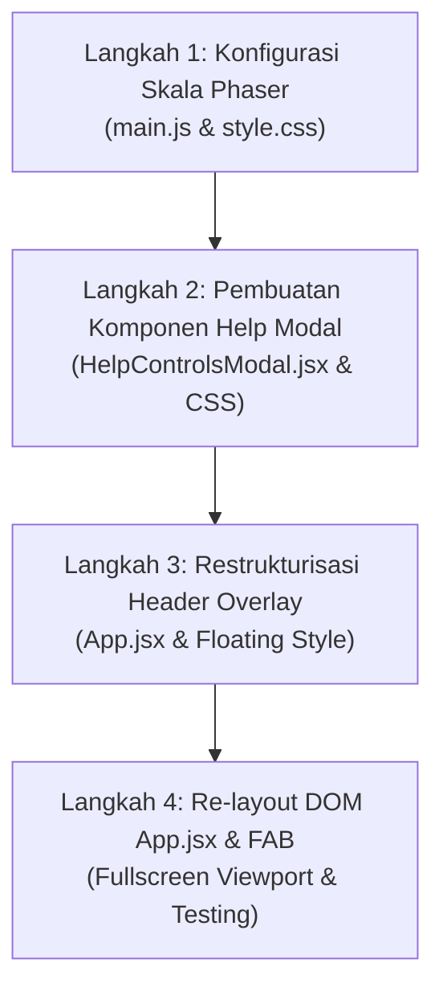

# DOKUMEN PERENCANAAN ARSITEKTUR UI/UX FULLSCREEN (DIRECTIVE v4.6)
**SISTEM:** CHIBIREX VIRTUAL HQ — LIVING OFFICE ECOSYSTEM  
**STATUS DOKUMEN:** ARCHITECTURE PROPOSAL & AUDIT (ANALYSIS PHASE)  
**TARGET IMPLEMENTASI:** AI Coding Assistant (Claude 3.5 Sonnet / Daffa) & Lead Frontend Architect  
**TANGGAL PENYUSUNAN:** 25 Oktober 2026  
**VERSI DOKUMEN:** v1.0.0 (Master Blueprint)

---

## 1. EXECUTIVE SUMMARY & LATAR BELAKANG

Aplikasi **Virtual HQ ChibiRex** saat ini mengadopsi struktur tata letak halaman web konvensional (traditional boxed document layout). Elemen UI dipecah menjadi tiga bagian vertikal statis:
1. **Header Kaku (Top Bar):** Mengonsumsi ruang vertikal ~60px dengan border bawah dan latar belakang gelap statis.
2. **Game Container (Middle Viewport):** Kanvas game Phaser 3 dikunci secara statis pada resolusi `960 × 640 px` dengan border abu-abu 2px, border-radius 8px, dan drop-shadow luar. Akibatnya, pada monitor modern (1080p, 1440p, ultrawide), terdapat margin kosong gelap di sekeliling game, memberikan ilusi "game dalam kotak" alih-alih dunia simulasi kantor hidup yang imersif.
3. **Footer Statis (Bottom Dock):** Mengonsumsi ruang vertikal ~40px di bagian bawah hanya untuk menampilkan teks panduan tombol (`Navigasi: WASD`, `Interaksi: E`, dll).

### Visi Transformasi Directive v4.6
Mentransformasikan antarmuka Virtual HQ menjadi **True Fullscreen Living Office Application**:
* **Kanvas Game 100% Layar:** Kanvas Phaser 3 mengisi penuh `100vw` dan `100vh` tanpa border, tanpa margin, dan tanpa letterbox terpotong.
* **Header Floating Absolute Overlay:** Header atas melayang anggun di atas kanvas dengan efek glassmorphism (`backdrop-filter: blur(16px)`), membiarkan visual kantor dan pergerakan NPC terlihat di baliknya.
* **Pemberantasan Footer Kaku → Floating Help FAB:** Footer bawah dihapus total untuk memaksimalkan ruang pandang. Panduan tombol navigasi dikemas ke dalam sebuah tombol mengambang elegan (`[ ? ]` Floating Action Button) di pojok kanan bawah yang memicu modal popup informatif (`<HelpControlsModal />`).
* **Z-Index Layering Matrix Tanpa Tabrakan:** Seluruh modal interaktif (Chat Smartphone, Time Simulation, Regional Command, Doni Hub, SAP Approval, NPC Dialogs) memiliki hirarki tumpukan (*stacking context*) yang disiplin dan aman dari tertimpa kanvas.

---

## 2. PILAR 1: PEMETAAN DOM TREE & STRATEGI Z-INDEX HIERARCHICAL MATRIX

### 2.1. Audit DOM Tree Saat Ini (Current State)
Berdasarkan audit mendalam pada [`virtual_hq/src/App.jsx`](file:///d:/Documents/ChibiRex/ChibiRex/virtual_hq/src/App.jsx) dan [`virtual_hq/public/style.css`](file:///d:/Documents/ChibiRex/ChibiRex/virtual_hq/public/style.css):

```
div#app (flex column, minHeight: 100vh, alignItems: center)
 ├── header (block flow, width: 100%, zIndex: 20, borderBottom: 1px)
 ├── main (display: inline-block, margin: auto, position: relative)
 │    ├── div#game-container (flex: 1, position: relative)
 │    │    └── canvas (960×640 px, border: 2px solid, border-radius: 8px)
 │    ├── ThoughtBubble (React overlay, zIndex: 1000)
 │    ├── Action Pills (Rexa & Manager Proximity, zIndex: 25)
 │    ├── ApprovalModal (zIndex: 2000)
 │    ├── GlobalStatsTVModal (zIndex: 40)
 │    ├── SmartphoneChatModal (zIndex: 9999)
 │    ├── CrisisCommandModal (z-index: 99999)
 │    ├── NPCDialogModal (z-index: 99998)
 │    ├── RegionalDashboardModal (zIndex: 9999)
 │    └── TimeSimulationModal (zIndex: 9999)
 └── footer (block flow, width: 100%, zIndex: 20, borderTop: 1px)
```

**Kelemahan Kritis Arsitektur Saat Ini:**
1. **Vertical Flow Partitioning:** Elemen `header`, `main`, dan `footer` ditumpuk secara vertikal (`flex-direction: column`). Ini memotong tinggi viewport yang seharusnya dinikmati pemain.
2. **Margin Kosong & Kanvas Terkurung:** Kanvas berada di dalam tag `<main>` dengan `margin: auto`. Kanvas tidak menyentuh tepi layar manapun.
3. **Z-Index Fragmentasi:** Beberapa modal menggunakan inline styles (`zIndex: 2000`, `zIndex: 9999`), sementara yang lain mengandalkan file CSS eksternal (`z-index: 99998`, `z-index: 99999`). Ini berisiko memicu modal collision jika dua modal terbuka bersamaan.

---

### 2.2. Rancang Bangun DOM Tree Baru (Target Fullscreen Architecture)

```
div#app (position: fixed, inset: 0, width: 100vw, height: 100vh, overflow: hidden)
 │
 ├── [LAYER 1: GAME VIEWPORT (Z-INDEX: 1)]
 │    └── main#main-viewport (position: absolute, inset: 0, width: 100%, height: 100%)
 │         └── div#game-container (width: 100%, height: 100%, position: absolute)
 │              └── canvas (100% width & height, border: none, border-radius: 0)
 │
 ├── [LAYER 2: IN-GAME SCREEN-SPACE HUD (Z-INDEX: 20 - 40)]
 │    ├── ThoughtBubble Rexa (position: absolute, zIndex: 30)
 │    ├── Action Pills (Rexa & Manager Proximity, position: absolute, zIndex: 25)
 │    └── Smart TV Peek Bar (Bottom right peek, zIndex: 35)
 │
 ├── [LAYER 3: FLOATING COMMAND HEADER (Z-INDEX: 50)]
 │    └── header.floating-header (position: absolute, top: 0, left: 0, right: 0, height: 56px, backdrop-filter)
 │
 ├── [LAYER 4: FLOATING ACTION BUTTON (Z-INDEX: 60)]
 │    └── button.fab-help (position: absolute, bottom: 20px, right: 20px, diameter: 44px)
 │
 └── [LAYER 5: MODAL & DIALOG LADDER (Z-INDEX: 100 - 200)]
      ├── <HelpControlsModal />      → z-index: 100
      ├── <GlobalStatsTVModal /> (Inspect) → z-index: 110
      ├── <ApprovalModal />           → z-index: 120
      ├── <NPCDialogModal />          → z-index: 130
      ├── <TimeSimulationModal />     → z-index: 140
      ├── <SmartphoneChatModal />     → z-index: 150
      ├── <RegionalDashboardModal />  → z-index: 160
      └── <CrisisCommandModal />      → z-index: 200 (Highest Priority Overlay)
```

---

### 2.3. Matriks Hirarki Z-Index Terpadu (Unified Z-Index Matrix)

Untuk mencegah bug visual di mana modal tertutup kanvas atau kontrol modal bertumpuk secara tidak terduga, berikut adalah standarisasi Z-Index terpadu:

| Lapisan (Layer) | Komponen / Elemen | Z-Index | Pointer Events | Keterangan & Perilaku |
| :--- | :--- | :--- | :--- | :--- |
| **Layer 0** | Latar Belakang Dasar DOM | `auto` / `0` | `auto` | Gradien dasar latar belakang jendela browser. |
| **Layer 1** | Phaser Game Canvas (`#game-container`) | **`1`** | `auto` | Kanvas game 100% viewport. Menerima input mouse drag & click. |
| **Layer 2** | Proximity Action Pills (`[E] Analisis`, dll) | **`25`** | `auto` | Mengikuti koordinat karakter di layar (*screen space*). |
| **Layer 2.5** | Rexa AI Thought Bubble | **`30`** | `auto` | Balon pemikiran agen AI saat investigasi berjalan. |
| **Layer 2.8** | Smart TV Peek Mode (1/8 layar) | **`35`** | `auto` | Mini HUD TV di pojok ruangan saat pemain mendekati TV. |
| **Layer 3** | **Floating Command Header** | **`50`** | `auto` | Melayang di bagian atas dengan efek glassmorphism transparan. |
| **Layer 4** | **Floating Help Action Button `[ ? ]`** | **`60`** | `auto` | Tombol bulat mengambang di pojok kanan bawah. |
| **Layer 5.1** | `<HelpControlsModal />` | **`100`** | `auto` | Dialog bantuan navigasi keyboard & hotkey interaksi. |
| **Layer 5.2** | `<GlobalStatsTVModal />` (Full Inspect) | **`110`** | `auto` | Mode inspeksi penuh metrik agregat 80 toko DuckDB. |
| **Layer 5.3** | `<ApprovalModal />` (Meja Manajer SAP) | **`120`** | `auto` | Dialog 1-Click Approval PO ke SAP S/4HANA. |
| **Layer 5.4** | `<NPCDialogModal />` (Maya, Citra, Rian, Budi)| **`130`** | `auto` | Dialog percakapan cepat staf kantor dengan metrik audit. |
| **Layer 5.5** | `<TimeSimulationModal />` | **`140`** | `auto` | Modal distorsi temporal (+1 Hari, +7 Hari, Reset Baseline). |
| **Layer 5.6** | `<SmartphoneChatModal />` (Rexa Copilot) | **`150`** | `auto` | Handheld smartphone chat Rexa AI (Hotkey C). |
| **Layer 5.7** | `<RegionalDashboardModal />` (80 Toko) | **`160`** | `auto` | Komando regional multi-tenant DuckDB. |
| **Layer 5.8** | `<CrisisCommandModal />` (Doni Emergency) | **`200`** | `auto` | Status krisis tertinggi; darurat operasional mendesak. |

> [!IMPORTANT]
> **Anti-Collision Rule:** Seluruh modal di Layer 5 menerapkan backdrop gelap dengan `position: fixed; inset: 0` dan `backdrop-filter: blur(12px)`. Dengan standar di atas, kanvas game (`z-index: 1`) dan Floating Header (`z-index: 50`) dijamin **100% berada di bawah** seluruh modal interaktif.

---

## 3. PILAR 2: RESTRUKTURISASI HEADER (ABSOLUTE FLOATING OVERLAY)

### 3.1. Konsep Desain: "Cyber-Command Holographic HUD"
Header tidak lagi mendorong kanvas game ke bawah. Sebaliknya, header melayang (*floating absolute overlay*) di koordinat paling atas:
* `position: absolute; top: 0; left: 0; right: 0; height: 56px; z-index: 50;`
* **Latar Belakang Glassmorphism:**  
  `background: linear-gradient(180deg, rgba(15, 23, 42, 0.82) 0%, rgba(15, 23, 42, 0.45) 85%, rgba(15, 23, 42, 0) 100%);`  
  `backdrop-filter: blur(16px);`  
  `border-bottom: 1px solid rgba(148, 163, 184, 0.12);`  
  `box-shadow: 0 4px 24px rgba(0, 0, 0, 0.25);`

Efek gradien transparan di bagian bawah header membuat dunia game di bawahnya menyatu secara organik (*seamless blend*).

---

### 3.2. Tata Letak 3-Way Flexbox Architecture

```
┌───────────────────────────────────────────────────────────────────────────────────────────────────────────────────────────────────┐
│ [ SISI KIRI: BRAND & STORE SWITCHER ]        [ SISI TENGAH: CENTRAL STATUS BADGE ]          [ SISI KANAN: UTILITY HUB & TOOLS ]   │
│ 🦖 CHIBIREX HQ v2.0                          ● STANDBY · SIAP PATROLI                       ● API :8000                           │
│ 🏬 STORE #74 (PAENTMARWY) ▼ GANTI                                                           📅 31 Des 2016 [BASELINE] ▼           │
│                                                                                             📱 Rexa Chat [C]                      │
│                                                                                             🏃 Doni Hub                           │
└───────────────────────────────────────────────────────────────────────────────────────────────────────────────────────────────────┘
```

#### A. Sisi Kiri: Brand & Store Badge
* **Logo Badge:** Ikon 🦖 dengan bingkai bercahaya gradien amber/indigo (`width: 34px`, `height: 34px`, `borderRadius: 8px`).
* **Title Typo:** Teks `CHIBIREX` bergradien cyan-to-amber dengan teks kecil `HQ v2.0`.
* **Kapsul Ganti Cabang Interaktif:**
  * Menampilkan: `🏬 STORE #${storeId} (${city}) ▼ GANTI`.
  * Status interaktif: Saat diarahkan (*hover*), kapsul menyala dengan warna emerald berkilau.
  * Saat diklik: Memicu pemanggilan `handleOpenRegionalModal()` untuk membuka daftar 80 cabang DuckDB.

#### B. Sisi Tengah: Dynamic Central Status Badge
Badge status responsif yang menginformasikan aktivitas utama kantor:
1. **State Normal / Standby:**
   `● STANDBY · SIAP PATROLI` (Latar semi-transparan slate dengan lampu indikator hijau berkedip halus).
2. **State Rexa Patroli:**
   `⚡ REXA IN PATROL · LANGKAH #N` (Latar amber bercahaya dengan animasi pulse).
3. **State Meja Manajer / Approval:**
   `📋 MEJA MANAJER · REVIEW & SAP APPROVAL` (Latar cyan modern).
4. **State Krisis Aktif (Doni):**
   `🚨 KRISIS DARURAT AKTIF · KOORDINATOR MERESPONS` (Latar merah darurat dengan animasi strobe).

#### C. Sisi Kanan: Utility & Control Hub (Refactored)
* **Pembersihan Koordinat POS (Developer-Only):**
  * Elemen `POS: X, Y` **dihapus dari antarmuka produksi**.
  * Koordinat pemain tetap disiarkan di console log atau dapat diaktifkan kembali hanya saat mode developer cheat aktif. Hal ini menghemat ~90px ruang horizontal, mencegah header berdesakan pada layar beresolusi lebih kecil.
* **API Health Capsule:**
  * Desain rapat: `● API :8000` (indikator hijau live).
* **Temporal Simulation Capsule (Time Engine):**
  * Kapsul interaktif: `📅 31 Des 2016 [BASELINE / +NH] ▼`.
  * Jika diklik: Memicu pembukaan `<TimeSimulationModal />`.
  * Tampilan amber menyala jika waktu toko sedang dalam kondisi lompatan masa depan (`daysOffset > 0`).
* **Tombol Cepat Rexa Chat:**
  * Tombol kapsul: `📱 Rexa Chat [C]`.
  * Menyala biru cyan saat chat aktif. Hotkey shortcut keyboard `C` tetap sinkron.
* **Tombol Emergency Doni Hub:**
  * Tombol kapsul: `🏃 Doni Hub` (atau berkedip merah terang `🚨 KRISIS AKTIF` jika krisis toko sedang meledak).

---

## 4. PILAR 3: TRANSFORMASI FOOTER MENJADI HELP CONTROLS MODAL (COLLAPSIBLE)

### 4.1. Latar Belakang & Rasionalitas
Footer statis saat ini memiliki tinggi ~36-44px dengan susunan teks kaku yang selalu memakan layar:
```html
<footer>
    Navigasi: [W][A][S][D] | Interaksi: [E] | Koordinator: [E] | Rexa: [C] | Tutup: [ESC]
</footer>
```
Pada aplikasi desktop/game modern, pemain yang sudah mahir tidak perlu melihat instruksi navigasi setiap detik. Menampilkan footer permanen menghancurkan imersi simulasi kantor.

---

### 4.2. Arsitektur Floating Action Button (FAB) `[ ? ]`
* **Posisi:** `position: absolute; bottom: 20px; right: 20px; z-index: 60;`
* **Dimensi & Bentuk:** Lingkaran 42×42 px dengan ikon tanda tanya tebal `?` atau simbol keyboard `⌨️`.
* **Visual:**
  * Latar belakang: `rgba(15, 23, 42, 0.85)` dengan `backdrop-filter: blur(12px)`.
  * Bingkai: `1px solid rgba(56, 189, 248, 0.4)`.
  * Efek Hover: Berpendar dengan bayangan cyan neon (`box-shadow: 0 0 16px rgba(56, 189, 248, 0.5)`), skala membesar 1.08x.
* **Aksesibilitas & Hotkey:**
  * Dilengkapi tooltip HTML: `"Buka Panduan Kontrol & Navigasi (H)"`.
  * **Hotkey Global:** Menekan tombol `H` atau `?` pada keyboard langsung membuka modal panduan bantuan.

---

### 4.3. Komponen Baru: `<HelpControlsModal.jsx>`
Sebuah komponen modal React baru yang dirancang khusus untuk memaparkan seluruh kontrol permainan secara terstruktur, elegan, dan interaktif.

#### Layout Isi Modal Bantuan:
1. **Header Modal:**
   * Judul: `⌨️ PANDUAN KONTROL & PINTASAN SISTEM`
   * Subjudul: `Navigasi Kantor Virtual, Proximity Trigger, dan Perintah Manajerial`
   * Tombol Tutup `[✕]` di pojok kanan atas.
2. **Bagian 1: Navigasi Dasar Avatar (Gerak 8 Arah):**
   * Keycap 3D: `W`, `A`, `S`, `D` atau `↑`, `←`, `↓`, `→`.
   * Keterangan: Berjalan menjelajahi area kantor Virtual HQ.
3. **Bagian 2: Interaksi Objek Proximity (Tombol `E`):**
   * `[E] Dekat Meja Rexa`: Memicu analisis inventaris toko dan perumusan draf Purchase Order (PO).
   * `[E] Dekat Meja Manajer`: Membuka dokumen review PO untuk disetujui (1-Click SAP Approval).
   * `[E] Dekat Smart TV`: Membuka inspeksi visual metrik agregat 80 cabang DuckDB.
   * `[E] Dekat Mesin Kopi`: Menyeduh kopi espresso segar untuk memulihkan fokus kerja.
   * `[E] Dekat Kursi Rapat / Kerja`: Duduk santai di kursi dengan penyesuaian perspektif meja.
   * `[E] Dekat Koordinator Doni`: Membuka Crisis Command Hub untuk mengatasi ancaman toko.
4. **Bagian 3: Komunikasi & Peralatan Sistem:**
   * `[C] Rexa Smartphone`: Membuka/menutup percakapan handheld chat dengan Rexa AI Copilot.
   * `Klik Kapsul Toko`: Membuka Regional Command Center untuk berpindah pengawasan antar-80 cabang.
   * `Klik Kapsul Tanggal`: Membuka Temporal Engine (+1 Hari, +7 Hari, Reset Baseline 31 Des 2016).
5. **Bagian 4: Hotkey Developer & Simulasi Krisis (Collapsible Accordion):**
   * Tombol `1`: Picu Krisis Kehabisan Stok Fast-Moving.
   * Tombol `2`: Picu Krisis Deadstock & Cashflow Terkunci.
   * Tombol `3`: Picu Krisis Circuit Breaker Anomali Lonjakan PO.
   * Tombol `4`: Picu Krisis Health Index Cabang Jatuh.
   * Tombol `U`: Toggle Fitur Auto-Crisis Organik 30-Menit (On / Off).
   * Tombol `R`: Quick Restart Scene.
6. **Footer Modal:**
   * Teks info: `Tekan [ESC] atau [H] kapan saja untuk menutup panduan ini.`

---

## 5. PILAR 4: EVALUASI MENDALAM SKALA PHASER (SCALE MODE OPTIMIZATION)

### 5.1. Audit Konfigurasi Phaser Saat Ini
Pada file [`virtual_hq/src/game/main.js`](file:///d:/Documents/ChibiRex/ChibiRex/virtual_hq/src/game/main.js):
```javascript
const config = {
    type: AUTO,
    width:  960,
    height: 640,
    parent: 'game-container',
    backgroundColor: '#f1f5f9',
    pixelArt: true,
    roundPixels: true,
    // TIDAK ADA OBJEK scale: { ... } DI SINI!
};
```
Dan pada [`virtual_hq/src/game/scenes/MainScene.js`](file:///d:/Documents/ChibiRex/ChibiRex/virtual_hq/src/game/scenes/MainScene.js):
```javascript
const TILE_SIZE = 32;
const MAP_COLS  = 24; // 24 × 32 = 768 px
const MAP_ROWS  = 16; // 16 × 32 = 512 px

this.cameras.main.setBounds(0, 0, 768, 512);
this.physics.world.setBounds(0, 0, 768, 512);
this.cameras.main.setZoom(1.5);
this.cameras.main.startFollow(this.player, true, 0.05, 0.05);
```

**Temuan Analisis:**
1. Karena tidak ada konfigurasi `scale`, Phaser membuat elemen kanvas berukuran tepat `960 × 640 px`.
2. Kanvas tersebut diatur oleh CSS `public/style.css`:
   ```css
   #game-container canvas {
       display: block;
       border-radius: 8px;
       border: 2px solid rgba(203, 213, 225, 0.4);
       box-shadow: ...;
   }
   ```
3. Peta ruangan kantor berukuran fisik `768 × 512 px`. Dengan kamera zoom `1.5x`, area pandang visual yang dibutuhkan adalah `512 × 341 px`. Batas kamera (`setBounds`) mengunci kamera agar tidak melihat area di luar dinding kantor.

---

### 5.2. Komparasi Komprehensif Opsi Skala Phaser

| Mode Skala | Mekanisme Kerja | Kelebihan | Risiko / Kekurangan | Rekomendasi |
| :--- | :--- | :--- | :--- | :--- |
| **Opsi 1: `Scale.FIT`** + `CENTER_BOTH` | Menjaga resolusi logika `960 × 640` (rasio 3:2). Kanvas di-stretch secara seragam untuk mengisi layar semaksimal mungkin tanpa merusak rasio. | • Nol risiko distorsi piksel.<br>• Koordinat world & screen tidak berubah sama sekali.<br>• Sangat stabil dan mudah diimplementasikan. | Muncul bilah hitam (*letterbox / pillarbox*) di sisi kiri-kanan atau atas-bawah jika aspek rasio monitor pengguna bukan 3:2 (misal monitor 16:9 atau ultrawide). | Cocok sebagai *fallback mode*, namun belum memberikan kesan Fullscreen Sejati. |
| **Opsi 2: `Scale.RESIZE`** (Direct) | Kanvas game secara dinamis mengikuti tepat `100vw` dan `100vh` jendela peramban. Resolusi kanvas diperbarui setiap jendela di-resize. | • Menghilangkan 100% bilah hitam.<br>• Memenuhi seluruh layar tanpa sisa.<br>• Sensasi aplikasi desktop native yang sangat imersif. | Karena peta kita berukuran `768 × 512 px`, pada layar lebar (misal 1920×1080) dengan zoom kamera tetap 1.5, tepi luar peta (area kosong hitam di luar kantor) dapat terlihat jika zoom tidak diadaptasikan. | **SANGAT DIREKOMENDASIKAN** jika dikombinasikan dengan *Adaptive Dynamic Zoom* (Opsi 3). |
| **Opsi 3: Hybrid `Scale.RESIZE` + Adaptive Camera Zoom** *(Best Practice)* | Kanvas memakai `Scale.RESIZE` (100% layar). Di dalam `MainScene.js`, ditambahkan listener resize kamera yang secara dinamis menyesuaikan nilai `setZoom()` berdasarkan rasio aspek dan dimensi layar pengguna. | • Tampilan 100% fullscreen sejati di semua perangkat.<br>• Kamera tidak pernah menampilkan area kosong di luar dinding kantor.<br>• Pixel-art tetap tajam dan proporsional. | Memerlukan fungsi kalkulasi zoom matematis saat event `resize` Phaser terpicu. | ⭐ **PILIHAN TERBAIK (DIREKOMENDASIKAN)** |

---

### 5.3. Formula Matematis Adaptive Camera Zoom (Opsi 3)
Agar saat kanvas membesar hingga `1920 × 1080 px` atau lebih, kamera tidak melihat area hampa di luar batas dinding kantor (`768 × 512 px`):

```javascript
// Rumus Kalkulasi Zoom Adaptif di MainScene:
_updateResponsiveCamera(width, height) {
    const MAP_WIDTH  = 768; // 24 * 32
    const MAP_HEIGHT = 512; // 16 * 32

    // Hitung faktor zoom minimum yang dibutuhkan agar peta selalu menutupi viewport
    const zoomX = width / MAP_WIDTH;
    const zoomY = height / MAP_HEIGHT;

    // Ambil nilai terbesar agar seluruh viewport terisi oleh peta (anti-void guarantee)
    // Dibatasi dengan batas bawah 1.35x dan batas atas 2.2x agar karakter tidak terlalu kecil/besar
    const calculatedZoom = Math.max(zoomX, zoomY);
    const targetZoom = Phaser.Math.Clamp(calculatedZoom * 1.05, 1.35, 2.25);

    this.cameras.main.setZoom(targetZoom);
    this.cameras.main.setBounds(0, 0, MAP_WIDTH, MAP_HEIGHT);
}
```

Dengan formula di atas:
* Pada monitor Full HD (1920×1080): Zoom otomatis disetel sekitar `1.8x - 2.0x`. Ruang kantor terlihat megah dan mendetail.
* Pada laptop kecil (1366×768): Zoom otomatis disetel sekitar `1.45x - 1.55x`.
* Pemain selalu berada di tengah kamera tanpa ada ruang kosong abu-abu di luar dinding kantor.

---

## 6. RENCANA KERJA & ROADMAP IMPLEMENTASI (FASE BERIKUTNYA)

Ketika Directive eksekusi v4.7 diberikan oleh Lead Engineer, pekerjaan akan dieksekusi dalam 4 langkah sistematis:



### Rincian Tindakan per Berkas:
1. **`virtual_hq/src/game/main.js`:**
   * Tambahkan properti `scale`:
     ```javascript
     scale: {
         mode: Scale.RESIZE,
         parent: 'game-container',
         width: '100%',
         height: '100%',
     }
     ```
2. **`virtual_hq/public/style.css`:**
   * Ubah `#app` menjadi `position: fixed; inset: 0; width: 100vw; height: 100vh; overflow: hidden;`.
   * Bersihkan border 2px, border-radius 8px, dan shadow pada `#game-container canvas` agar menyatu 100% dengan viewport.
3. **`virtual_hq/src/game/scenes/MainScene.js`:**
   * Di dalam `create()`, pasang listener:
     ```javascript
     this.scale.on('resize', (gameSize) => {
         this._updateResponsiveCamera(gameSize.width, gameSize.height);
     });
     this._updateResponsiveCamera(this.scale.width, this.scale.height);
     ```
4. **`virtual_hq/src/components/HelpControlsModal.jsx` (Berkas Baru):**
   * Buat komponen modal panduan kontrol lengkap dengan hotkey `ESC` dan `H`.
5. **`virtual_hq/src/App.jsx`:**
   * Hapus elemen `<footer>...</footer>`.
   * Ganti dengan Floating Action Button `[ ? ]` di pojok kanan bawah.
   * Modifikasi `<header>` menjadi `position: absolute; top: 0; left: 0; right: 0; z-index: 50` dengan flexbox 3-way.
   * Hilangkan tag koordinat `POS: X, Y`.
   * Pasang state `isHelpModalOpen` dan render `<HelpControlsModal />` pada `z-index: 100`.

---

## 7. KRITERIA KEBERHASILAN (VERIFICATION CHECKLIST)

Sebelum refaktor dinyatakan lulus uji:
- [ ] Kanvas game memenuhi 100% layar browser dari ujung ke ujung tanpa bilah hitam di segala resolusi.
- [ ] Header melayang anggun di bagian atas dengan efek tembus pandang (*glassmorphism blur*), pergerakan avatar/NPC di balik header tetap terlihat.
- [ ] Tidak ada footer kaku di bagian bawah layar.
- [ ] Tombol mengambang `[ ? ]` di pojok kanan bawah dapat diklik atau dipicu via tombol `H` untuk membuka dialog panduan navigasi.
- [ ] Seluruh modal (Time Simulation, Rexa Chat, Crisis Command Hub, Approval PO, NPC Dialog) terbuka di atas kanvas dan di atas header tanpa ada konflik z-index.
- [ ] Karakter avatar dapat digerakkan secara responsif (WASD) tanpa ada pergeseran hit detection proximity (< 50px).
- [ ] Validasi syntax bundling `esbuild` 0 error dan Vite dev server tetap stabil di `http://localhost:8080/`.

---

**STATUS DOKUMEN:** Dokumen perencanaan ini telah selesai disusun secara komprehensif sebagai acuan mutlak sebelum tahap penulisan kode dimulai. Menunggu arahan instruksi eksekusi resmi!
